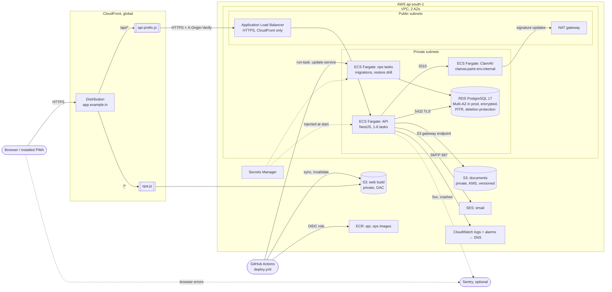

# Production architecture (AWS Mumbai, ap-south-1)

Everything is defined in [`infra/terraform`](../infra/terraform). Staging and production have the
same shape; they differ only in sizes ([envs/staging](../infra/terraform/envs/staging/main.tf),
[envs/prod](../infra/terraform/envs/prod/main.tf)).

## Request path

1. The browser loads the app from CloudFront. App routes without a file extension get
   `index.html` ([spa.js](../infra/terraform/modules/web/functions/spa.js)); hashed assets are
   cached for a year, `index.html` and the service worker are revalidated on every load.
2. The app calls `/api/...` on its own origin. CloudFront sends those requests, uncached and with
   every header except `Host`, to the load balancer after stripping `/api`
   ([api-prefix.js](../infra/terraform/modules/web/functions/api-prefix.js)) — the same rewrite as
   Vite's dev proxy, so the API needs no CORS.
3. The load balancer accepts HTTPS only from CloudFront's address ranges and only requests that
   carry the shared `X-Origin-Verify` header; everything else gets 403.
4. API tasks run in private subnets with no public IP. They reach PostgreSQL (TLS verified against
   the RDS CA bundle in the image), ClamAV through Cloud Map DNS, S3 through a gateway endpoint, and
   SES and Sentry through the NAT gateway.
5. Every response carries `X-Request-Id`; the same id tags the Sentry event of a server error.

## Deploys

[`deploy.yml`](../.github/workflows/deploy.yml) builds the images, runs migrations once as a one-off
ops task, then rolls the API service (rolling, 100% minimum healthy, circuit breaker with automatic
rollback), uploads the web build and invalidates CloudFront. See
[runbooks/deploy.md](runbooks/deploy.md).

## Data protection

| What           | How                                                                                                                                                                                                                                                                                                                    |
| -------------- | ---------------------------------------------------------------------------------------------------------------------------------------------------------------------------------------------------------------------------------------------------------------------------------------------------------------------- |
| Database       | Encrypted storage; automated backups with point-in-time recovery (7 days staging, 14 days prod); Multi-AZ standby in prod                                                                                                                                                                                              |
| Tenant data    | Row-level security on every table (`app_tenant` role); the restore drill checks it survives a restore                                                                                                                                                                                                                  |
| Documents      | Private bucket, SSE-KMS, versioning (old versions kept 90 days), TLS-only policy, virus-scanned before storing                                                                                                                                                                                                         |
| Secrets        | Secrets Manager; the database password and `AUTH_SECRET` are generated as ephemeral values and never enter state                                                                                                                                                                                                       |
| Error tracking | Off unless `SENTRY_DSN` / `VITE_SENTRY_DSN` is set. Bodies, headers (including Authorization), cookies and query strings are never sent; passwords, OTP/TOTP and recovery codes, 2FA secrets, tokens, phone numbers and emails are masked ([packages/observability](../packages/observability/src/error-scrubbing.ts)) |

## Containers

| Image | Dockerfile                                            | Runs                                                                                               |
| ----- | ----------------------------------------------------- | -------------------------------------------------------------------------------------------------- |
| api   | [apps/api/Dockerfile](../apps/api/Dockerfile)         | `node dist/server/main.js` as user `node`, read-only root filesystem, production dependencies only |
| ops   | [packages/ops/Dockerfile](../packages/ops/Dockerfile) | `node src/migrate-cli.ts` (deploys) or `node src/restore-drill-cli.ts` (drills), with pg_dump 17   |
| clam  | `clamav/clamav-debian` (upstream)                     | `clamd` on 3310, updating signatures itself                                                        |

`pnpm test:docker` (CI job "Container images") builds both images and runs them against PostgreSQL.
