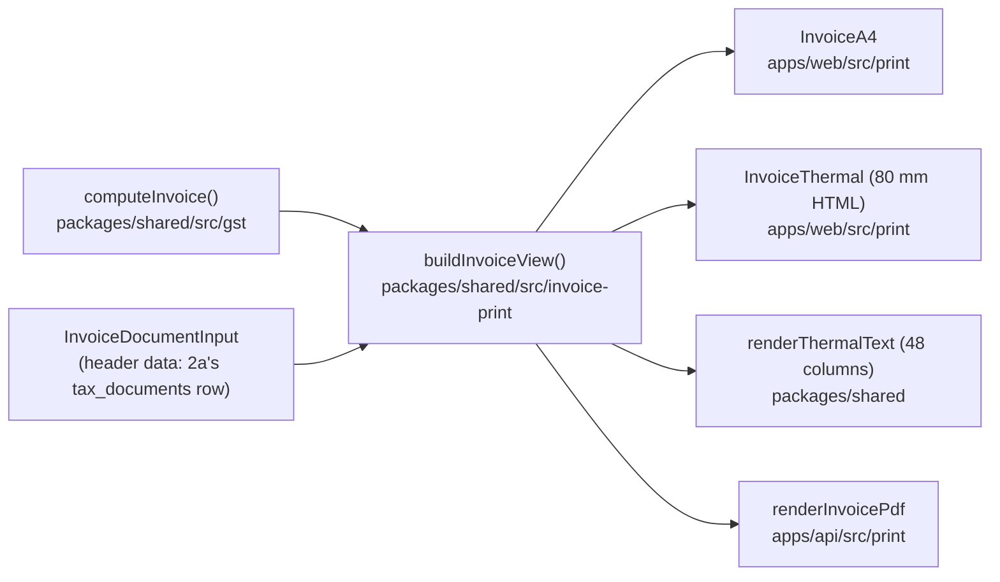

# Invoice print and PDF (MVP 2, round 2b)

|            |                                                                                           |
| ---------- | ----------------------------------------------------------------------------------------- |
| Spec       | [sell-and-bill.md](sell-and-bill.md) §2.2–§2.4, §2.6, §2.7, §5.4, §7 row 2b               |
| Status     | No endpoint or screen uses it yet; round 3 prints issued invoices with it                 |
| Open items | [CA-2] copy marks on thermal receipts, [CA-12] Telugu-only invoices, [PO-7] printer tests |

## What is where

| Piece               | Where                                            | Notes                                                                                                                                                               |
| ------------------- | ------------------------------------------------ | ------------------------------------------------------------------------------------------------------------------------------------------------------------------- |
| Header input type   | `invoice-print/types.ts`: `InvoiceDocumentInput` | What the engine does not know: supplier, buyer, ship-to, number, date, copy mark, line descriptions, turnover, logo, notes, terms, bank, signatory, second language |
| View model          | `invoice-print/view-model.ts`                    | Pure; every amount, date and label formatted; Rule 46 requirements and missing fields                                                                               |
| Labels (en, hi, te) | `invoice-print/labels.ts`                        | In `@paint/shared`, not the web catalogue, because the API's PDF prints them too                                                                                    |
| Thermal text        | `invoice-print/thermal-text.ts`                  | 48 columns, English, "Rs", for ESC/POS and plain-text sharing later                                                                                                 |
| A4 and 80 mm HTML   | `apps/web/src/print/`                            | React; browser printing; theme tokens only                                                                                                                          |
| Print preview       | `/print-preview` in the web app                  | Sample invoice in the signed-in business's name and logo; any signed-in member                                                                                      |
| PDF                 | `apps/api/src/print/render-invoice-pdf.ts`       | pdfkit, A4, from the view model                                                                                                                                     |
| Sample              | `invoice-print/sample.ts`                        | `sampleInvoiceView()` for the preview and every template test                                                                                                       |

## Mapping round 2a's tax document onto the input

| `InvoiceDocumentInput`                                      | From (§3.3)                                                                          |
| ----------------------------------------------------------- | ------------------------------------------------------------------------------------ |
| `kind`                                                      | `tax_documents.kind` (`invoice` → `tax_invoice`, `bill_of_supply`)                   |
| `number`, `issuedOn`                                        | `number`, `issued_on`                                                                |
| `supplier`                                                  | supplier snapshot (GSTIN, state, legal name, address) + store's trade name and phone |
| `buyer`, `shipTo`                                           | buyer snapshot (`gstin` null when unregistered) and ship-to snapshot                 |
| `lines[i]`                                                  | `tax_document_lines`: description, `variantName(variant)`, `hsn_code`, `uqc`         |
| `aggregateTurnoverPaise`                                    | the GSTIN profile's turnover band (§2.7)                                             |
| `reverseCharge`                                             | `reverse_charge` (always false)                                                      |
| `copy`                                                      | chosen at print time                                                                 |
| `logoUrl`                                                   | `GET /organization/identity` logo address (HTML); the PDF takes the bytes instead    |
| `notes`, `terms`, `bank`, `signatoryName`, `secondLanguage` | `sales_settings` (round 2a), per store or business                                   |

The engine `Invoice` comes from the stored lines through `computeInvoice`, or (round 3) is rebuilt
from the stored amounts; `buildInvoiceView` refuses a document whose kind, buyer type or line count
does not match it (`InvoicePrintError`), because that is a programming error, not missing data.

## Rule 46 decisions in the view model

| Case                                  | `requirements`                              | Printed                                                                                                                     |
| ------------------------------------- | ------------------------------------------- | --------------------------------------------------------------------------------------------------------------------------- |
| B2B (buyer GSTIN)                     | `buyerGstin`, `buyerDetails` (46(d))        | Name, GSTIN, address, state                                                                                                 |
| Unregistered, taxable value ≥ ₹50,000 | `buyerDetails`, `deliveryAddress` (46(e))   | Name, address, state; ship-to or the buyer's address as delivery                                                            |
| Unregistered, under ₹50,000           | nothing (46(f): only if the buyer asks)     | What was given, else "Walk-in customer", GSTIN "Unregistered"                                                               |
| HSN                                   | `hsnDigits` from `requiredHsnDigits` (§2.7) | HSN on every line as stored (8 digits by default)                                                                           |
| Inter-state                           | `placeOfSupply` (46(n))                     | Place of supply with state name and code is printed **always** (it also decides tax for unregistered buyers since Oct 2023) |
| Tax invoice                           | `reverseChargeLine` (46(p))                 | "Whether tax is payable on reverse charge: No"                                                                              |
| Bill of supply                        | `compositionNotice` (Rule 5(1)(f), Rule 49) | The fixed notice; no rate, tax columns or tax summary                                                                       |
| Serial number                         | issue `number_format` (46(b))               | Up to 16 of `A–Z 0–9 - /`                                                                                                   |
| Copy marks                            | Rule 48                                     | ORIGINAL FOR RECIPIENT / DUPLICATE FOR TRANSPORTER / TRIPLICATE FOR SUPPLIER, or none                                       |

Missing fields come back as `issues` (`buyer_name`, `buyer_address`, `delivery_address`,
`hsn_digits` with the line, `number_format`), each with its clause. The view never refuses to print:
round 2a refuses to **issue** such a document, and an old document must always reprint. `gstClass`
(b2b, b2cl above ₹1,00,000 inter-state, b2cs) is on the view for round 3's lists.

Legal headings, the composition notice, copy marks and "Yes/No" stay English in every language
([CA-12]); labels get a second line in Hindi or Telugu when chosen. Translations are drafts
(see [the glossary](../translations/glossary.md)) and hold no Latin letters, so the PDF draws each
with one script font (a test keeps it so).

## Templates

- **A4 (HTML)**: `@page invoice-a4 { size: A4; margin: 12mm }` as a named page, so the app's other
  pages are untouched. The line table's `<thead>` carries a running header (business, title, number)
  and the column headings; Chromium repeats a table header on every printed page, and rows,
  the totals block and the closing block do not split (`break-inside: avoid`).
- **Thermal 80 mm (HTML)**: 80 mm wide, 72 mm of content. `@page invoice-thermal { size: 80mm
297mm }`: the spec's `80mm auto` is not valid CSS (a length and `auto` cannot be combined), so the
  declaration would be dropped. Roll printers' drivers cut after the content; [PO-7] checks this on
  the TM-T82 and RP-3160 class.
- **Thermal text**: 48 columns at 12 cpi, ASCII except names; "Rs" and English only, since counter
  printers' built-in fonts lack ₹ and Indic scripts.
- **White-label**: the business's name (trade name, else legal name) and logo head every format. The
  web templates use theme tokens only (`theme-guard.test.ts` covers `apps/web/src/print`): the paper is
  `--palette-neutral-50` with `--palette-neutral-950` text in light and dark mode, and the business
  name and title take `--palette-primary-800`. The PDF lives in `apps/api`, outside the guard, and
  uses neutral print colours (black, greys): a tax document goes to accountants and photocopiers, and
  the brand shows through the name and logo.
- Every format has HSN and rate per line, the hardware variant label or paint pack size under the
  product, the tax summary by rate (CGST + SGST/UTGST or IGST, cess only when charged), discount,
  round-off, total, amount in words, notes, terms, bank and UPI details, and the signatory.

## PDF: decision

**pdfkit 0.20 (MIT), pure JavaScript, drawing the A4 layout from the view model.** Headless
Chromium was rejected: it adds about 300 MB, needs a writable profile directory (the image is
read-only and runs as `node`), and is a second process to supervise. pdf-lib was the other pure-JS
option; it embeds fonts through fontkit too but ignores glyph positioning (GPOS), so Devanagari and
Telugu marks land in the wrong place. pdfkit applies fontkit's shaping and positions.

| Item                               | Size                                                                                                                                                    |
| ---------------------------------- | ------------------------------------------------------------------------------------------------------------------------------------------------------- |
| pdfkit + dependencies              | about 25 MB unpacked in `node_modules` (pdfkit 10.5 MB, fontkit 5.8 MB, brotli, noble hashes/ciphers, fflate …); no native code                         |
| Fonts (`apps/api/src/print/fonts`) | 1.2 MB: Noto Sans Regular and Bold (Latin, ₹), Noto Sans Devanagari and Telugu Regular, unhinted TTF, SIL Open Font License 1.1 (`OFL.txt` beside them) |
| A typical PDF                      | about 20 KB (fonts subset into each file)                                                                                                               |

Measured on the API image (`pnpm test:docker`): 414 MB on disk, 77.9 MB compressed, against
370 MB and 70.1 MB for the image built before it (from an earlier checkout, so roughly +44 MB and
+8 MB).

The build copies the fonts to `dist/server/fonts`, next to the bundle, where the module finds them
with `new URL('./fonts/…', import.meta.url)` in source and bundle alike. The image test
(`pnpm test:docker`) draws a PDF in all three scripts inside the image as the read-only `node` user.

`renderInvoicePdf(view, { logo })` takes the logo's bytes, because the view only links to it; PNG
and JPEG embed, WebP (allowed for logos) is left out and the name prints alone until round 3
converts or stores a PNG copy. Pages break with a short running header and the table headings
repeated, and each page is numbered "Page n of m" (with the second language under it).

PDF text is tested by extracting it with `unpdf` (dev dependency only, 2 MB, zero dependencies).

## Decisions to review

1. Labels live in `@paint/shared`, not the web i18n catalogue, so the API can print them.
2. Place of supply is printed on every invoice, not only inter-state ones.
3. The view reports missing Rule 46 fields instead of refusing to print.
4. Thermal `@page` height is fixed at 297 mm (see above); thermal text is English and "Rs" only.
5. The PDF is neutral black and grey; the HTML uses the brand's primary colour for the name and title.
6. WebP logos are left out of PDFs for now.
7. The preview route (`/print-preview`) is open to every signed-in member and not in the navigation.
