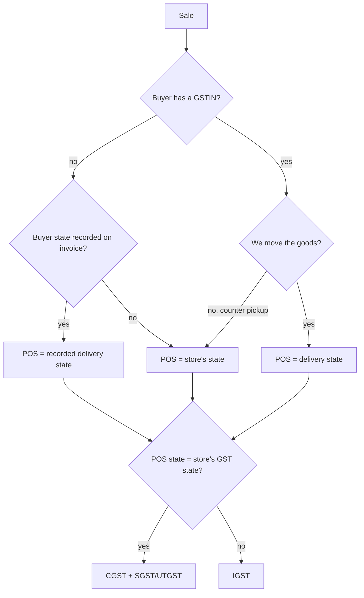
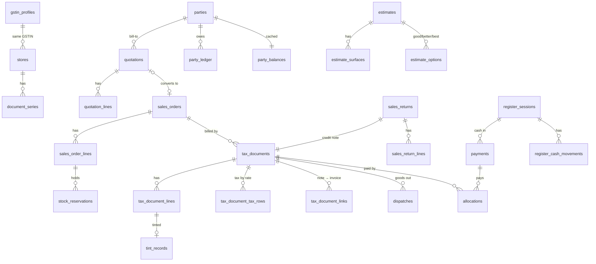
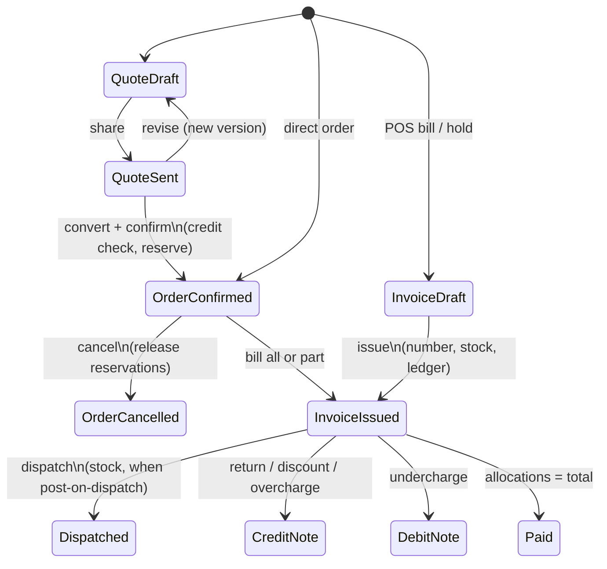
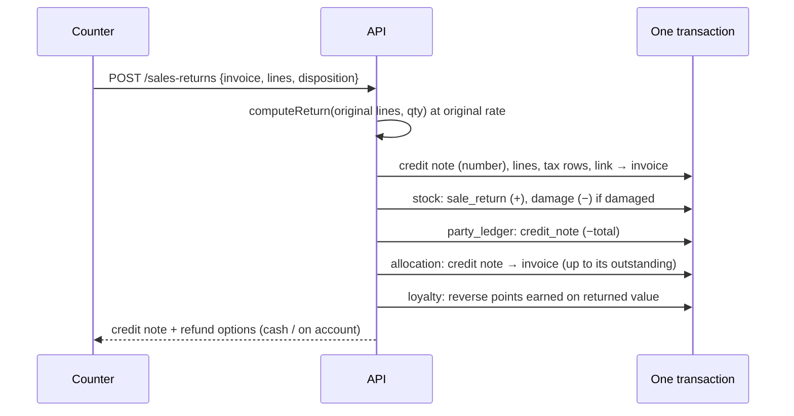

# MVP 2 — Sell & Bill (Release 2.0): design spec

|           |                                                                                                                                                |
| --------- | ---------------------------------------------------------------------------------------------------------------------------------------------- |
| Release   | 2.0 "Sell & Bill" ([roadmap](https://github.com/Avali-Tech/paint-retail-saas-roadmap/blob/main/docs/phases/phase-2-commerce-finance-paint.md)) |
| Modules   | P2-M01 – M07, P2-M29 – M31 (P2-M08 subscriptions is out, see §1.2)                                                                             |
| Branch    | feature PRs → `mvp-2`                                                                                                                          |
| Builds on | MVP 1 on `mvp-2` at migration `0049`                                                                                                           |
| Status    | Draft for product-owner review. Every GST rule below still needs CA sign-off (§8).                                                             |

**How to read it.** §1 is what we build. §2 is the law it must follow, each rule with its source. §3–§6
are the design. §7 is the build order. §8 lists the questions that block or shape the build. `[CA-n]`
and `[PO-n]` point to those questions.

---

## 1. Scope

### 1.1 In Release 2.0

| ID     | Module                     | What ships                                                                                                                                                                             | Done when (roadmap)                                             |
| ------ | -------------------------- | -------------------------------------------------------------------------------------------------------------------------------------------------------------------------------------- | --------------------------------------------------------------- |
| P2-M01 | Tax engine (GST)           | Pure engine in `packages/shared/src/gst/` (round 1); tax categories with dated rates; per-store GST registration; place of supply; B2B / B2C; inclusive and exclusive prices; rounding | A CA-reviewed scenario suite passes                             |
| P2-M02 | Counter sale / POS         | Scan or search → qty → optional customer by mobile → split payment → print (80 mm or A4); hold and resume; day-end register                                                            | A 3-item walk-in sale is billed in under 60 s                   |
| P2-M03 | Quotations                 | Versioned quotes for a party, site or project; validity date; PDF; convert to order                                                                                                    | A quote is revised, shared and converted                        |
| P2-M04 | Sales orders & reservation | Order from quote or direct; fulfil from one or more stores; reserve and release stock; payment terms prepaid / partial / postpaid; basic credit check                                  | Confirm reserves stock; cancel releases it                      |
| P2-M05 | Invoices, notes, returns   | Tax invoice and bill of supply; gap-free numbering per GSTIN per FY; stock out on invoice or on dispatch; credit and debit notes; returns to restock or damage; no edits after issue   | Numbering has no gaps; returns reverse stock and money          |
| P2-M06 | Payments & allocation      | Cash, UPI, card, bank transfer, cheque (with bounce), other modes; one payment across many invoices; advances; receipt PDF; append-only party ledger                                   | Balance = invoices − payments ± notes, for every party          |
| P2-M07 | Tally export               | Tally XML vouchers (sales, credit note, debit note, receipt) and Excel; ledger mapping settings                                                                                        | A pilot accountant imports a month without manual fixes         |
| P2-M29 | Paint estimator            | Rooms and surfaces → litres → cheapest pack mix that never under-supplies; good / better / best; convert to quote                                                                      | A 3-room estimate becomes a quote in under 3 min                |
| P2-M30 | Tint record at POS         | Shade, base, pack, colorant cost, machine on a tinted line; history per customer and site across stores                                                                                | A repeat order at another branch finds the shade                |
| P2-M31 | Bill-to, influencer, site  | Every quote, order and invoice carries bill-to, optional influencer and optional site                                                                                                  | A homeowner's invoice credits the painter, under the right site |

### 1.2 Out of Release 2.0

| Out                                        | Where it goes      | What 2.0 leaves ready                                                                                                     |
| ------------------------------------------ | ------------------ | ------------------------------------------------------------------------------------------------------------------------- |
| P2-M08 SaaS subscriptions                  | Separate spec      | Nothing here depends on it                                                                                                |
| E-invoice (IRN / QR), e-way bill API       | 2.3 (P2-M19, M20)  | Columns for IRN, ack, signed QR and EWB number on documents; a per-registration "e-invoice required from" date (§2.10)    |
| GSTR-1 / 3B files                          | 2.3 (P2-M21)       | Every document stores supply type, place of supply, B2B / B2CL / B2CS class, HSN and tax per rate, so GSTR-1 is a query   |
| Credit approval workflow, auto hold        | 2.1 (P2-M09)       | 2.0 runs `checkCredit` at order and invoice time against ledger exposure; overrides need `credit:approve` and are audited |
| Receivables, ageing, collections           | 2.1 (P2-M10, M11)  | Due dates on invoices; the party ledger and allocations are the source                                                    |
| Statements, WhatsApp, UPI links            | 2.1 (P2-M12, M32)  | Receipt and invoice PDFs stored in S3 as documents; payments carry a gateway reference column for auto-matching           |
| Painter points from invoices               | 2.1 (P2-M36)       | Influencer on every invoice (P2-M31)                                                                                      |
| Price lists, discounts by role, schemes    | 2.2 (P2-M13 – M15) | Line and bill discounts exist; price comes from `product_variants.selling_price_paise`                                    |
| Delivery and proof of delivery             | 2.2 (P2-M16)       | A minimal dispatch record (§4.2)                                                                                          |
| Purchase-side tax (supplier invoices, ITC) | 2.2 (P2-M17)       | Tally export covers sales side only (§6.1)                                                                                |
| Batches, tint jobs, colorant stock         | 2.2, 2.4           | The tint record (P2-M30) becomes the tint job's source in 2.4                                                             |
| Offline POS                                | Phase 4            | Idempotency keys on every create, so retries are safe                                                                     |

### 1.3 How Release 2.1 builds on 2.0

| 2.1 module                  | Uses from 2.0                                                                                                                   |
| --------------------------- | ------------------------------------------------------------------------------------------------------------------------------- |
| P2-M09 credit enforcement   | `party_balances` (live outstanding) + open postpaid order value = exposure; the 2.0 override record becomes an approval request |
| P2-M10 receivables          | Invoice `due_on`, allocations, `party_ledger`; ageing is a query, no new ledger                                                 |
| P2-M12 statements           | `party_ledger` for a date range, with opening balance                                                                           |
| P2-M32 WhatsApp + UPI links | Invoice and receipt PDFs; `payments.gateway_reference` for matching; auto-allocation uses the 2.0 allocation service            |
| P2-M36 painter points       | `influencer_party_id` on invoices and credit notes                                                                              |

---

## 2. GST rules we must follow

Researched on 7 Oct 2026 from CBIC's tax-information portal, the GST Council site, CBIC fliers, the
e-invoice portal and a GSTN advisory. Each row links the source we opened. Rules change; the CA reviews
this section before round 2 merges ([CA-1](#8-open-questions)).

### 2.1 Which document

| Situation                                                     | Document                                                                                   | Source                                                                                                                                                                                                                                                                             |
| ------------------------------------------------------------- | ------------------------------------------------------------------------------------------ | ---------------------------------------------------------------------------------------------------------------------------------------------------------------------------------------------------------------------------------------------------------------------------------- |
| Regular registrant sells taxable goods                        | **Tax invoice**, issued before or at removal of goods (movement) or delivery (no movement) | [CGST Act s.31(1)](https://taxinformation.cbic.gov.in/content/html/tax_repository/gst/acts/2017_CGST_act/active/chapter7/section31_v1.00.html)                                                                                                                                     |
| Composition dealer, or exempt goods                           | **Bill of supply**, no tax shown                                                           | [s.31(3)(c)](https://taxinformation.cbic.gov.in/content/html/tax_repository/gst/acts/2017_CGST_act/active/chapter7/section31_v1.00.html), [Rule 49](https://taxinformation.cbic.gov.in/content/html/tax_repository/gst/rules/cgst_rules/active/chapter6/rule49_v1.00.html)         |
| Value under ₹200, buyer unregistered and does not ask for one | Invoice optional; then one consolidated invoice per day                                    | [s.31(3)(b)](https://taxinformation.cbic.gov.in/content/html/tax_repository/gst/acts/2017_CGST_act/active/chapter7/section31_v1.00.html), [Rule 46 proviso](https://taxinformation.cbic.gov.in/content/html/tax_repository/gst/rules/cgst_rules/active/chapter6/rule46_v1.00.html) |
| Advance received before the invoice                           | **Receipt voucher**                                                                        | [s.31(3)(d)](https://taxinformation.cbic.gov.in/content/html/tax_repository/gst/acts/2017_CGST_act/active/chapter7/section31_v1.00.html), [Rule 50](https://taxinformation.cbic.gov.in/content/html/tax_repository/gst/rules/cgst_rules/active/chapter6/rule50_v1.00.html)         |
| Advance refunded, no supply made                              | **Refund voucher**                                                                         | [s.31(3)(e)](https://taxinformation.cbic.gov.in/content/html/tax_repository/gst/acts/2017_CGST_act/active/chapter7/section31_v1.00.html)                                                                                                                                           |
| Return, over-charge, post-sale discount                       | **Credit note**                                                                            | [s.34(1)](https://taxinformation.cbic.gov.in/content/html/tax_repository/gst/acts/2017_CGST_act/active/chapter7/section34_v1.00.html)                                                                                                                                              |
| Under-charge                                                  | **Debit note** (includes a supplementary invoice)                                          | [s.34(3)](https://taxinformation.cbic.gov.in/content/html/tax_repository/gst/acts/2017_CGST_act/active/chapter7/section34_v1.00.html)                                                                                                                                              |

**Decision:** 2.0 always issues an invoice, even under ₹200. It is simpler than a daily consolidated
invoice, and the law allows it ([PO-1]).

### 2.2 Tax invoice fields (Rule 46)

Source: [CGST Rule 46](https://taxinformation.cbic.gov.in/content/html/tax_repository/gst/rules/cgst_rules/active/chapter6/rule46_v1.00.html).

| Clause   | Field                                                                                                        | Where we get it                                             |
| -------- | ------------------------------------------------------------------------------------------------------------ | ----------------------------------------------------------- |
| (a)      | Supplier name, address, GSTIN                                                                                | Store GST registration (round 1)                            |
| (b)      | Consecutive serial number, ≤ 16 chars, `A–Z 0–9 - /`, one or more series, unique per FY                      | `document_series` (§3.4)                                    |
| (c)      | Date of issue                                                                                                | `issued_on` (India date)                                    |
| (d)      | Recipient name, address, GSTIN, if registered                                                                | Bill-to party snapshot                                      |
| (e)      | Unregistered recipient and taxable value **≥ ₹50,000**: name, address, delivery address, state name and code | POS forces these fields at that value                       |
| (f)      | Same, under ₹50,000, if the buyer asks                                                                       | Optional fields                                             |
| (g)      | HSN code                                                                                                     | Product `hsn_code`; digits per §2.6                         |
| (h), (i) | Description; quantity and unit (UQC)                                                                         | Line snapshot; UQC mapped from `unit_of_measure`            |
| (j), (k) | Total value; taxable value after discount                                                                    | Engine output                                               |
| (l), (m) | Rate and amount of CGST, SGST / UTGST, IGST, cess                                                            | Engine tax lines                                            |
| (n)      | Place of supply with state name, **for inter-state supplies**                                                | `place_of_supply_code`                                      |
| (o)      | Delivery address if different from place of supply                                                           | Ship-to snapshot                                            |
| (p)      | Whether tax is payable on reverse charge                                                                     | `reverse_charge` (always false for our sales; printed "No") |
| (q)      | Signature or digital signature; **not needed for an electronic invoice** (proviso)                           | Signatory name and "Authorised signatory" on print          |
| (r)      | QR code with IRN, when e-invoicing applies                                                                   | Release 2.3                                                 |

[Rule 48](https://taxinformation.cbic.gov.in/content/html/tax_repository/gst/rules/cgst_rules/active/chapter6/rule48_v1.00.html):
goods invoices are prepared in triplicate, marked ORIGINAL FOR RECIPIENT, DUPLICATE FOR TRANSPORTER and
TRIPLICATE FOR SUPPLIER. A4 prints offer the three marks; whether a thermal counter receipt needs them
is [CA-2].

### 2.3 Bill of supply for composition dealers

| Rule                                                                                                                       | What it means for us                                                                       | Source                                                                                                                                     |
| -------------------------------------------------------------------------------------------------------------------------- | ------------------------------------------------------------------------------------------ | ------------------------------------------------------------------------------------------------------------------------------------------ |
| Composition is open to turnover up to ₹50 lakh, raisable by notification to at most ₹1.5 crore                             | Registration type `composition` (round 1)                                                  | [CGST s.10(1)](https://taxinformation.cbic.gov.in/content/html/tax_repository/gst/acts/2017_CGST_act/active/chapter3/section10_v1.00.html) |
| A composition dealer may not make inter-state outward supplies of goods                                                    | Refuse any document from a composition registration whose place of supply is another state | [s.10(2)(c)](https://taxinformation.cbic.gov.in/content/html/tax_repository/gst/acts/2017_CGST_act/active/chapter3/section10_v1.00.html)   |
| He may not collect tax from the buyer and gets no input credit                                                             | Bill of supply has no tax lines; the price is the value                                    | [s.10(4)](https://taxinformation.cbic.gov.in/content/html/tax_repository/gst/acts/2017_CGST_act/active/chapter3/section10_v1.00.html)      |
| Header "composition taxable person, not eligible to collect tax on supplies" at the top of the bill                        | Print template text, fixed                                                                 | [Rule 5(1)(f)](https://taxinformation.cbic.gov.in/content/html/tax_repository/gst/rules/cgst_rules/active/chapter2/rule5_v1.00.html)       |
| Bill-of-supply fields: supplier and GSTIN, serial (same 16-char rule), date, recipient, HSN, description, value, signature | Same template, no tax block                                                                | [Rule 49](https://taxinformation.cbic.gov.in/content/html/tax_repository/gst/rules/cgst_rules/active/chapter6/rule49_v1.00.html)           |
| A trader pays 0.5 % CGST (plus the matching SGST) on turnover                                                              | Not on the document; a report for the accountant                                           | [Rule 7](https://taxinformation.cbic.gov.in/content/html/tax_repository/gst/rules/cgst_rules/active/chapter2/rule7_v1.00.html)             |

The current composition turnover limit (the Act allows up to ₹1.5 crore) is [CA-3].

### 2.4 Numbering

| Rule                                                                  | Design                                                                                                       | Source                                                                                                                                                                                                                                                                                   |
| --------------------------------------------------------------------- | ------------------------------------------------------------------------------------------------------------ | ---------------------------------------------------------------------------------------------------------------------------------------------------------------------------------------------------------------------------------------------------------------------------------------- |
| ≤ 16 characters; letters, digits, `-` and `/` only                    | Series format validated on save, e.g. `AMP/26-27/00123` (15 chars)                                           | [Rule 46(b)](https://taxinformation.cbic.gov.in/content/html/tax_repository/gst/rules/cgst_rules/active/chapter6/rule46_v1.00.html)                                                                                                                                                      |
| Consecutive, in one or more series                                    | One series per store **and** document kind; gap-free via `nextDocumentNumber` inside the issuing transaction | Rule 46(b)                                                                                                                                                                                                                                                                               |
| Unique for a financial year                                           | Series key includes the FY (`2026-27`); numbering restarts on 1 April (India time)                           | Rule 46(b)                                                                                                                                                                                                                                                                               |
| Same rule for credit / debit notes, receipt vouchers, bills of supply | Separate series per kind                                                                                     | [Rule 53(1A)(c)](https://taxinformation.cbic.gov.in/content/html/tax_repository/gst/rules/cgst_rules/active/chapter6/rule53_v1.00.html), [Rule 50(b)](https://taxinformation.cbic.gov.in/content/html/tax_repository/gst/rules/cgst_rules/active/chapter6/rule50_v1.00.html), Rule 49(b) |
| Serial numbers of documents issued are reported in GSTR-1             | Cancelled documents keep their number and stay listed                                                        | [Rule 48(3)](https://taxinformation.cbic.gov.in/content/html/tax_repository/gst/rules/cgst_rules/active/chapter6/rule48_v1.00.html)                                                                                                                                                      |

Uniqueness is per GSTIN, not per store. Two stores in one state share a GSTIN, so their prefixes must
differ. A unique index on (GSTIN, FY, kind, number) enforces it (§3.4).

### 2.5 Place of supply and which tax

| Case                                                              | Place of supply                                                                                                                                                           | Tax                                                       | Source                                                                                                                                       |
| ----------------------------------------------------------------- | ------------------------------------------------------------------------------------------------------------------------------------------------------------------------- | --------------------------------------------------------- | -------------------------------------------------------------------------------------------------------------------------------------------- |
| Goods move to the buyer (we deliver, or a courier does)           | Where the movement ends                                                                                                                                                   | Same state as supplier: CGST + SGST; else IGST            | [CBIC IGST flier §10, table row 1](https://cbic-gst.gov.in/pdf/e-version-igst-fliers/eflier-IGST-23062017.pdf) (IGST Act s.10(1)(a))         |
| No movement: buyer takes it at the counter                        | Location of the goods at delivery, i.e. the store                                                                                                                         | CGST + SGST                                               | Same flier, row 3 (s.10(1)(c))                                                                                                               |
| **Buyer is unregistered**                                         | The buyer's address recorded on the invoice; **the supplier's location if none is recorded**. A state name alone counts as an address. This overrides the two rows above. | Follows the recorded state                                | [Circular 209/03/2024-GST](https://gstcouncil.gov.in/sites/default/files/2024-09/circular-no-209-03-2024.pdf) (s.10(1)(ca), from 1 Oct 2023) |
| Billing address differs from delivery address, unregistered buyer | The delivery address on the invoice                                                                                                                                       |                                                           | Circular 209/03/2024-GST, para 4                                                                                                             |
| Inter-state vs intra-state                                        | Supplier location and place of supply in two states (or UTs) = inter-state; same state = intra-state                                                                      | IGST vs CGST + SGST (UTGST in a UT without a legislature) | [CBIC IGST flier §8](https://cbic-gst.gov.in/pdf/e-version-igst-fliers/eflier-IGST-23062017.pdf)                                             |

What the engine (round 1, `placeOfSupply`) does:



A registered buyer from another state who collects at our counter is charged CGST + SGST under row 2.
That surprises customers, so it is [CA-4].

### 2.6 B2B, B2C and B2C large

| Class                                 | Test                                                               | What changes                                                                                    | Source                                                                                                                                                                                                                                                                         |
| ------------------------------------- | ------------------------------------------------------------------ | ----------------------------------------------------------------------------------------------- | ------------------------------------------------------------------------------------------------------------------------------------------------------------------------------------------------------------------------------------------------------------------------------ |
| B2B                                   | Buyer has a GSTIN                                                  | Buyer GSTIN on invoice; reported invoice-wise in GSTR-1; e-invoice when above threshold (§2.10) | [Rule 46(d)](https://taxinformation.cbic.gov.in/content/html/tax_repository/gst/rules/cgst_rules/active/chapter6/rule46_v1.00.html); [Rule 59(4)(a)(i)](https://taxinformation.cbic.gov.in/content/html/tax_repository/gst/rules/cgst_rules/active/chapter8/rule59_v1.00.html) |
| B2C large (B2CL)                      | Unregistered buyer, **inter-state**, invoice value **> ₹1,00,000** | Reported invoice-wise in GSTR-1                                                                 | [Rule 59(4)(a)(ii)](https://taxinformation.cbic.gov.in/content/html/tax_repository/gst/rules/cgst_rules/active/chapter8/rule59_v1.00.html) (was ₹2.5 lakh)                                                                                                                     |
| B2C small (B2CS)                      | Every other unregistered sale                                      | Reported as totals per rate (intra) or per state (inter)                                        | Rule 59(4)(b)                                                                                                                                                                                                                                                                  |
| Unregistered, taxable value ≥ ₹50,000 | Any state                                                          | Name, address, delivery address, state on invoice are mandatory                                 | [Rule 46(e)](https://taxinformation.cbic.gov.in/content/html/tax_repository/gst/rules/cgst_rules/active/chapter6/rule46_v1.00.html)                                                                                                                                            |

We store the class on each document (`gst_class`) when it is issued.

### 2.7 HSN digits

| Aggregate turnover in the previous FY | Digits on a tax invoice                                      | Source                                                                                                                                         |
| ------------------------------------- | ------------------------------------------------------------ | ---------------------------------------------------------------------------------------------------------------------------------------------- |
| Up to ₹5 crore                        | 4. Optional on invoices to unregistered buyers               | [Notification 78/2020-CT](https://www.gstcouncil.gov.in/sites/default/files/2024-05/notfctn-78-central-tax-english-2020.pdf) (from 1 Apr 2021) |
| More than ₹5 crore                    | 6                                                            | Same                                                                                                                                           |
| E-invoice                             | The IRP will reject 4-digit HSN for taxpayers above ₹5 crore | [e-invoice portal notice](https://einvoice1.gst.gov.in/)                                                                                       |

`products.hsn_code` already allows 4, 6 or 8 digits. Each registration stores its turnover band; the
engine's `requiredHsnDigits` refuses an invoice whose lines have too few digits. **Default: store 8
digits** so no band change forces data fixes.

### 2.8 Rounding

| Rule                                                                                                                      | Design                                                                                                                                                                                                 | Source                                                                                                                                     |
| ------------------------------------------------------------------------------------------------------------------------- | ------------------------------------------------------------------------------------------------------------------------------------------------------------------------------------------------------ | ------------------------------------------------------------------------------------------------------------------------------------------ |
| Tax, interest, penalty and refunds **payable under the Act** are rounded to the nearest rupee; 50 paise or more rounds up | Applies to amounts paid in returns, not clearly to each invoice                                                                                                                                        | [CGST s.170](https://taxinformation.cbic.gov.in/content/html/tax_repository/gst/acts/2017_CGST_act/active/chapter21/section170_v1.00.html) |
| Invoices (our design)                                                                                                     | Tax per line in paise, half-up, per component; the invoice total is rounded to the rupee with a separate `round_off_paise` (−50 to +49 paise), shown on the invoice and exported to a Round-off ledger | Trade practice; [CA-5]                                                                                                                     |
| Tax-inclusive prices (MRP-style counter prices)                                                                           | The engine backs out taxable value from the inclusive price, then puts any paise difference into the taxable value so total = shelf price                                                              | [CA-5]                                                                                                                                     |
| CGST = SGST                                                                                                               | Each half is computed and rounded separately from the same taxable value, so they are always equal                                                                                                     | Engine rule                                                                                                                                |

### 2.9 Credit and debit notes

| Rule                                                                                                                      | Design                                                                           | Source                                                                                                                                        |
| ------------------------------------------------------------------------------------------------------------------------- | -------------------------------------------------------------------------------- | --------------------------------------------------------------------------------------------------------------------------------------------- |
| Credit note when value or tax charged was too high, goods are returned, or goods are deficient                            | `credit_note.reason` ∈ return, overcharge, deficient, discount                   | [s.34(1)](https://taxinformation.cbic.gov.in/content/html/tax_repository/gst/acts/2017_CGST_act/active/chapter7/section34_v1.00.html)         |
| One note may cover several invoices of one FY                                                                             | `tax_document_links` (§3.5) allows many source invoices, same FY                 | s.34(1)                                                                                                                                       |
| Declare it no later than **30 November after the end of the FY** of the supply, or the annual return date if earlier      | Block credit notes on an invoice past 30 Nov of the next FY; warn 30 days before | s.34(2), "November" from 1 Oct 2022                                                                                                           |
| From 1 Oct 2025: no reduction in the supplier's tax unless the registered buyer has reversed the input credit             | B2B credit notes carry `itc_reversal_status` (unknown in 2.0, filled in 2.3)     | s.34(2) proviso, substituted w.e.f. 01.10.2025                                                                                                |
| Post-sale discount counts only if agreed before the supply and linked to invoices, with ITC reversed                      | Discount credit notes need a reference to a pre-agreed scheme or are refused     | [CGST s.15(3)(b)](https://taxinformation.cbic.gov.in/content/html/tax_repository/gst/acts/2017_CGST_act/active/chapter4/section15_v1.00.html) |
| Finance Act 2026 adds "or where a discount under s.15(3)(b) is given" to s.34(1), **not yet in force**                    | Design for it; no change now                                                     | s.34(1) footnote 7                                                                                                                            |
| Debit note must be declared in the return of the month it is issued; no outer time limit                                  | Debit note any time                                                              | [s.34(4)](https://taxinformation.cbic.gov.in/content/html/tax_repository/gst/acts/2017_CGST_act/active/chapter7/section34_v1.00.html)         |
| Note fields: supplier, nature of document, serial, date, recipient, source invoice numbers and dates, value, rate and tax | Print template                                                                   | [Rule 53(1A)](https://taxinformation.cbic.gov.in/content/html/tax_repository/gst/rules/cgst_rules/active/chapter6/rule53_v1.00.html)          |

A note reverses tax **at the rate on the source invoice**, not today's rate ([CA-6]).

### 2.10 E-invoice and e-way bill (built in 2.3, designed for now)

| Rule                                                                                                             | Today                     | Impact on 2.0                                                                                                                                            | Source                                                                                                                                                                                                                                                            |
| ---------------------------------------------------------------------------------------------------------------- | ------------------------- | -------------------------------------------------------------------------------------------------------------------------------------------------------- | ----------------------------------------------------------------------------------------------------------------------------------------------------------------------------------------------------------------------------------------------------------------- |
| E-invoice (IRN) for B2B invoices and notes when aggregate turnover in **any** FY since 2017-18 exceeded ₹5 crore | In force since 1 Aug 2023 | **A tenant above ₹5 crore cannot legally issue a B2B invoice from 2.0 without an IRN.** Rule 48(5): such a document "shall not be treated as an invoice" | [Notification 10/2023-CT](https://gstcouncil.gov.in/node/4365); [Rule 48(4)–(5)](https://taxinformation.cbic.gov.in/content/html/tax_repository/gst/rules/cgst_rules/active/chapter6/rule48_v1.00.html)                                                           |
| IRN must be obtained within 30 days of the document date when AATO ≥ ₹10 crore                                   | From 1 Apr 2025           | 2.3 must queue IRN requests promptly                                                                                                                     | [GSTN advisory, 5 Nov 2024](https://www.mahagst.gov.in/public/uploads/gstnadvisory/1760531580_293%20Advisory%20Time%20Limit%20for%20Reporting%20e%20Invoice%20on%20the%20IRP%20Portal%20%20Lowering%20of%20Threshold%20to%20AATO%2010%20Crores%20and%20Above.pdf) |
| E-way bill before moving goods whose consignment value (including tax) **exceeds ₹50,000**                       | In force                  | Contractor deliveries over ₹50,000 need one; 2.0 records a manually generated EWB number on the dispatch                                                 | [Rule 138(1)](https://taxinformation.cbic.gov.in/content/html/tax_repository/gst/rules/cgst_rules/active/chapter16/rule138_v1.00.html) and Explanation 2                                                                                                          |
| States may exempt movements within notified areas                                                                | State rules               | Per-state threshold setting, default ₹50,000                                                                                                             | Rule 138(14)(d)                                                                                                                                                                                                                                                   |

2.0 rule: each GST registration has `einvoice_required_from` (date, nullable). When it is set and has
passed, B2B issue needs a manually entered IRN and ack number from the free government portal, or is
refused. Pilot shops' turnover decides how much this matters ([PO-2]).

### 2.11 GST rates for what paint shops sell

From 22 Sep 2025, [Notification 9/2025-CT(Rate)](https://taxinformation.cbic.gov.in/view-pdf/1010436/ENG/Notifications)
replaced Notification 1/2017-CT(Rate); IGST uses the same serial numbers in
[9/2025-IT(Rate)](https://taxinformation.cbic.gov.in/view-pdf/1010431/ENG/Notifications). The
[56th GST Council press release](https://gstcouncil.gov.in/sites/default/files/2025-09/press_release_press_information_bureau.pdf)
lists the goods whose rates changed; **no paint-trade item below is on it**. Paints and putty moved from
28 % to 18 % on 27 Jul 2018 ([Notification 18/2018-CT(Rate)](https://taxinformation.cbic.gov.in/view-pdf/1000942/ENG/Notifications)).
Rate notifications since then, up to 1/2026-CT(Rate) of 30 Apr 2026, touch only tobacco, pan masala and beverages.

| HSN  | Goods                                         | Rate now | Before 22 Sep 2025            | Entry in 9/2025-CT(Rate), Schedule II                |
| ---- | --------------------------------------------- | -------- | ----------------------------- | ---------------------------------------------------- |
| 3208 | Paints, varnishes, enamels (non-aqueous)      | 18 %     | 18 % (28 % until 26 Jul 2018) | S.No 50                                              |
| 3209 | Emulsions, aqueous paints                     | 18 %     | 18 % (28 % until 26 Jul 2018) | S.No 51                                              |
| 3210 | Other paints, distempers                      | 18 %     | 18 % (28 % until 26 Jul 2018) | S.No 52                                              |
| 3211 | Prepared driers                               | 18 %     | 18 %                          | S.No 53                                              |
| 3212 | Stainers, pigments in retail packs            | 18 %     | 18 %                          | S.No 54                                              |
| 3214 | Wall putty, fillers, mastics                  | 18 %     | 18 % (28 % until 26 Jul 2018) | S.No 56                                              |
| 3814 | Thinners, paint removers                      | 18 %     | 18 % (28 % until 14 Nov 2017) | S.No 101                                             |
| 3824 | Waterproofing and other chemical preparations | 18 %     | 18 %                          | S.No 110                                             |
| 9603 | Brushes, **paint pads and rollers**           | 18 %     | 18 %                          | S.No 623 (toothbrushes and broomsticks moved to 5 %) |
| 8205 | Hand tools: scrapers, putty knives            | 18 %     | 18 %                          | S.No 365                                             |
| 6805 | Sandpaper, abrasive cloth                     | 18 %     | 18 %                          | S.No 221                                             |
| 3919 | Masking tape                                  | 18 %     | 18 %                          | S.No 120                                             |
| 3506 | Adhesives, retail ≤ 1 kg                      | 18 %     | 18 %                          | S.No 75                                              |
| 3926 | Other plastic articles (buckets, trays)       | 18 %     | 18 %                          | S.No 127                                             |

So in practice every line a paint shop sells is 18 %. The model still keeps dated rates per tax
category, because rates have changed before and will again. Classifying individual SKUs (is a
waterproofing coat 3214 or 3824?) and confirming that tinting charges are part of a composite supply of
paint at 18 % are [CA-7] and [CA-8].

---

## 3. Data model

### 3.1 Conventions (unchanged from MVP 1)

| Convention             | How it applies here                                                                                                                                                                               |
| ---------------------- | ------------------------------------------------------------------------------------------------------------------------------------------------------------------------------------------------- |
| Tenant isolation       | Every table has `organization_id`, RLS policy `<table>_tenant_isolation` on `app.current_organization_id`, and `UNIQUE (organization_id, id)`                                                     |
| Composite foreign keys | Every reference is `(organization_id, x_id) → parent (organization_id, id)`, so a row can never point into another tenant                                                                         |
| Money                  | `bigint` paise (`_paise` suffix); rates as `integer` basis points (`rate_bps`, 1800 = 18 %)                                                                                                       |
| Quantity               | `numeric(14,3)`, as in `stock_ledger`                                                                                                                                                             |
| Dates                  | Business dates (`issued_on`, `due_on`) are India-time `date`; instants are `timestamptz`                                                                                                          |
| Ledgers                | Append-only by `REVOKE UPDATE, DELETE` plus a reject trigger, as `stock_ledger` (0009) and `loyalty_ledger` (0038) do. Balances are cached in a `_balances` table updated in the same transaction |
| Issued documents       | Immutable after issue by trigger (§3.6); corrections are new documents                                                                                                                            |
| Audit                  | `audit_row_change()` triggers (0025) on settings, series, registrations, quotations, orders and every status change of a document                                                                 |
| Numbering              | `nextDocumentNumber(tx, org, series)` in the issuing transaction (gap-free); formatted per §3.4                                                                                                   |
| Who                    | `created_by_member_id` composite FK to `organization_members`                                                                                                                                     |
| Retries                | New: `Idempotency-Key` header on every create and issue endpoint (`idempotency_keys`, §3.3)                                                                                                       |

### 3.2 From round 1 (tax master data, migrations 0050–0052 as drafted)

| Object                     | Shape                                                                                                                                                                                                          |
| -------------------------- | -------------------------------------------------------------------------------------------------------------------------------------------------------------------------------------------------------------- |
| `tax_categories`           | Per organisation; name, key, default flag, active flag                                                                                                                                                         |
| `tax_rates`                | `tax_category_id`, `rate_bps`, `effective_from`, `effective_to`; no overlapping periods (gist exclusion); only the open period may be closed                                                                   |
| `stores` + GST columns     | `gst_registration_type` (regular / composition / unregistered), `gst_state_code`, `gstin`, `legal_name`, `trade_name`, `address_line`, `pincode`. Registration is per store; stores in one state share a GSTIN |
| `products.tax_category_id` | Replaces `products.gst_rate_bps` as the rate source                                                                                                                                                            |
| `parties.place_of_supply`  | State code for the buyer                                                                                                                                                                                       |
| Engine                     | `computeInvoice`, `computeReturn`, `placeOfSupply`, `rateOn`, `requiredHsnDigits`, `amountInWords`, `GST_STATES`                                                                                               |

### 3.3 New tables (rounds 2–5)



| Table                                                | Key columns                                                                                                                                                                                                                                                                                                                                                                                                                                                                                                                                                                                                                                                                                                                                                                                                                                    | Rules                                                                                                                                                                                                                                                                                                            |
| ---------------------------------------------------- | ---------------------------------------------------------------------------------------------------------------------------------------------------------------------------------------------------------------------------------------------------------------------------------------------------------------------------------------------------------------------------------------------------------------------------------------------------------------------------------------------------------------------------------------------------------------------------------------------------------------------------------------------------------------------------------------------------------------------------------------------------------------------------------------------------------------------------------------------- | ---------------------------------------------------------------------------------------------------------------------------------------------------------------------------------------------------------------------------------------------------------------------------------------------------------------- |
| `gstin_profiles`                                     | `gstin`, `aato_band` (`up_to_5cr` / `above_5cr`), `einvoice_required_from`, `eway_threshold_paise` (default 5 000 000)                                                                                                                                                                                                                                                                                                                                                                                                                                                                                                                                                                                                                                                                                                                         | One row per GSTIN in the organisation; drives HSN digits (§2.7) and the e-invoice gate (§2.10)                                                                                                                                                                                                                   |
| `sales_settings`                                     | One row per organisation: `stock_post_on` (`invoice` / `dispatch`), `walk_in_party_id`, `quote_validity_days`, `partial_min_advance_pct`, `default_price_mode` (`inclusive` / `exclusive`), `billing_live_on`                                                                                                                                                                                                                                                                                                                                                                                                                                                                                                                                                                                                                                  | Audited                                                                                                                                                                                                                                                                                                          |
| `document_series`                                    | `store_id`, `kind`, `prefix` (e.g. `AMP`), `digits`                                                                                                                                                                                                                                                                                                                                                                                                                                                                                                                                                                                                                                                                                                                                                                                            | `char_length(prefix) + 7 + digits ≤ 16` and `prefix ~ '^[A-Z0-9]+$'`; one active series per store and kind                                                                                                                                                                                                       |
| `quotations`                                         | `number`, `version`, `root_quotation_id`, `status` (draft / sent / accepted / expired / superseded / converted), `valid_until`, store, bill-to, influencer, project, ship-to, `price_mode`, totals                                                                                                                                                                                                                                                                                                                                                                                                                                                                                                                                                                                                                                             | A revision is a new row with `version + 1`; the old one becomes `superseded`. Editable only in `draft`                                                                                                                                                                                                           |
| `quotation_lines`                                    | `variant_id`, `quantity`, `unit_price_paise`, `discount_bps` or `discount_paise`, `tax_category_id`, `tint` (jsonb, optional), computed tax                                                                                                                                                                                                                                                                                                                                                                                                                                                                                                                                                                                                                                                                                                    | Totals use the engine at the quote date; re-priced on conversion if the rate changed                                                                                                                                                                                                                             |
| `sales_orders`                                       | `number`, `status` (draft / confirmed / partly_fulfilled / fulfilled / cancelled / closed), `payment_terms` (`prepaid` / `partial` / `postpaid`), `advance_required_paise`, `credit_check` (jsonb snapshot of `checkCredit`), `credit_override_by_member_id`, `quotation_id`, bill-to, influencer, project, ship-to                                                                                                                                                                                                                                                                                                                                                                                                                                                                                                                            | Confirm runs the credit check (postpaid) and reserves stock                                                                                                                                                                                                                                                      |
| `sales_order_lines`                                  | `variant_id`, `fulfil_store_id`, `quantity`, `quantity_invoiced`, `quantity_cancelled`, price, discount, tint                                                                                                                                                                                                                                                                                                                                                                                                                                                                                                                                                                                                                                                                                                                                  | `quantity_invoiced + quantity_cancelled ≤ quantity`                                                                                                                                                                                                                                                              |
| `stock_reservations`                                 | `store_id`, `variant_id`, `order_line_id`, `quantity`, `status` (open / consumed / released)                                                                                                                                                                                                                                                                                                                                                                                                                                                                                                                                                                                                                                                                                                                                                   | `stock_balances.reserved` = sum of open rows, kept by `reserveStock` / `releaseStock` in `packages/db/src/stock.ts`; a nightly test reconciles them                                                                                                                                                              |
| `tax_documents`                                      | `kind` (invoice / bill_of_supply / credit_note / debit_note / receipt_voucher / refund_voucher), `status` (draft / issued / cancelled), `store_id`, `number`, `fy`, `issued_on`, `issued_at`; **supplier snapshot** (GSTIN, state, legal name, address); **buyer snapshot** (party, name, GSTIN, address, state); ship-to snapshot; `place_of_supply_code`, `supply_type` (intra / inter), `gst_class` (b2b / b2cl / b2cs), `price_mode`, `reverse_charge` (false); `taxable_paise`, `cgst_paise`, `sgst_paise`, `igst_paise`, `cess_paise`, `round_off_paise`, `total_paise`; `due_on`; `sales_order_id`, `project_id`, `influencer_party_id`; `reason` (notes); `stock_posting` (on_issue / on_dispatch / none); `itc_reversal_status`; e-invoice columns `irn`, `ack_no`, `ack_at`, `signed_qr` (nullable); `cancel_reason`, `cancelled_at` | `UNIQUE (organization_id, supplier_gstin, fy, kind, number)`; `number` null only in draft; `total = taxable + taxes + cess + round_off`; `cgst = sgst` and `igst = 0` when intra, and the reverse when inter; composition stores may only issue `bill_of_supply`, `credit_note`, `receipt_voucher` with zero tax |
| `tax_document_lines`                                 | `line_no`, `variant_id`, description, `hsn_code`, `uqc`, `quantity`, `unit_price_paise`, discount, `taxable_paise`, `tax_category_id`, `rate_bps`, `cgst_paise`, `sgst_paise`, `igst_paise`, `cess_paise`, `total_paise`, `source_line_id` (notes), `order_line_id`                                                                                                                                                                                                                                                                                                                                                                                                                                                                                                                                                                            | Snapshot at issue: later product or rate changes never alter an issued line                                                                                                                                                                                                                                      |
| `tax_document_tax_rows`                              | `rate_bps`, `hsn_code`, `taxable_paise`, per-component tax                                                                                                                                                                                                                                                                                                                                                                                                                                                                                                                                                                                                                                                                                                                                                                                     | The engine's `TaxSummaryRow`s, stored as printed; GSTR-1 HSN summary and Tally read these                                                                                                                                                                                                                        |
| `tax_document_links`                                 | `from_document_id`, `to_document_id`, `kind` (note_of / advance_adjusted_in / replaces)                                                                                                                                                                                                                                                                                                                                                                                                                                                                                                                                                                                                                                                                                                                                                        | A note links to one or more invoices of the same FY                                                                                                                                                                                                                                                              |
| `sales_returns`                                      | `number`, `invoice_id`, `store_id`, `status` (draft / completed), `credit_note_id`                                                                                                                                                                                                                                                                                                                                                                                                                                                                                                                                                                                                                                                                                                                                                             | Completing it issues the credit note and posts stock in one transaction                                                                                                                                                                                                                                          |
| `sales_return_lines`                                 | `invoice_line_id`, `quantity`, `disposition` (restock / damage), `reason`                                                                                                                                                                                                                                                                                                                                                                                                                                                                                                                                                                                                                                                                                                                                                                      | Returned qty per invoice line ≤ invoiced − already returned                                                                                                                                                                                                                                                      |
| `dispatches`                                         | `invoice_id`, `store_id`, `dispatched_at`, `vehicle_no`, `eway_bill_no`, `eway_valid_until`, lines                                                                                                                                                                                                                                                                                                                                                                                                                                                                                                                                                                                                                                                                                                                                             | Used when `stock_post_on = dispatch`; e-way number required above the GSTIN's threshold (§2.10)                                                                                                                                                                                                                  |
| `payment_modes`                                      | `kind` (cash / upi / card / bank_transfer / cheque / other), `name`, `active`                                                                                                                                                                                                                                                                                                                                                                                                                                                                                                                                                                                                                                                                                                                                                                  | Seeded with the five base modes; "other" for finance companies, wallets                                                                                                                                                                                                                                          |
| `payments`                                           | `number` (receipt), `direction` (in / out), `party_id`, `store_id`, `mode_id`, `amount_paise`, `received_on`, `reference` (UTR, card slip, cheque no.), `cheque_date`, `cheque_status` (pending / cleared / bounced), `register_session_id`, `gateway_reference`, `note`                                                                                                                                                                                                                                                                                                                                                                                                                                                                                                                                                                       | Immutable once saved; a bounce is a new reversal entry, not an edit                                                                                                                                                                                                                                              |
| `allocations`                                        | `payment_id` or `credit_note_id`, `document_id` (invoice or debit note) or `opening_party_ledger_id`, `amount_paise`, `reverses_allocation_id`                                                                                                                                                                                                                                                                                                                                                                                                                                                                                                                                                                                                                                                                                                 | Append-only; a negative row undoes one. Per invoice: sum ≤ total; per payment: sum ≤ amount                                                                                                                                                                                                                      |
| `party_ledger`                                       | `party_id`, `store_id`, `entry_on`, `entry_type` (opening / invoice / debit_note / credit_note / payment_in / refund_out / cheque_bounce / adjustment), `amount_paise` (+ = party owes more), `reference_type`, `reference_id`, `note`                                                                                                                                                                                                                                                                                                                                                                                                                                                                                                                                                                                                         | Append-only (trigger as 0009). Every money document writes exactly one row                                                                                                                                                                                                                                       |
| `party_balances`                                     | `party_id`, `balance_paise`, `advance_paise` (unallocated payments), `updated_at`                                                                                                                                                                                                                                                                                                                                                                                                                                                                                                                                                                                                                                                                                                                                                              | Kept by `postPartyLedger` in `packages/db`, same pattern as `postStockMovements`                                                                                                                                                                                                                                 |
| `register_sessions`                                  | `store_id`, `register_code`, `status` (open / closed), `opened_by`, `opened_at`, `opening_float_paise`, `closed_by`, `closed_at`, `expected_cash_paise`, `counted_cash_paise`, `variance_paise`, `denominations` (jsonb)                                                                                                                                                                                                                                                                                                                                                                                                                                                                                                                                                                                                                       | One open session per register; closed sessions are immutable                                                                                                                                                                                                                                                     |
| `register_cash_movements`                            | `session_id`, `kind` (pay_in / pay_out / bank_deposit), `amount_paise`, `reason`                                                                                                                                                                                                                                                                                                                                                                                                                                                                                                                                                                                                                                                                                                                                                               | Insert only while the session is open                                                                                                                                                                                                                                                                            |
| `idempotency_keys`                                   | `member_id`, `key`, `request_hash`, `response` (jsonb), `created_at`                                                                                                                                                                                                                                                                                                                                                                                                                                                                                                                                                                                                                                                                                                                                                                           | `UNIQUE (organization_id, member_id, key)`; purged after 24 h                                                                                                                                                                                                                                                    |
| `ledger_mappings`                                    | `purpose` (sales / output_cgst / output_sgst / output_igst / round_off / party / payment_mode / discount), `match` (rate, store, mode, party), `tally_ledger_name`                                                                                                                                                                                                                                                                                                                                                                                                                                                                                                                                                                                                                                                                             | Settings for §6.1                                                                                                                                                                                                                                                                                                |
| `accounting_exports`                                 | `period_from`, `period_to`, `kinds`, `document_id` (the stored XML / Excel), `created_by`                                                                                                                                                                                                                                                                                                                                                                                                                                                                                                                                                                                                                                                                                                                                                      | One row per export, for audit                                                                                                                                                                                                                                                                                    |
| `tint_records`                                       | `document_line_id` (quotation, order or invoice line), `party_id`, `project_id`, `store_id`, `brand_id`, `shade_code`, `shade_name`, `base_variant_id`, `pack_quantity`, `colorant_cost_paise`, `tint_charge_paise`, `machine` (text until 2.4)                                                                                                                                                                                                                                                                                                                                                                                                                                                                                                                                                                                                | Indexed on (`party_id`, `shade_code`) and (`project_id`) across all stores                                                                                                                                                                                                                                       |
| `estimates`, `estimate_surfaces`, `estimate_options` | Surfaces: room, kind (interior wall / ceiling / exterior / wood / metal), area or L × H, openings, condition, coats, primer / putty flags. Options: tier (good / better / best), products, resulting pack mix and total                                                                                                                                                                                                                                                                                                                                                                                                                                                                                                                                                                                                                        | Convert copies the chosen option into a quotation                                                                                                                                                                                                                                                                |

### 3.4 Document numbers

| Kind                                 | Default prefix   | Example            | Length                              |
| ------------------------------------ | ---------------- | ------------------ | ----------------------------------- |
| Tax invoice                          | store code       | `AMP/26-27/000123` | 16                                  |
| Bill of supply                       | store code + `B` | `AMPB/26-27/00123` | 16                                  |
| Credit note                          | store code + `C` | `AMPC/26-27/00012` | 16                                  |
| Debit note                           | store code + `D` | `AMPD/26-27/00003` | 16                                  |
| Receipt voucher (advance)            | store code + `A` | `AMPA/26-27/00045` | 16                                  |
| Payment receipt (not a GST document) | `RC`             | `RC-000123`        | —                                   |
| Quotation, sales order, return       | `QT`, `SO`, `SR` | `QT-000042`        | — (existing `formatDocumentNumber`) |

The sequence key is `<kind>:<store_id>:<fy>` in the existing `document_sequences` table, so a new FY
starts at 1 without a job. The number is taken only when a draft is **issued**, inside the issuing
transaction; a rollback returns it. Drafts and held bills have no number.

### 3.5 MVP 1 tables that change

| Table                  | Change                                                                                                                                                                                      | Why                                      |
| ---------------------- | ------------------------------------------------------------------------------------------------------------------------------------------------------------------------------------------- | ---------------------------------------- |
| `products`             | Add `coverage_sqft_per_litre` (numeric 6,2), `default_coats`, `is_tintable`                                                                                                                 | Estimator (P2-M29), tint record (P2-M30) |
| `credit_profiles`      | `manual_exposure_paise` and `overdue_days` become read-only after `billing_live_on`; exposure comes from `party_balances` (§4.7)                                                            | P1-M25 rules on real data                |
| `loyalty_ledger`       | Add `tax_document_id`; relax `loyalty_ledger_purchase` so a purchase row has either `manual_purchase_paise` or `tax_document_id`                                                            | Points from invoices (§4.7)              |
| `stock_movement_type`  | No change: `sale` and `sale_return` exist, `damage` exists                                                                                                                                  | —                                        |
| `document_record_type` | Add `tax_document`, `quotation`, `sales_order`, `payment`, `register_session`, `accounting_export`                                                                                          | PDFs and exports stored as documents     |
| `notification_event`   | Add `quotation_expiring`, `cheque_bounced`, `register_variance`                                                                                                                             | Existing notification outbox             |
| Permissions            | Add `sales:read`, `sales:manage`, `billing:issue`, `billing:notes`, `billing:cancel`, `payments:manage`, `register:manage`, `accounting:export` (`tax:read` / `tax:manage` come in round 1) | Keys are never renamed                   |

### 3.6 Immutability rules (database triggers)

| Table                                                               | Allowed after `status = issued`                                                                                                                                                                        |
| ------------------------------------------------------------------- | ------------------------------------------------------------------------------------------------------------------------------------------------------------------------------------------------------ |
| `tax_documents`                                                     | `status → cancelled` with `cancel_reason` (needs `billing:cancel`, same FY, no payments or notes against it); filling `irn`, `ack_no`, `ack_at`, `signed_qr` once; `itc_reversal_status`. Nothing else |
| `tax_document_lines`, `tax_document_tax_rows`, `tax_document_links` | Insert only while the parent is a draft; never update or delete after issue                                                                                                                            |
| `party_ledger`, `allocations`, `payments`                           | Insert only                                                                                                                                                                                            |
| `register_sessions`                                                 | No change after `closed`                                                                                                                                                                               |

Whether cancelling an invoice (instead of issuing a credit note) is allowed for a counter mistake on the
same day is [CA-9]. Until answered, cancel is limited to the same day and to invoices not yet exported.

---

## 4. Money and stock flows

### 4.1 Document lifecycle



### 4.2 When stock moves

| Event                                             | `stock_post_on = invoice` (default)                                | `stock_post_on = dispatch`                                        |
| ------------------------------------------------- | ------------------------------------------------------------------ | ----------------------------------------------------------------- |
| Order confirmed                                   | Reserve: `reserved += qty` per fulfil store                        | Same                                                              |
| Order cancelled / line cancelled                  | Release reservation                                                | Same                                                              |
| POS invoice issued (no order)                     | `sale` movement, `−qty`                                            | `sale` movement (counter goods leave now)                         |
| Order invoice issued                              | Consume reservation, `sale` movement                               | Reservation stays; invoice is billed, goods held for the customer |
| Dispatch recorded                                 | No stock effect                                                    | Consume reservation, `sale` movement                              |
| Return completed, restock                         | `sale_return +qty`                                                 | Same                                                              |
| Return completed, damage                          | `sale_return +qty` then `damage −qty` (both visible in the ledger) | Same                                                              |
| Credit note without return (discount, overcharge) | None                                                               | None                                                              |

All movements go through `postStockMovements` with `reference_type = 'tax_document'` (or `dispatch`),
in the same transaction as the document. `InsufficientStockError` rolls back the issue. The law requires
the invoice before or at removal of goods ([s.31(1)](https://taxinformation.cbic.gov.in/content/html/tax_repository/gst/acts/2017_CGST_act/active/chapter7/section31_v1.00.html)),
so "post on dispatch" means **bill now, hand over later**, never dispatch before the invoice. The setting
is per organisation; per store is [PO-3].

### 4.3 Reservations

| Rule                 | Detail                                                                                                                    |
| -------------------- | ------------------------------------------------------------------------------------------------------------------------- |
| What is available    | `on_hand − reserved` (existing check `reserved ≤ on_hand`)                                                                |
| Confirm              | Reserves each line at its fulfil store; fails line by line with the short quantity shown                                  |
| Partial availability | The user splits the line across stores, or confirms with a back-order quantity that is not reserved ([PO-4])              |
| Expiry               | Reservations on orders not invoiced in `n` days (setting, default 14) are listed for release; no automatic release in 2.0 |
| Transfer             | A reservation stays at its store; moving it is cancel + re-reserve                                                        |

### 4.4 Payment models (spec §6.2)

| Model             | At confirm                                                                                                                                                                                     | Before invoice / dispatch                                                                            | Ledger effect                                           |
| ----------------- | ---------------------------------------------------------------------------------------------------------------------------------------------------------------------------------------------- | ---------------------------------------------------------------------------------------------------- | ------------------------------------------------------- |
| Prepaid           | Order confirmed; no credit check                                                                                                                                                               | Payments allocated to the order ≥ order total, else issue is refused                                 | Advance payment (credit) → invoice (debit) → allocation |
| Partial (advance) | Advance ≥ `partial_min_advance_pct` of total, recorded as a payment with a **receipt voucher** (§2.1)                                                                                          | Balance becomes due on the invoice's `due_on`                                                        | Same, balance stays open                                |
| Postpaid (credit) | `checkCredit(rules, position, orderTotal)`: allowed → confirm; manager / owner approval → a member with `credit:approve` confirms in the same dialog, recorded on the order; blocked → refused | Invoice `due_on = issued_on + credit_days`                                                           | Invoice debit, paid later                               |
| POS walk-in       | —                                                                                                                                                                                              | Tendered amount must cover the total unless the customer has credit (then the postpaid rule applies) | Invoice + payment in one transaction                    |

Whether GST is due on advances for goods (receipt voucher with or without tax) is [CA-10]. The design
supports both: the receipt voucher carries optional tax rows, and the later invoice links to it with
`advance_adjusted_in`.

### 4.5 Returns, credit and debit notes



| Note                                  | Stock                        | Tax                                                    | Party ledger                                                                                            |
| ------------------------------------- | ---------------------------- | ------------------------------------------------------ | ------------------------------------------------------------------------------------------------------- |
| Credit note, return                   | Restock or damage (§4.2)     | Reverses the original line's tax, pro rata by quantity | − total; allocated to the invoice, any excess becomes an advance or a refund (`payments` direction out) |
| Credit note, discount / overcharge    | None                         | Reverses tax on the value reduced                      | − total                                                                                                 |
| Debit note                            | None                         | Adds tax at the original line's rate                   | + total                                                                                                 |
| Invoice cancellation (same day, §3.6) | Reverses the `sale` movement | Excluded from returns                                  | Reverses the invoice entry                                                                              |

### 4.6 Party balance

The rule, checked by a reconciliation test for every party:

```text
balance = opening + Σ invoices + Σ debit notes − Σ credit notes − Σ payments in + Σ refunds out + Σ bounced cheques
        = Σ party_ledger.amount_paise
        = party_balances.balance_paise
outstanding(d) = total(d) − Σ allocations to d      for every invoice, debit note and opening balance d
Σ outstanding(d) − party_balances.advance_paise = balance
```

| Event                           | `party_ledger` entry                                          | `allocations`                                                                                   |
| ------------------------------- | ------------------------------------------------------------- | ----------------------------------------------------------------------------------------------- |
| Invoice issued                  | + total                                                       | —                                                                                               |
| Payment received                | − amount                                                      | To chosen invoices (oldest first by default); remainder is an advance                           |
| Advance later used              | —                                                             | New allocation from the payment to the new invoice                                              |
| Cheque bounced                  | + amount (`cheque_bounce`)                                    | Negative rows undo that payment's allocations; optional bounce charge as a debit note ([CA-11]) |
| Refund paid                     | + amount (`refund_out`)                                       | —                                                                                               |
| Opening balance (go-live, §4.7) | + amount (`opening`)                                          | Payments allocate to it like an invoice (`allocations.opening_party_ledger_id`)                 |
| Walk-in cash sale               | + total and − payment, both against the store's walk-in party | Allocated in full                                                                               |

### 4.7 Switching MVP 1 hand-entered data to invoices

`sales_settings.billing_live_on` is the cut-over date, set when a shop starts billing in the system.

| MVP 1 data                                                                        | Before go-live             | At go-live (one transaction per organisation)                                                       | After                                                                                                                                                        |
| --------------------------------------------------------------------------------- | -------------------------- | --------------------------------------------------------------------------------------------------- | ------------------------------------------------------------------------------------------------------------------------------------------------------------ |
| Credit exposure (`credit_profiles.manual_exposure_paise`)                         | Entered by hand            | One `opening` ledger entry per party = its manual exposure (or an imported opening balance, [PO-5]) | Exposure = `party_balances.balance_paise` + open postpaid order value; the manual field is read-only and hidden                                              |
| Overdue days (`credit_profiles.overdue_days`)                                     | Entered by hand            | Kept as an "opening overdue since" date                                                             | Computed from the oldest invoice with outstanding > 0 past `due_on`                                                                                          |
| Loyalty purchases (`loyalty_ledger` kind `purchase` with `manual_purchase_paise`) | Staff enter purchase value | Manual purchase entry is switched off for parties with a loyalty account                            | Each issued invoice posts `pointsForPurchase(taxable value, rate)` with `tax_document_id`; returns post a negative `adjust` ([PO-6]: taxable or total value) |
| Credit rules (`checkCredit`)                                                      | Used on manual figures     | Unchanged                                                                                           | Same function, real exposure                                                                                                                                 |

---

## 5. API contract and screens

### 5.1 Endpoints

Same style as MVP 1: NestJS controllers, Zod-validated bodies, amounts in paise, list endpoints paged.
Every `POST` that creates or issues takes an `Idempotency-Key` header; a repeat returns the first
response.

| Method and path                                                                                                                          | Body / query (short)                                                                                                     | Returns                                                                                                                     | Permission                                      |
| ---------------------------------------------------------------------------------------------------------------------------------------- | ------------------------------------------------------------------------------------------------------------------------ | --------------------------------------------------------------------------------------------------------------------------- | ----------------------------------------------- |
| `GET /gst/registrations`, `PUT /gst/gstin-profiles/:gstin`                                                                               | AATO band, e-invoice date, e-way threshold                                                                               | Profiles                                                                                                                    | `tax:manage`                                    |
| `GET/PUT /sales/settings`                                                                                                                | `stockPostOn`, walk-in party, validity, advance %, price mode, `billingLiveOn`                                           | Settings                                                                                                                    | `organization:manage`                           |
| `GET/POST/PUT /document-series`                                                                                                          | `storeId`, `kind`, `prefix`, `digits`                                                                                    | Series with a sample number                                                                                                 | `billing:issue`                                 |
| `POST /sales/price-preview`                                                                                                              | `{storeId, partyId?, shipToState?, delivery, priceMode, lines[{variantId, qty, unitPricePaise?, discount?}]}`            | Engine result: lines, tax rows, round-off, total, `placeOfSupply`, `gstClass`, warnings (HSN digits, ₹50,000 buyer details) | `sales:read`                                    |
| `POST /quotations`, `PUT /quotations/:id`, `POST /quotations/:id/revise`, `/send`, `/convert`                                            | Header + lines (as preview)                                                                                              | Quotation (version) / new order id                                                                                          | `sales:manage`                                  |
| `POST /sales-orders`, `/:id/confirm`, `/:id/cancel`, `/:id/lines/:lineId/cancel`                                                         | Terms, lines with `fulfilStoreId`; confirm takes optional `creditOverride`                                               | Order with reservations and `creditCheck`                                                                                   | `sales:manage` (+ `credit:approve` to override) |
| `POST /invoices`                                                                                                                         | Draft: `{storeId, partyId?, buyer?, shipTo?, delivery, salesOrderId?, influencerPartyId?, projectId?, lines[], tint?[]}` | Draft (no number)                                                                                                           | `billing:issue`                                 |
| `PUT /invoices/:id`                                                                                                                      | Same, draft only (hold / resume)                                                                                         | Draft                                                                                                                       | `billing:issue`                                 |
| `POST /invoices/:id/issue`                                                                                                               | `{payments?: [{modeId, amountPaise, reference?}], allocateAdvances?: bool}`                                              | Issued invoice with number, tax rows, payments, balance                                                                     | `billing:issue`                                 |
| `POST /invoices/:id/cancel`                                                                                                              | `{reason}`                                                                                                               | Cancelled invoice                                                                                                           | `billing:cancel`                                |
| `GET /invoices?store&party&from&to&status&q`                                                                                             | —                                                                                                                        | Page of invoices                                                                                                            | `sales:read`                                    |
| `GET /invoices/:id/print?format=thermal80\|a4&copy=original\|duplicate\|triplicate`                                                      | —                                                                                                                        | HTML for print; `?pdf=1` stores and returns a PDF document                                                                  | `sales:read`                                    |
| `POST /invoices/:id/dispatches`                                                                                                          | `{lines?, vehicleNo?, ewayBillNo?}`                                                                                      | Dispatch                                                                                                                    | `billing:issue`                                 |
| `POST /sales-returns`                                                                                                                    | `{invoiceId, lines[{invoiceLineId, qty, disposition}], refund?: {modeId} \| 'on_account'}`                               | Return + credit note                                                                                                        | `billing:notes`                                 |
| `POST /credit-notes`, `POST /debit-notes`                                                                                                | `{invoiceIds[], reason, lines[{sourceLineId, valuePaise}]}`                                                              | Issued note                                                                                                                 | `billing:notes`                                 |
| `POST /payments`                                                                                                                         | `{partyId, modeId, amountPaise, receivedOn, reference?, chequeDate?, allocations?: [{documentId, amountPaise}]}`         | Payment + receipt number + allocations                                                                                      | `payments:manage`                               |
| `POST /payments/:id/allocate`, `/:id/bounce`, `/:id/clear`                                                                               | Allocations / bounce date and charge                                                                                     | Updated allocations, ledger entries                                                                                         | `payments:manage`                               |
| `GET /parties/:id/ledger?from&to`                                                                                                        | —                                                                                                                        | Opening, entries, closing, open documents                                                                                   | `sales:read`                                    |
| `POST /registers/:code/open`, `POST /register-sessions/:id/movements`, `POST /register-sessions/:id/close`, `GET /register-sessions/:id` | Float; pay-in/out; counted cash and denominations                                                                        | Session with expected, counted, variance                                                                                    | `register:manage`                               |
| `GET /tint-records?party&project&shade&q`                                                                                                | —                                                                                                                        | Shade history across stores                                                                                                 | `sales:read`                                    |
| `POST /estimates`, `POST /estimates/:id/compute`, `POST /estimates/:id/convert`                                                          | Surfaces, product choices per tier                                                                                       | Litres, pack mix, totals / quotation id                                                                                     | `sales:manage`                                  |
| `GET/PUT /accounting/ledger-mappings`, `POST /accounting/exports`                                                                        | `{from, to, kinds[], format: 'tally_xml' \| 'xlsx'}`                                                                     | Export record with download link                                                                                            | `accounting:export`                             |

### 5.2 POS: a 3-item sale in under 60 seconds

Budget for the "done when" (cashier who knows the screen, barcode scanner, UPI):

| Step | Action                                                                                            | Target |
| ---- | ------------------------------------------------------------------------------------------------- | ------ |
| 1    | Screen opens on an empty bill with focus in the search / scan box (session already open)          | 0 s    |
| 2    | Scan 3 items (or type 2–3 letters, Enter); quantity with `+` / `−` or typing `3*` before the scan | 15 s   |
| 3    | Optional: type the mobile number; the customer and any credit appear; skip for walk-in            | 10 s   |
| 4    | `F8` pay: amount pre-filled; pick UPI / cash; split by typing a second amount                     | 10 s   |
| 5    | `Enter` issues; the thermal print dialog opens with the bill already rendered                     | 5 s    |
|      | Slack for UPI confirmation                                                                        | 20 s   |

Design rules that protect the budget: one screen, no modals before pay; price preview runs locally with
the shared engine (no round trip per line); product search hits the existing search index; the bill is
saved as a draft on every change, so a reload or "hold" (`F4`) loses nothing; a held-bills tray resumes
any draft; a timing test in Playwright fails above 60 s on the demo data.

```text
┌ Ameerpet · Counter 1 · Ravi ─────────────────────────────── Held (2) ┐
│ [ Scan or search…                     ]   Customer: [ 98xxxxxxx ] Walk-in │
│  # Item                         Qty   Rate     Disc   Amount           │
│  1 Apex Ultima 20 L  (3209)       1  10,450.00   –   10,450.00        │
│  2 Asian Putty 20 kg (3214)       2   1,120.00   –    2,240.00        │
│  3 Roller 9" (9603)               1     260.00   –      260.00        │
│  Taxable 10,974.58  CGST 9% 987.71  SGST 9% 987.71  Round-off +0.00   │
│                                         TOTAL ₹12,950 (inclusive)     │
│ [F4 Hold] [F6 Tint] [F7 Site/Painter]            [F8 Pay ₹12,950 ▶]   │
└───────────────────────────────────────────────────────────────────────┘
```

### 5.3 Quote → order → invoice

| Screen           | Key behaviour                                                                                                                                                                       |
| ---------------- | ----------------------------------------------------------------------------------------------------------------------------------------------------------------------------------- |
| Quotation editor | Same line grid as POS; party, site, influencer, validity; "Revise" creates v2 and keeps v1 read-only; "Share" gives a PDF and a WhatsApp link (`wa.me` with the PDF link until 2.1) |
| Order            | Shows availability per line per store; payment terms; "Confirm" runs the credit check inline and shows `checkCredit`'s figures and the approval needed                              |
| Order → invoice  | "Bill" pre-fills a draft invoice with uninvoiced quantities; partial billing allowed; prepaid orders show the advance applied                                                       |
| Invoice view     | Read-only; actions: print (thermal / A4, copy mark), PDF, record payment, return, credit note, debit note, dispatch, cancel (same day)                                              |

### 5.4 Print formats

| Format        | Layout                                                                                                                                                          | Notes                                                                                                                                   |
| ------------- | --------------------------------------------------------------------------------------------------------------------------------------------------------------- | --------------------------------------------------------------------------------------------------------------------------------------- |
| Thermal 80 mm | 72 mm printable, 48 columns at 12 cpi; CSS `@page { size: 80mm auto; margin: 0 }`; HSN and rate per line; tax summary by rate; amount in words; QR slot for 2.3 | Browser print to the store's default printer; tested on Epson TM-T82 and TVS RP-3160 class printers ([PO-7])                            |
| A4            | Rule 46 fields (§2.2) in a header block; line table; HSN / rate tax summary; bank and UPI details; terms; signatory; copy mark                                  | Same HTML template rendered to PDF on the server for sharing and storage in S3 (documents module, ClamAV not needed for our own output) |
| Languages     | Labels in en / hi / te from the existing i18n catalogue; legal headings ("Tax Invoice", "Bill of Supply") always also in English                                | [CA-12] on whether a Telugu-only invoice is acceptable                                                                                  |

PDF rendering is a new dependency. Options: a pure-JS PDF library (no browser in the API image) or a
headless-Chromium sidecar. Round 2 spikes the first, because the API image runs read-only as `node`.

### 5.5 Day-end register

| Step           | Detail                                                                                                                                                                                      |
| -------------- | ------------------------------------------------------------------------------------------------------------------------------------------------------------------------------------------- |
| Open           | Cashier enters the opening float; one open session per register                                                                                                                             |
| During the day | Cash payments and cash refunds attach to the open session; pay-in / pay-out with a reason                                                                                                   |
| Close          | Cashier counts by denomination (₹500 … ₹1); screen shows expected = float + cash in − cash out ± movements, counted, variance; other modes listed as totals for the day (UPI, card, cheque) |
| After close    | Session is immutable; variance above a threshold notifies the branch manager (`register_variance`); printable Z-report on thermal                                                           |

---

## 6. Tally export, estimator, tint record, bill-to / influencer / site

### 6.1 Tally export (P2-M07)

**Mode:** accounting vouchers (ledger lines only, no stock items), because shops keep stock in our system
and their accountants mostly want sales and tax ledgers right. Item-level vouchers are [PO-8].

| Our document              | Tally voucher type               | Ledger lines                                                                                                                                                         |
| ------------------------- | -------------------------------- | -------------------------------------------------------------------------------------------------------------------------------------------------------------------- |
| Tax invoice               | Sales                            | Dr party (or "Cash Sales" for the walk-in party) = total; Cr sales ledger per rate and supply type = taxable; Cr Output CGST / SGST / IGST per rate; Dr/Cr Round Off |
| Bill of supply            | Sales (separate voucher class)   | Dr party; Cr "Sales – Composition"                                                                                                                                   |
| Credit note               | Credit Note                      | Mirror of the sale; original invoice number and date in the reference fields                                                                                         |
| Debit note                | Debit Note                       | Same as a sale                                                                                                                                                       |
| Payment in                | Receipt                          | Cr party; Dr cash / bank / UPI clearing ledger by payment mode; bill-wise allocation to the invoice numbers                                                          |
| Refund out                | Payment                          | Dr party; Cr mode ledger; bill-wise against the advance repaid, or on account                                                                                        |
| Bounced cheque            | Journal (receipt kept)           | On the bounce date: Dr party, reopening the bills; Cr mode ledger; a bounce charge Dr party, Cr "Cheque Bounce Charges" (docs/mvp-2/tally.md)                        |
| Receipt voucher (advance) | Receipt with "Advance" bill type | As a receipt, not allocated                                                                                                                                          |

| Mapping setting (`ledger_mappings`) | Default name                                                            | Matched by                              |
| ----------------------------------- | ----------------------------------------------------------------------- | --------------------------------------- |
| Sales                               | `Sales GST 18% Local`, `Sales GST 18% Interstate`                       | rate × supply type (optionally × store) |
| Output tax                          | `Output CGST 9%`, `Output SGST 9%`, `Output IGST 18%`                   | component × rate                        |
| Party                               | Party's display name; GSTIN and state on the ledger master              | party (override per party)              |
| Walk-in                             | `Cash Sales`                                                            | walk-in party                           |
| Payment modes                       | `Cash`, `HDFC Bank`, `UPI Clearing`, `Card Clearing`, `Cheques in Hand` | mode                                    |
| Round off, discount                 | `Round Off`, `Discount Allowed`                                         | fixed                                   |

| Export rule | Detail                                                                                                                                                                                                                                    |
| ----------- | ----------------------------------------------------------------------------------------------------------------------------------------------------------------------------------------------------------------------------------------- |
| Format      | One `ENVELOPE` / `IMPORTDATA` XML per export with `VOUCHER` elements (`ACTION="Create"`), plus an optional masters file creating any missing party ledgers; an `.xlsx` with one sheet per voucher type for accountants who key in by hand |
| Identity    | Voucher number = our document number; each voucher carries our document id in a narration tag so a re-import can be detected                                                                                                              |
| Period      | By `issued_on`; cancelled invoices exported as cancelled vouchers keeping the number (§2.4)                                                                                                                                               |
| Proof       | Round 2 builds golden XML fixtures and a pilot accountant imports them into TallyPrime before any UI is built; the exact tag set is fixed then, against the pilot's TallyPrime release                                                    |
| Out of 2.0  | Purchase vouchers: GRNs hold no supplier invoice number or input tax until P2-M17 (2.2)                                                                                                                                                   |

### 6.2 Paint estimator (P2-M29)

Pure function in `packages/shared/src/estimator/`, unit-tested, no database.

| Input                       | Source                                                                                                                                      |
| --------------------------- | ------------------------------------------------------------------------------------------------------------------------------------------- |
| Surfaces                    | Per room: kind, L × H (or area), openings to deduct, condition (new / repaint / damaged), coats                                             |
| Coverage per litre per coat | `products.coverage_sqft_per_litre` (brand data sheets quote m²/L; the roadmap's "10–12" is m², about 108–129 sq ft)                         |
| Wastage                     | Setting, default 5 %                                                                                                                        |
| Putty and primer            | Putty kg per sq ft by condition; primer one coat on new or damaged surfaces                                                                 |
| Packs                       | Active variants of the chosen product, with selling price                                                                                   |
| Packs in the other measure  | A pack sold by the kg counts in litres (and a putty pack in litres in kg) through its density, g per ml; without one it is left out (MVP 3) |

```text
net area   = Σ (L × H) − Σ openings
litres     = net area × coats ÷ coverage × (1 + wastage)
pack mix   = cheapest multiset of pack sizes with Σ volume ≥ litres
             (exact dynamic programme over millilitres; ties → fewer packs, then less surplus)
```

Example: 3 rooms, 1,350 sq ft net, 2 coats, 120 sq ft/L/coat, 5 % wastage → 23.63 L → packs 20 L, 10 L,
4 L, 1 L available → **20 L + 4 L** (24 L), never 20 L + 1 L × 4 if that costs more. The property test
"Σ pack volume ≥ litres for every input" is the "never under-supplies" guarantee. Good / better / best
are three product choices run through the same function; "Convert" copies the chosen tier's lines into a
quotation with the estimate linked.

### 6.3 Tint record at POS (P2-M30)

| Field         | Rule                                                                                                                                              |
| ------------- | ------------------------------------------------------------------------------------------------------------------------------------------------- |
| On which line | Any quotation, order or invoice line whose product `is_tintable`                                                                                  |
| Captured      | Brand, shade code and name, base (the line's variant), pack, colorant cost (entered), tinting charge, machine (free text until 2.4)               |
| Price         | Line unit price = base price + tinting charge; colorant cost is kept for margin only. Tax at the paint's rate as one composite supply ([CA-8])    |
| History       | `tint_records` with party and project; search "same shade as last time" by mobile, party, site or shade code, across every store the user can see |
| Repeat        | Picking a past record adds the same base, pack and shade to the bill                                                                              |

### 6.4 Bill-to, influencer and site (P2-M31)

| Field                 | Meaning                                               | Rules                                                                                                                          |
| --------------------- | ----------------------------------------------------- | ------------------------------------------------------------------------------------------------------------------------------ |
| `bill_to_party_id`    | Who pays and owes                                     | Drives the party ledger, credit check, GSTIN and B2B / B2C                                                                     |
| `influencer_party_id` | Painter, contractor or architect who brought the sale | Must hold one of those `party_role`s; copied onto credit notes so returns reduce influencer credit; feeds P2-M36 points in 2.1 |
| `project_id`          | The site (existing `projects`)                        | Its address and state pre-fill ship-to and therefore place of supply (§2.5)                                                    |
| Reports in 2.0        | Sales by influencer, sales by site                    | From issued invoices minus credit notes                                                                                        |

---

## 7. Delivery plan

Rules: at most 3 parallel sessions per round; **only the session marked [migrations] adds migrations**; each round
merges into `mvp-2` as a whole and leaves the product working. Sessions in a round code against this
spec's contract and merge in the order listed. Every session ships its tests (100 % coverage) in the
same change.

**Round 1 (running):** (a) this spec; (b) GST engine in `packages/shared/src/gst/`; (c) [migrations] tax master
data (tax categories and dated rates, store GST registration, product tax category, party place of
supply; migrations 0050–0052 as drafted).

Risk order: legal correctness of the invoice (numbering, immutability, tax) → accountant acceptance
(Tally) → counter speed (POS) → money correctness (payments, ledger) → orders and credit → paint
features.

### Round 2 — the invoice is right

| Session                            | Builds                                                                                                                                                                                                                                                                                                                                                                            | Depends on  |
| ---------------------------------- | --------------------------------------------------------------------------------------------------------------------------------------------------------------------------------------------------------------------------------------------------------------------------------------------------------------------------------------------------------------------------------- | ----------- |
| 2a [migrations] Tax documents core | `gstin_profiles`, `sales_settings`, `document_series`, `tax_documents` (+ lines, tax rows, links), `sales_returns` tables, `party_ledger` + `party_balances` + `postPartyLedger`, `idempotency_keys`, immutability triggers, new permissions; API: draft / issue / cancel invoice and bill of supply, stock out on issue, ledger entry, e-invoice gate, ₹50,000 buyer-detail rule | Round 1     |
| 2b Print and PDF                   | Invoice view model from the engine's `Invoice`; thermal 80 mm and A4 templates (Rule 46 fields, copy marks, amount in words, en / hi / te labels); PDF library spike inside the read-only API image                                                                                                                                                                               | Engine only |
| 2c Tally mapper                    | Pure `packages/shared/src/tally/`: documents → Tally XML and `.xlsx`; ledger-mapping resolution; golden fixtures for a month of sample sales, notes and receipts                                                                                                                                                                                                                  | Engine only |

**Demo:** issue a B2B and a B2C invoice through the API in two stores (one inter-state), print each on
thermal and A4, show gap-free numbers under 20 concurrent issues, and a pilot accountant imports the
fixture XML into TallyPrime.

### Round 3 — sell at the counter, take money

| Session                               | Builds                                                                                                                                                                                                                                                      | Depends on          |
| ------------------------------------- | ----------------------------------------------------------------------------------------------------------------------------------------------------------------------------------------------------------------------------------------------------------- | ------------------- |
| 3a [migrations] Payments and register | `payment_modes`, `payments`, `allocations`, `register_sessions`, `register_cash_movements`, `ledger_mappings`, `accounting_exports`; receipt and receipt-voucher numbering; allocate, bounce, refund; issue-with-payments in one transaction; walk-in party | 2a                  |
| 3b POS screen                         | Scan / search, local engine preview, customer by mobile, hold / resume (drafts), split payment, print; Playwright 60-second test                                                                                                                            | 2a, 2b, 3a contract |
| 3c Returns and notes                  | Return with restock / damage, credit notes (return, discount, overcharge) at the original rate, debit notes, 30 November time-limit check, loyalty reversal hook; screens from the invoice view                                                             | 2a, 3a contract     |

**Demo:** a 3-item walk-in sale in under 60 s with cash + UPI and a thermal print; a contractor pays one
UPI amount across three invoices; a cheque bounces and the balance goes back up; a return to stock and
one to damage with credit notes; balance = invoices − payments ± notes for every demo party.

### Round 4 — orders, credit and the books

| Session                                               | Builds                                                                                                                                                                                                                                                                                                                                                         | Depends on      |
| ----------------------------------------------------- | -------------------------------------------------------------------------------------------------------------------------------------------------------------------------------------------------------------------------------------------------------------------------------------------------------------------------------------------------------------- | --------------- |
| 4a [migrations] Quotes, orders, reservations, go-live | `quotations`, `sales_orders` (+ lines), `stock_reservations`, `dispatches`, `reserveStock` / `releaseStock`, credit check at confirm with audited override, post-on-dispatch mode, bill-to / influencer / site on quotes and orders, `billing_live_on` cut-over (opening balances, ledger exposure, loyalty from invoices, `loyalty_ledger` constraint change) | 3a              |
| 4b Quote → order → invoice screens                    | Quote editor with versions and PDF share, order with availability and credit panel, bill from order, dispatch                                                                                                                                                                                                                                                  | 4a contract, 2b |
| 4c Day-end and Tally screens                          | Register open / close with denominations and Z-report; receipt PDF; ledger-mapping settings; export screen and endpoint using 2c                                                                                                                                                                                                                               | 3a, 2c          |

**Demo:** quote v1 → v2 → order → reservation → partial invoice → dispatch; the spec §6.3 example (₹30,000
limit, ₹18,000 owed, ₹15,000 order = 110 %) asks for owner approval; a
branch closes its register with a ₹20 variance; the pilot accountant imports a real month.

### Round 5 — paint-specific

| Session                       | Builds                                                                                                                                            | Depends on      |
| ----------------------------- | ------------------------------------------------------------------------------------------------------------------------------------------------- | --------------- |
| 5a [migrations] Paint data    | `products.coverage_sqft_per_litre`, `default_coats`, `is_tintable`; `tint_records`; `estimates` (+ surfaces, options); APIs; shade-history search | 4a              |
| 5b Estimator                  | Pure pack-mix algorithm with the never-under-supply property test; estimate screen with good / better / best; convert to quotation                | 5a contract, 4b |
| 5c Tint record and influencer | Tint panel on POS and order lines; "same shade as last time"; sales-by-influencer and sales-by-site reports                                       | 5a contract, 3b |

**Demo:** a 3-room estimate becomes a quotation in under 3 minutes; a contractor's repeat order at
Kukatpally finds the shade billed at Ameerpet; a homeowner's invoice credits the painter under the right
site.

### Round 6 — pilot readiness

| Session                                 | Builds                                                                                                                                                                                        | Depends on |
| --------------------------------------- | --------------------------------------------------------------------------------------------------------------------------------------------------------------------------------------------- | ---------- |
| 6a [migrations] Data and reconciliation | Opening-balance import (imports module), nightly reconciliation (stock reserved, party balances, allocations), demo seed with two months of invoices and payments, any CA-driven schema fixes | Rounds 2–5 |
| 6b CA scenario suite                    | The CA's signed scenarios as engine and API tests (done-when of P2-M01); fixes                                                                                                                | CA answers |
| 6c Scale and polish                     | Invoice and ledger lists at large-shop volume (as PR #15 did for MVP 1), translations of new screens, accessibility pass                                                                      | Rounds 2–5 |

**Demo:** a pilot shop's dry-run day: open register, 50 bills, two returns, a credit customer's payment,
day-end close, Tally export, all reconciled.

---

## 8. Open questions

### For the product owner

| #     | Question                                                                                                                                          | Default if unanswered                              |
| ----- | ------------------------------------------------------------------------------------------------------------------------------------------------- | -------------------------------------------------- |
| PO-1  | Always issue an invoice, even under ₹200, instead of a daily consolidated invoice?                                                                | Always issue                                       |
| PO-2  | What is each pilot shop's aggregate turnover? Above ₹5 crore, B2B invoices need an IRN from day one (§2.10), which would pull part of 2.3 forward | Manual IRN entry field                             |
| PO-3  | Is "post stock on invoice or on dispatch" per organisation or per store?                                                                          | Per organisation                                   |
| PO-4  | Allow back-orders (confirm an order without enough stock, unreserved)?                                                                            | No                                                 |
| PO-5  | At go-live, take opening balances from MVP 1's manual exposure or from an imported Tally ledger?                                                  | Import, falling back to manual exposure            |
| PO-6  | Loyalty points on taxable value or invoice total?                                                                                                 | Taxable value                                      |
| PO-7  | Which thermal printers do pilots use (model, 58 or 80 mm, USB or network)?                                                                        | 80 mm via browser print                            |
| PO-8  | Do pilot accountants want item-level Tally vouchers or purchases in 2.0?                                                                          | Accounting vouchers, sales side only               |
| PO-9  | Can counter staff change price or give a discount before the 2.2 discount engine?                                                                 | Discount up to a per-role %, setting               |
| PO-10 | Can the POS sell more than book stock (goods arrived, GRN not yet entered)?                                                                       | No; MVP 1 refuses negative stock                   |
| PO-11 | Must a cash register session be open to bill?                                                                                                     | Yes for cash; UPI / card allowed without           |
| PO-12 | Is P2-M08 (subscriptions) planned in a parallel track?                                                                                            | Yes: [subscriptions.md](../mvp-3/subscriptions.md) |

### For the CA

| #     | Question                                                                                                                                 | Section |
| ----- | ---------------------------------------------------------------------------------------------------------------------------------------- | ------- |
| CA-1  | Review §2 as a whole and the engine's scenario suite                                                                                     | §2      |
| CA-2  | Does a thermal counter invoice need the ORIGINAL / DUPLICATE / TRIPLICATE copies of Rule 48?                                             | §2.2    |
| CA-3  | Current composition turnover limit for traders (the Act allows up to ₹1.5 crore)                                                         | §2.3    |
| CA-4  | Registered buyer from another state collecting at our counter: CGST + SGST (no movement, s.10(1)(c)), not IGST?                          | §2.5    |
| CA-5  | Invoice-level rounding to the rupee with a round-off line, per-line tax in paise, and backing out tax from inclusive prices: acceptable? | §2.8    |
| CA-6  | Credit and debit notes at the original invoice's rate even if the rate has changed since                                                 | §2.9    |
| CA-7  | HSN for waterproofing products, wall care, tools and accessories in the demo catalogue                                                   | §2.11   |
| CA-8  | Tinting charge on the paint line as one composite supply at 18 %?                                                                        | §6.3    |
| CA-9  | May a same-day counter mistake be cancelled (number kept, marked cancelled) instead of a credit note?                                    | §3.6    |
| CA-10 | GST on advances received for goods: does the receipt voucher show tax?                                                                   | §4.4    |
| CA-11 | Cheque bounce charges: debit note with GST or a non-GST recovery?                                                                        | §4.6    |
| CA-12 | Invoice in Hindi or Telugu with English legal headings: acceptable?                                                                      | §5.4    |
| CA-13 | Selling below MRP with a tax-inclusive price: how to show MRP, discount and taxable value                                                | §2.8    |
| CA-14 | B2B credit notes after the 1 Oct 2025 proviso to s.34(2): what must we record until IMS data arrives in 2.3?                             | §2.9    |
| CA-15 | Walk-in invoices under ₹50,000 with no buyer name ("Cash customer"): acceptable?                                                         | §2.2    |
| CA-16 | E-way bill when the buyer carries goods over ₹50,000 in their own vehicle: whose duty, and must we record it?                            | §2.10   |
