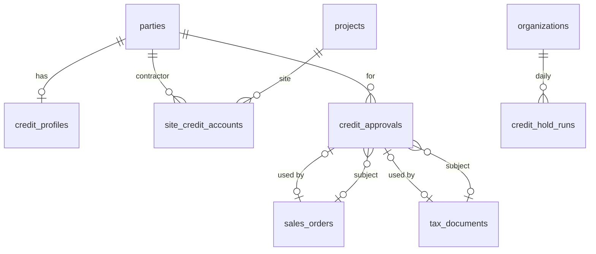
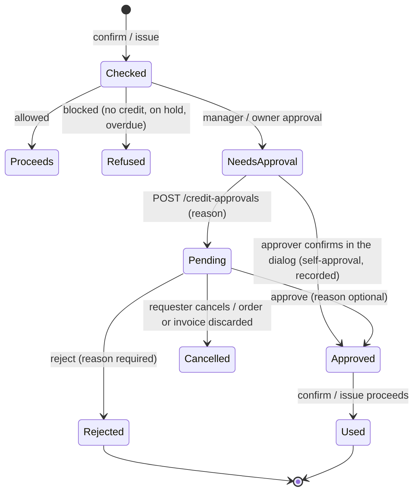

# MVP 3 — Credit, Receivables & Multi-Brand Money (Release 2.1): design spec

|           |                                                                                                                                                                            |
| --------- | -------------------------------------------------------------------------------------------------------------------------------------------------------------------------- |
| Release   | 2.1 "Credit, Receivables & Multi-Brand Money" ([roadmap](https://github.com/Avali-Tech/paint-retail-saas-roadmap/blob/main/docs/phases/phase-2-commerce-finance-paint.md)) |
| Modules   | P2-M08 (round 3a), P2-M09 – M12, P2-M32 – M36                                                                                                                              |
| Branch    | feature PRs → `mvp-3`                                                                                                                                                      |
| Builds on | MVP 2 on `mvp-3` at migration `0068` (commit `1ad6626`)                                                                                                                    |
| Status    | Draft for product-owner review. Ageing and statement rules need CA sign-off (§8); BSP and payment gateway are open ([PO-1], [PO-2]).                                       |

**How to read it.** §1 is what we build. §2 is the round 1 contract between the two parallel
sessions, written first so both can start. §3 is the data model, §4 the money rules, §5 the API and
screens, §6 the modules that come after round 1, §7 the build order and §8 the open questions.
`[CA-n]` and `[PO-n]` point to §8.

---

## 1. Scope

### 1.1 In Release 2.1

| ID     | Module                                           | What ships                                                                                                                                                                                                                                                                                                                                     | Done when (roadmap)                                                                                                             |
| ------ | ------------------------------------------------ | ---------------------------------------------------------------------------------------------------------------------------------------------------------------------------------------------------------------------------------------------------------------------------------------------------------------------------------------------- | ------------------------------------------------------------------------------------------------------------------------------- |
| P2-M09 | Credit approval, limit enforcement, sites        | Live exposure; projected exposure checked at order confirm and at credit-invoice issue; approval requests routed to a manager or the owner; automatic overdue hold with approved release; site accounts                                                                                                                                        | The spec §6.3 example (limit ₹30,000, outstanding ₹18,000, order ₹15,000) asks for approval, through real invoices and payments |
| P2-M10 | Receivables & ageing                             | Dashboard (outstanding, due today, due this week, overdue, utilisation, top customers); ageing 0–30 / 31–60 / 61–90 / 90+ by customer, salesperson, store                                                                                                                                                                                      | Ageing figures match the party ledger exactly                                                                                   |
| P2-M11 | Collections                                      | Worklist per salesperson; call / WhatsApp / note / promise-to-pay / record payment / escalate / hold; scheduled reminders (SMS and email until a BSP exists)                                                                                                                                                                                   | A broken promise-to-pay date escalates automatically                                                                            |
| P2-M12 | Customer ledger & statements                     | Statement for any date range, opening and closing balance, PDF in en / hi / te; share by a signed, expiring link and `wa.me`                                                                                                                                                                                                                   | A contractor receives their statement on WhatsApp in 2 clicks                                                                   |
| P2-M32 | WhatsApp messages & UPI payment links            | Messaging and payment-link provider interfaces with a `log` provider; templates (invoice, receipt, statement, reminder, order ready); opt-in / opt-out; payment links; webhook auto-match and allocation                                                                                                                                       | A reminder paid by UPI is recorded and allocated with no manual entry (with the `log` gateway until [PO-2])                     |
| P2-M33 | Brand scheme, target & rebate tracker            | Schemes with periods, slabs and benefits; progress to next slab from GRNs; expected vs received benefits; claims with ageing; price-hike planner (research)                                                                                                                                                                                    | Per brand: distance to the next slab and benefits still outstanding                                                             |
| P2-M34 | Brand statement reconciliation                   | Import a brand statement (CSV / Excel; PDF is research) with a mapping template per brand; match against GRNs, scheme credit notes and recorded brand payments; list mismatches                                                                                                                                                                | A month's brand statement reconciles with mismatches listed                                                                     |
| P2-M35 | Brand profitability                              | True margin per brand, product and store: sales − cost + schemes − credit cost − loyalty paid; side by side; CSV                                                                                                                                                                                                                               | The owner answers "which brand makes me the most money?" for any period                                                         |
| P2-M36 | Painter points from invoices                     | Points to the influencer of an invoice by rules (per ₹ or per litre, brand multiplier); reversed by credit notes; WhatsApp notice through P2-M32                                                                                                                                                                                               | A tagged invoice creates points and queues the painter's WhatsApp notice                                                        |
| P2-M08 | SaaS subscriptions (round 3a, from draft PR #50) | Manual invoicing by default (the PO's choice, no gateway live): the owner asks for a plan, an operator applies it; our GST invoices on schedule; bank transfer or UPI recorded by an operator; grace, then read-only. Razorpay and fake adapters behind config, on a payment-gateway port P2-M32 reuses ([subscriptions.md](subscriptions.md)) | A trial business asks for a plan, sees our invoice with how to pay it, an operator records the payment and it is active         |

### 1.2 Out of Release 2.1

| Out                                                    | Where it goes               | What 2.1 leaves ready                                                                                                               |
| ------------------------------------------------------ | --------------------------- | ----------------------------------------------------------------------------------------------------------------------------------- |
| A live payment gateway for subscriptions               | When [PO-2] answers         | Round 3a ships manual invoicing; the Razorpay adapter stays behind `SUBSCRIPTION_GATEWAY` ([subscriptions.md](subscriptions.md) §2) |
| A real WhatsApp BSP and payment gateway                | When [PO-1] / [PO-2] answer | Provider interfaces, `log` providers, outbox, webhook endpoint shape, signed statement links (§6.4)                                 |
| Supplier ledger, purchase invoices, input tax (P2-M17) | 2.2                         | P2-M34 matches GRNs and scheme credit notes; matching supplier invoices waits for P2-M17                                            |
| Price lists and discounts by role (P2-M13 – M15)       | 2.2                         | P2-M35 reads the price actually billed on each line                                                                                 |
| Credit scoring, credit intelligence (spec §7.4)        | Phase 3                     | Approval history, holds and ageing are kept for it                                                                                  |
| Interest on overdue amounts                            | [PO-6]                      | Ageing per document makes it a query                                                                                                |
| Loyalty catalogue, KYC, UPI payouts (P2-M27)           | 2.5                         | P2-M36 writes to the P1-M26 points ledger; redemption stays manual                                                                  |

### 1.3 What 2.1 uses from 2.0

| 2.0 piece                                                                     | Used by                                                                            |
| ----------------------------------------------------------------------------- | ---------------------------------------------------------------------------------- |
| `party_ledger` (append-only) and `party_balances` (`postPartyLedger`)         | Exposure (M09), statements (M12), ageing totals (M10)                              |
| `allocations` (append-only, opening balances via `party_ledger_id`)           | Outstanding per document: ageing (M10), site exposure (M09), auto-allocation (M32) |
| `tax_documents.due_on`, `project_id`, `influencer_party_id`                   | Ageing (M10), site accounts (M09), painter points (M36)                            |
| `checkCredit` (`@paint/shared`), `credit_profiles`, `credit_rules`            | Approval routing (M09)                                                             |
| `sales_orders.credit_check` and the 2.0 override columns                      | The approval request replaces the in-dialog override (M09, §4.3)                   |
| `sales_settings.billing_live_on`, `go_live_openings`, `opening_overdue_since` | Exposure source and overdue days (§4.7 of the MVP 2 spec)                          |
| `payments.gateway_reference`                                                  | Auto-matching gateway payments (M32)                                               |
| Notifier, email outbox, the background worker                                 | Approval notices, auto hold (M09), reminders and escalation (M11), messages (M32)  |
| `GET /parties/:id/ledger` with `openDocuments`                                | Statement body (M12), collection worklist (M11)                                    |
| Quotation PDF (pdfkit, Noto fonts)                                            | Statement PDF (M12)                                                                |

---

## 2. Round 1 contract (sessions 1a and 1b)

Round 1 runs two sessions in parallel. **1a [migrations]** builds P2-M09. **1b** builds P2-M10 and
P2-M12 with **no migrations**, on the existing `party_ledger`, `allocations` and `due_on`. This
section is what each may rely on from the other; anything not here is private to its session.

### 2.1 File ownership

| Area                                                                                                  | Owner | The other session                                    |
| ----------------------------------------------------------------------------------------------------- | ----- | ---------------------------------------------------- |
| `packages/db` (schema, migrations 0069+, snapshots, journal, migrate and data-migration tests)        | 1a    | Must not touch                                       |
| `apps/api/src/credit/**`, `apps/api/src/orders/order-credit.ts`, invoice-issue credit gate            | 1a    | Read only                                            |
| `packages/shared/src/credit.ts`, `credit-api.ts` (new)                                                | 1a    | Imports only                                         |
| `apps/api/src/receivables/**` (new), `apps/api/src/statements/**` (new)                               | 1b    | Read only                                            |
| `packages/shared/src/receivables.ts`, `receivables-api.ts` (new)                                      | 1b    | 1a imports nothing from it in round 1                |
| Web: `apps/web/src/credit/**`, order and POS credit prompts, customer 360 credit section              | 1a    | —                                                    |
| Web: `apps/web/src/receivables/**` (new), statement screen and share                                  | 1b    | —                                                    |
| `apps/web/src/i18n/{en,hi,te}-credit.ts`                                                              | 1a    | 1b adds `{en,hi,te}-receivables.ts`                  |
| Shared touch points: `app.module.ts`, `routes.tsx`, nav, `i18n/{en,hi,te}.ts` index, README API table | both  | Append only; resolve conflicts by keeping both sides |

### 2.2 Definitions both sessions use

| Term                | Definition (India dates from the database clock, `(now() at time zone 'Asia/Kolkata')::date`)                                                                                                              |
| ------------------- | ---------------------------------------------------------------------------------------------------------------------------------------------------------------------------------------------------------- |
| Open document       | An issued invoice, bill of supply or debit note, or an `opening` party-ledger entry, whose outstanding is above 0 (the existing `OpenDocumentView`)                                                        |
| Outstanding(d)      | `total(d) − Σ allocations to d` (payments, credit notes and reversals; cancelled documents excluded)                                                                                                       |
| Due date            | `tax_documents.due_on`; for an opening balance, `credit_profiles.opening_overdue_since` when set; an opening balance without one was current at go-live and stays `not_due` for ageing and credit ([CA-7]) |
| Days past due       | `asOf − due date` (negative = not yet due)                                                                                                                                                                 |
| Ageing bucket       | `not_due` (< 0), `d0_30` (0–30), `d31_60`, `d61_90`, `d90_plus` (> 90) days past due ([CA-1]: due date, not invoice date)                                                                                  |
| Balance             | `party_balances.balance_paise` = `Σ party_ledger` = `Σ outstanding − advance` (MVP 2 §4.6)                                                                                                                 |
| Advance             | `party_balances.advance_paise` (unallocated money); shown as its own row in ageing, never spread over buckets                                                                                              |
| Exposure (credit)   | `balance + open postpaid order value` after go-live; the hand-entered figure before (§4.1). 1b shows "credit utilisation" as `exposure ÷ limit` by calling 1a's existing `creditSummaryOf`                 |
| Salesperson         | `customer_profiles.assigned_member_id`; parties without one group under "Unassigned"                                                                                                                       |
| Store of a document | `tax_documents.store_id`; of an opening balance, the party's home store, else "Business-wide"                                                                                                              |

The ageing invariant 1b tests for every party and every `asOf`:
`Σ buckets − advance = balance at asOf` (the party ledger's running balance on that day).

### 2.3 What 1a gives 1b

- `exposureOf`, `creditSummaryOf` and `creditRulesOf` in `apps/api/src/credit/credit-lookups.ts`
  keep their signatures (1a may add optional parameters only).
- Site accounts (§3.3) filter documents by `tax_documents.project_id`. 1b's ageing takes an optional
  `projectId` filter from day one so the site screen can link to it; 1a's site view computes its own
  figures with the same bucket edges (§2.2), and a round 6 test checks both agree. (As built: the
  filter and the test came in round 4b, `receivables/site-agreement.int.test.ts`.)

### 2.4 What 1b gives 1a

- Nothing 1a depends on in round 1. In round 2, collections (P2-M11) builds its worklist on 1b's
  `GET /receivables/ageing` and `GET /parties/:id/statement`.

### 2.5 Merge order

1a merges first (it carries the migrations); 1b rebases on it. Neither changes the other's tests.

---

## 3. Data model

### 3.1 Conventions (unchanged from MVP 1 and 2)

| Convention             | How it applies here                                                                                                                                  |
| ---------------------- | ---------------------------------------------------------------------------------------------------------------------------------------------------- |
| Tenant isolation       | `organization_id`, RLS policy `<table>_tenant_isolation`, `UNIQUE (organization_id, id)`                                                             |
| Composite foreign keys | `(organization_id, x_id) → parent (organization_id, id)`                                                                                             |
| Money                  | `bigint` paise (`_paise`); percentages as integers; ratios computed with `BigInt` (as `checkCredit` does)                                            |
| Dates                  | Business dates are India `date`; instants `timestamptz`; "today" always from the database clock                                                      |
| Audit                  | `audit_row_change()` triggers on every new table that decides money or credit                                                                        |
| Numbering              | `nextDocumentNumber(tx, org, key)` + `formatDocumentNumber` (`AP-000001` for approvals)                                                              |
| Background jobs        | Worker job pattern: `pg_try_advisory_xact_lock`, explicit `organization_id` filter, one transaction per business, one run per business per India day |
| Retries                | `Idempotency-Key` on create endpoints that move money or credit                                                                                      |

### 3.2 Round 1a (P2-M09): new and changed objects, migrations 0069–0071



| Table / change                 | Key columns                                                                                                                                                                                                                                                                                                                                                                                                                                                        | Rules                                                                                                                                                                                                                                              |
| ------------------------------ | ------------------------------------------------------------------------------------------------------------------------------------------------------------------------------------------------------------------------------------------------------------------------------------------------------------------------------------------------------------------------------------------------------------------------------------------------------------------ | -------------------------------------------------------------------------------------------------------------------------------------------------------------------------------------------------------------------------------------------------- |
| `credit_approvals` (new)       | `number` (`AP-000001`), `kind` (`sale` / `release`), `party_id`, `project_id` (site, nullable), `store_id`, `sales_order_id` or `tax_document_id` (sale), `level` (`manager` / `owner`), `amount_paise`, `check` (jsonb: `checkCredit` result and position at request), `reason`, `status` (`pending` / `approved` / `rejected` / `cancelled` / `used`), `requested_by`, `decided_by`, `decided_at`, `decision_reason`, `waive_overdue_until` (release), `used_at` | A sale approval names exactly one subject; a release names none. One pending approval per subject and per party release (partial unique indexes). Rejection needs a reason. `used` only from `approved`. Audited (status, level, amount, decision) |
| `site_credit_accounts` (new)   | `party_id` (contractor), `project_id` (site), `limit_paise`, `status` (`active` / `on_hold` / `closed`), `hold_reason`, `held_at`, `held_by`, `notes`, `created_by`                                                                                                                                                                                                                                                                                                | `UNIQUE (organization_id, party_id, project_id)`; limit > 0; the party holds the project as customer or as a project party; limit ≤ the party's limit (API). Audited (limit, status, hold reason)                                                  |
| `credit_hold_runs` (new)       | `run_on` (India date), `ran_at`, `held_count`                                                                                                                                                                                                                                                                                                                                                                                                                      | One per business per day (unique); append-only like `reconciliation_runs`                                                                                                                                                                          |
| `credit_profiles` (changed)    | add `hold_kind` (`manual` / `auto`), `overdue_waived_until` (date)                                                                                                                                                                                                                                                                                                                                                                                                 | An automatic hold has no member (`held_by` null when `hold_kind = 'auto'`); a trigger refuses changes to `manual_exposure_paise` and `overdue_days` once `billing_live_on` is set (MVP 2 §4.7). Audit adds `hold_kind`, `overdue_waived_until`     |
| `sales_orders` (changed)       | add `credit_approval_id`                                                                                                                                                                                                                                                                                                                                                                                                                                           | Set when a confirm uses an approval; the 2.0 override columns are filled from it, so old and new orders read the same                                                                                                                              |
| `tax_documents` (changed)      | add `credit_check` (jsonb), `credit_approval_id`                                                                                                                                                                                                                                                                                                                                                                                                                   | Written once, in the issuing update; part of the issued, immutable document                                                                                                                                                                        |
| `notification_event` (changed) | add `credit_approval_requested`, `credit_approval_decided`, `credit_hold_applied`                                                                                                                                                                                                                                                                                                                                                                                  | Existing notifier and outbox                                                                                                                                                                                                                       |
| Permissions                    | add `credit:approve_sale` (owners, admins, branch managers)                                                                                                                                                                                                                                                                                                                                                                                                        | Data migration grants it to existing system roles; owner-level approvals stay with the Owner role                                                                                                                                                  |

### 3.3 Site accounts (P2-M09, research)

**Reuse.** A site is the existing `projects` row (P1-M08), already on quotations, orders and invoices
as `project_id` (P2-M31). A site account adds only a limit and a status for one contractor on one
project; it never holds its own ledger. Everything else is a view over documents with that
`project_id` and that party:

| Site figure | Source                                                                                                                              |
| ----------- | ----------------------------------------------------------------------------------------------------------------------------------- |
| Outstanding | Σ outstanding of the party's open documents with `project_id` = site                                                                |
| Open orders | Unbilled value of the party's open postpaid orders with that `project_id`                                                           |
| Exposure    | Outstanding + open orders (advances are not site money, so they never lower a site's exposure)                                      |
| Ledger view | The site's documents, oldest first: each invoice / debit note with its allocations (payments, credit notes) and running outstanding |
| Ageing      | The site's open documents in the §2.2 buckets                                                                                       |
| Roll-up     | The contractor's own exposure already includes every site; a sale on a site is checked against both (§4.2)                          |

**Built in 1a (core):** the table, CRUD, hold / release, site exposure and its check at confirm and
issue, the site view with ledger and ageing, and the screen. **Research, later:** sites billed to a
homeowner but guaranteed by the contractor (a second liable party), per-site credit days, and site
statements on WhatsApp (round 2 with P2-M12's share).

### 3.4 Later rounds (summary; each owning session details its tables before coding)

| Round | Module         | New tables (draft)                                                                                                                                   |
| ----- | -------------- | ---------------------------------------------------------------------------------------------------------------------------------------------------- |
| 2a    | P2-M11, P2-M32 | Built: see §3.5 (migrations 0074–0076)                                                                                                               |
| 2a    | P2-M36         | Built: see §3.5 (migrations 0072–0073)                                                                                                               |
| 3a    | P2-M08         | Built: [subscriptions.md](subscriptions.md) §7 (migrations 0077–0078), including the shared `payment_gateway_events`                                 |
| 4a    | P2-M32         | Built: see §3.6 (migrations 0079–0080); webhook events reuse 3a's `payment_gateway_events` through the shared port (`apps/api/src/payments-gateway`) |
| 5a    | P2-M33         | `brand_schemes`, `brand_scheme_slabs`, `brand_scheme_benefits`, `brand_claims`, `brand_benefit_receipts`                                             |
| 6a    | P2-M34         | `brand_statement_templates`, `brand_statement_imports`, `brand_statement_lines`, `brand_statement_matches`                                           |

### 3.5 Round 2a: new and changed objects, migrations 0072–0076

| Migration | What                                                                                                                                                                                                                     |
| --------- | ------------------------------------------------------------------------------------------------------------------------------------------------------------------------------------------------------------------------ |
| 0072      | P2-M36 schema: `loyalty_earn_rules`; `loyalty_entry_kind` gains `influencer`; `loyalty_ledger` rules for influencer entries; `loyalty_is_influencer()` (committed first, alone, for session 2b: branch `mvp3-r2-schema`) |
| 0073      | Audit trigger on `loyalty_earn_rules`                                                                                                                                                                                    |
| 0074      | Collections, messaging and statement-link tables; `activity_type` gains `promise_to_pay`; `notification_event` gains `promise_broken`; `activities` gains `UNIQUE (organization_id, id)` for composite keys              |
| 0075      | Rules: forward-only promises and messages, escalations acknowledged once, append-only runs and consents, statement links revoked once; audit triggers                                                                    |
| 0076      | Data migration: `receivables:read` to the Owner, Organization Admin, Branch Manager and Sales Executive system roles                                                                                                     |

| Table / change                 | Key columns                                                                                                                                                                                                                                                                                                | Rules                                                                                                                                                                                                                                                                                      |
| ------------------------------ | ---------------------------------------------------------------------------------------------------------------------------------------------------------------------------------------------------------------------------------------------------------------------------------------------------------- | ------------------------------------------------------------------------------------------------------------------------------------------------------------------------------------------------------------------------------------------------------------------------------------------ |
| `loyalty_earn_rules` (new)     | `name`, `basis` (`value` / `litre`), `points`, `per_paise` (value) or `per_millilitres` (litre), `brand_id` (null = every brand), `multiplier_bps` (10,000 = ×1), `valid_from`, `valid_until`, `is_active`, `created_by`                                                                                   | Exactly one of `per_paise` / `per_millilitres`, matching the basis, > 0; points > 0; multiplier 1–1,000,000 bps; from ≤ until; name unique per business (case-insensitive). Audited. Choosing the "best" rule per line is 2b's code                                                        |
| `loyalty_ledger` (changed)     | `kind` gains `influencer`                                                                                                                                                                                                                                                                                  | An influencer entry names its invoice (`tax_document_id`) and number (`reference`), adds points, once per invoice (partial unique index). Written as `kind::text` / `loyalty_is_influencer(kind)`: migrations run in one transaction, and a value added to an enum cannot be cast to in it |
| `promises_to_pay` (new)        | `party_id`, `amount_paise`, `promised_on`, `made_on`, `status` (`open` / `kept` / `broken` / `cancelled`), `note`, `activity_id`, `paid_paise` (when settled), `closed_at`, `closed_by` and `cancel_reason` (cancelled)                                                                                    | One open promise per party (partial unique index); `promised_on ≥ made_on`; forward only, what was promised never changes (trigger); no deletes. Audited                                                                                                                                   |
| `collection_escalations` (new) | `party_id`, `promise_id` (unique), `raised_on`, `notified_count`, `acknowledged_by`, `acknowledged_at`, `acknowledge_note`                                                                                                                                                                                 | Only the acknowledgement is written, once (trigger); no deletes. Audited                                                                                                                                                                                                                   |
| `collection_runs` (new)        | `run_on`, `ran_at`, `kept_count`, `broken_count`, `reminders_queued`                                                                                                                                                                                                                                       | One per business per India day; append-only, like `credit_hold_runs`                                                                                                                                                                                                                       |
| `reminder_schedules` (new)     | `offset_days` (−30 … 90 from a bill's due date), `channels` (`message_channel[]`, 1–3), `is_active`                                                                                                                                                                                                        | One row per offset per business; no rows = no reminders. Audited                                                                                                                                                                                                                           |
| `messaging_consents` (new)     | `party_id`, `channel` (`whatsapp` / `sms` / `email`), `address` (E.164 or lowercase email), `state` (`granted` / `withdrawn`), `method`, `notice_version`, `language`, `recorded_by` (null only for a `whatsapp_reply`), `recorded_at`                                                                     | Append-only (trigger, no update / delete / truncate); the current state is the latest row per (party, channel). Audited                                                                                                                                                                    |
| `message_templates` (new)      | `key` (`message_template_key`), `channel`, `language`, `body` (with `{{variables}}`), `provider_template_name`, `is_active`                                                                                                                                                                                | A business's own wording; no row = the product's default (`@paint/shared` `DEFAULT_TEMPLATES`). One per (key, channel, language). Audited                                                                                                                                                  |
| `message_outbox` (new)         | `party_id`, `channel`, `template_key`, `language`, `to_address`, `variables` (jsonb object), `body` (rendered), `reference_type` / `reference_id`, `dedupe_key`, `status`, `skip_reason`, `attempts`, `next_attempt_at`, `last_error`, `provider`, `provider_ref`, `created_by` (null = system), `sent_at` | Content never changes; status forward only: queued → sent / failed / skipped (or queued again for a retry), sent → delivered / read / failed (trigger); `dedupe_key` unique per business; no deletes                                                                                       |
| `statement_links` (new)        | `party_id`, `from_on`, `to_on`, `language`, `token_hash` (hex SHA-256, unique across businesses), `expires_at`, `revoked_at`, `revoked_by`, `opened_count`, `last_opened_at`, `created_by`                                                                                                                 | The token itself is never stored. Only revoked (once) or opened (count grows) after creation (trigger); no deletes. Audited (creation, revocation)                                                                                                                                         |
| `notification_event` (changed) | add `promise_broken`                                                                                                                                                                                                                                                                                       | Existing notifier and email outbox                                                                                                                                                                                                                                                         |
| `activity_type` (changed)      | add `promise_to_pay`                                                                                                                                                                                                                                                                                       | Written only by `POST /parties/:id/promises`; the activities API refuses it as a logged or scheduled type                                                                                                                                                                                  |
| Permissions                    | add `receivables:read`                                                                                                                                                                                                                                                                                     | Receivables dashboard, ageing, reports and the collections worklist (it replaces `credit:read` there); the statement stays on `sales:read`                                                                                                                                                 |

**Party merge.** A duplicate with promises to pay (and so escalations) is refused: merge the
other way. Its queued messages are skipped (`party_merged`) and its statement links revoked; a
consent grant is never carried to the survivor (it is asked again), but a withdrawal is, when the
survivor's own latest consent on that channel is a grant (the stricter choice wins, after draft PR
#51 CN-7).

**For session 2b (P2-M36).** `loyalty-reversal.ts` sums the `adjust` entries of an invoice's
notes across every account; once influencer entries exist, a reversal must filter by the account
it takes points from, or a painter's reversal would count against the bill-to party's. Queue the
`points_earned` notice with `queueMessage(tx, …)` (`apps/api/src/messaging/outbox.ts`,
variables `points`, `number`, `balance`).

### 3.6 Round 4a: new and changed objects, migrations 0079–0080

| Migration | What                                                                                                                                                                                                                                                                                                                               |
| --------- | ---------------------------------------------------------------------------------------------------------------------------------------------------------------------------------------------------------------------------------------------------------------------------------------------------------------------------------- |
| 0079      | `payment_links` and `payment_link_documents`; `payments` gains `payment_link_id` and may have no member for a link payment; `payment_mode_kind` gains `upi_link`, `payment_gateway` gains `log`, `message_template_key` gains `payment_request`, `notification_event` gains `payment_link_paid`                                    |
| 0080      | Rules: links keep what they asked for and move forward only, documents append-only, no deletes; audit trigger. The new enum values are not named in 0080 (migrations run in one transaction, and a value added to an enum cannot be used in it); `payments_link` compares `mode_kind::text` for the same reason. No data migration |

| Table / change                   | Key columns                                                                                                                                                                                                                                                                                                                                                                                                                                                                 | Rules                                                                                                                                                                                                                                                                                                                                                                               |
| -------------------------------- | --------------------------------------------------------------------------------------------------------------------------------------------------------------------------------------------------------------------------------------------------------------------------------------------------------------------------------------------------------------------------------------------------------------------------------------------------------------------------- | ----------------------------------------------------------------------------------------------------------------------------------------------------------------------------------------------------------------------------------------------------------------------------------------------------------------------------------------------------------------------------------- |
| `payment_links` (new)            | `number` (`PL-000001`), `store_id` (where its payments are recorded), `party_id`, `purpose` (`invoice` / `overdue` / `outstanding` / `bills` / `advance`), `origin` (`staff` / `reminder` / `statement`), `amount_paise`, `description`, `provider`, `gateway_reference`, `url`, `expires_at`, `status` (`created` / `paid` / `expired` / `cancelled`), `paid_paise`, `paid_at`, `cancelled_at`, `cancelled_by_member_id`, `created_by_member_id` (null = the reminder run) | Number unique per business; `(provider, gateway_reference)` unique; amount > 0; paid ≥ 0; `paid_at` exactly when paid; a cancelled link has `cancelled_at`, kept when money later pays it. Only status and what was paid change: created → paid / expired / cancelled, expired or cancelled → paid; paid only grows; paid and cancelled written once (trigger); no deletes. Audited |
| `payment_link_documents` (new)   | `link_id`, `party_id`, `document_id` or `party_ledger_id` (an opening balance or charge), `position` (oldest first), `outstanding_paise` (when the link was made)                                                                                                                                                                                                                                                                                                           | One target each; composite keys keep every document the link's party's; append-only (trigger)                                                                                                                                                                                                                                                                                       |
| `payments` (changed)             | add `payment_link_id`; `created_by_member_id` nullable                                                                                                                                                                                                                                                                                                                                                                                                                      | A link payment is money in with a gateway reference, never in a register, the only use of the `upi_link` mode, and the only payment without a member (`payments_link` check); its gateway payment id is unique per business (partial unique index); the link names the payment's party (composite key)                                                                              |
| `payment_mode_kind` (changed)    | add `upi_link`                                                                                                                                                                                                                                                                                                                                                                                                                                                              | The business's "UPI link" mode is made by the system when a link is first paid; members can neither create one nor record money by it                                                                                                                                                                                                                                               |
| `payment_gateway` (changed)      | add `log`                                                                                                                                                                                                                                                                                                                                                                                                                                                                   | The link provider of development and demos; `SUBSCRIPTION_GATEWAY` never accepts it                                                                                                                                                                                                                                                                                                 |
| `message_template_key` (changed) | add `payment_request`                                                                                                                                                                                                                                                                                                                                                                                                                                                       | A request for a party-level or advance amount with its link (§6.2 PL-12)                                                                                                                                                                                                                                                                                                            |
| `notification_event` (changed)   | add `payment_link_paid`                                                                                                                                                                                                                                                                                                                                                                                                                                                     | Existing notifier and email outbox                                                                                                                                                                                                                                                                                                                                                  |

**Party merge.** A duplicate with payment links is refused: the gateway may still pay one. Merge the
other way.

---

## 4. Money and credit rules

### 4.1 Exposure

```text
before go-live:  exposure = credit_profiles.manual_exposure_paise         (read-write)
after go-live:   exposure = party_balances.balance_paise
                          + Σ open postpaid order value (confirmed / partly fulfilled,
                            unbilled quantity × line total ÷ quantity, rounded per line)
                 manual_exposure_paise and overdue_days are read-only (API 409 and trigger)
projected        = exposure + amount of the sale being checked
overdue days     = today − min(due date of open documents), never below 0
```

The order being confirmed is excluded from "open postpaid order value" (it is the amount checked).
An invoice raised from a postpaid order moves value from "open orders" to the ledger, so issuing it
never changes exposure and needs no second check.

### 4.2 Where projected exposure is checked

| Moment                                                                           | Amount checked                                            | Check                                                                                                       |
| -------------------------------------------------------------------------------- | --------------------------------------------------------- | ----------------------------------------------------------------------------------------------------------- |
| Confirm a postpaid order                                                         | Order total                                               | `checkCredit(rules, party position, total)`; with a site account, also the site position; the stricter wins |
| Issue an invoice not from a postpaid order, leaving money unpaid (after go-live) | What stays unpaid after the payments taken with the issue | Same, after the invoice and payments are posted in the issuing transaction                                  |
| Walk-in bill                                                                     | —                                                         | Paid in full (MVP 2 rule); never on credit                                                                  |
| Before go-live                                                                   | Invoices are not checked; orders use the manual figures   | The hand-entered exposure is too stale to refuse a bill on                                                  |

"Stricter" orders decisions as `allowed < manager_approval < owner_approval < blocked`. A site check
uses the site's limit and status, the contractor's overdue days and the business rules.

### 4.3 Approval routing (the 2.0 override becomes a request)



| Rule              | Detail                                                                                                                                                                                             |
| ----------------- | -------------------------------------------------------------------------------------------------------------------------------------------------------------------------------------------------- |
| Level             | `manager_approval` → `manager`; `owner_approval` → `owner`; `blocked` is never approvable (put the party on credit, or release the hold)                                                           |
| Who approves      | `manager`: a member with `credit:approve_sale` at the subject's store; `owner`: a member with the Owner role. Never the requester ([PO-3])                                                         |
| Who is told       | `credit_approval_requested` to those approvers; `credit_approval_decided` to the requester; neither to the person who acted                                                                        |
| Waiting           | While an approval is pending the order cannot be confirmed and the invoice cannot be issued (409 `credit_approval_pending`)                                                                        |
| Using an approval | Valid when approved, unused, at a level ≥ the level now needed, and the projected exposure now ≤ the projected exposure approved; otherwise a new approval is needed (409 `credit_approval_stale`) |
| Self-approval     | A member who may approve the level can still approve inside the confirm or issue dialog (`creditOverride: {reason}`): an approval row is written already approved by them and used at once         |
| Audit             | `credit_approvals` status, level, amount and decision are audited; orders and invoices keep the approval id and the check they ran                                                                 |

### 4.4 Automatic credit hold

| Rule      | Detail                                                                                                                                                                                                                      |
| --------- | --------------------------------------------------------------------------------------------------------------------------------------------------------------------------------------------------------------------------- |
| When      | Once per business per India day, from the background worker, after go-live                                                                                                                                                  |
| Who       | Active profiles whose overdue days (§4.1, from the oldest open document past its due date) exceed `credit_rules.hold_after_overdue_days`, and whose `overdue_waived_until` is not today or later                            |
| Effect    | `status = on_hold`, `hold_kind = auto`, reason "Overdue N days (automatic)", no member; `credit_hold_applied` to the party's store's `credit:manage` holders and to `credit:approve` holders                                |
| Job shape | `pg_try_advisory_xact_lock` per business, explicit `organization_id` filter, one transaction per business inside `withTenant`, recorded in `credit_hold_runs` so a second server or a second tick does nothing              |
| Release   | Only with approval: an approver releases directly, or staff with `credit:manage` ask (`kind = release` approval) and an approver approves. Releasing an automatic hold may waive the overdue block up to a date (≤ 90 days) |
| Waiver    | While `overdue_waived_until ≥ today`, `checkCredit` ignores the overdue block for the party and the job skips it; utilisation rules still apply                                                                             |

### 4.5 Ageing and statements (P2-M10, P2-M12)

```text
for every party p and day asOf:
  open(p, asOf)     = documents issued on or before asOf with outstanding(asOf) > 0
  outstanding(d, asOf) = total(d) − Σ allocations to d created on or before asOf (India date)
  bucket(d, asOf)   = §2.2 on asOf − due date
  Σ buckets − advance(asOf) = Σ party_ledger.amount where entry_on ≤ asOf      (must hold exactly)

statement(p, from, to):
  opening  = Σ party_ledger.amount where entry_on < from
  entries  = party_ledger rows with from ≤ entry_on ≤ to, oldest first, with running balance
  closing  = opening + Σ entries = Σ party_ledger.amount where entry_on ≤ to
```

Statements and ageing are queries; neither stores totals. Allocations dated by their `created_at`
India date is [CA-2] (a payment received on the 31st but allocated on the 2nd).

---

## 5. API contract and screens

### 5.1 Round 1a endpoints (P2-M09)

| Method and path                                                                  | Body / query (short)                                                                                                     | Returns                                                                                                                                                                     | Permission                                                                      |
| -------------------------------------------------------------------------------- | ------------------------------------------------------------------------------------------------------------------------ | --------------------------------------------------------------------------------------------------------------------------------------------------------------------------- | ------------------------------------------------------------------------------- |
| `GET /parties/:id/credit`                                                        | —                                                                                                                        | Existing view + `exposure` breakdown (balance, open orders, advance), `holdKind`, `overdueWaivedUntil`, `sites` summary                                                     | `credit:read`                                                                   |
| `GET /credit-approvals?status&kind&partyId&mine&limit&offset`                    | `mine=true`: those the member may decide                                                                                 | Page of approvals, pending oldest first                                                                                                                                     | `credit:read`                                                                   |
| `GET /credit-approvals/:id`                                                      | —                                                                                                                        | Approval with the check at request and the check now                                                                                                                        | `credit:read`                                                                   |
| `POST /credit-approvals`                                                         | `{salesOrderId, reason}`, `{invoiceId, amountPaise, reason}` (what stays unpaid) or `{kind: 'release', partyId, reason}` | Pending approval (201); 409 when not needed, blocked or already pending                                                                                                     | `sales:manage` (order), `billing:issue` (invoice), `credit:manage` (release)    |
| `POST /credit-approvals/:id/approve`                                             | `{reason?, waiveOverdueUntil?}` (release)                                                                                | Approved (a release applies at once)                                                                                                                                        | `credit:approve_sale` (manager), Owner role (owner), `credit:approve` (release) |
| `POST /credit-approvals/:id/reject`                                              | `{reason}`                                                                                                               | Rejected                                                                                                                                                                    | as approve                                                                      |
| `POST /credit-approvals/:id/cancel`                                              | —                                                                                                                        | Cancelled                                                                                                                                                                   | the requester, or an approver                                                   |
| `POST /sales-orders/:id/confirm`                                                 | `{creditOverride?: {reason}}` (unchanged shape)                                                                          | Order; 409 `credit_approval_required` / `credit_approval_pending` / `credit_approval_stale` / `credit_blocked` / `credit_override_not_allowed` with `credit` and `approval` | `sales:manage`                                                                  |
| `POST /invoices/:id/issue`                                                       | adds `creditOverride?: {reason}`                                                                                         | Issued invoice; same 409 codes                                                                                                                                              | `billing:issue`                                                                 |
| `GET /invoices/:id/credit-check?unpaidPaise=`                                    | —                                                                                                                        | The credit view for issuing the draft on credit                                                                                                                             | `billing:issue`                                                                 |
| `POST /parties/:id/credit/release`                                               | `{reason, waiveOverdueUntil?}`                                                                                           | Credit view                                                                                                                                                                 | `credit:approve`                                                                |
| `GET /parties/:id/sites`, `POST /parties/:id/sites`                              | `{projectId, limitPaise, notes?}`                                                                                        | Site accounts with exposure                                                                                                                                                 | `credit:read` / `credit:approve`                                                |
| `GET /site-accounts/:id`                                                         | —                                                                                                                        | Site with exposure, ledger view and ageing                                                                                                                                  | `credit:read`                                                                   |
| `PATCH /site-accounts/:id`, `POST /site-accounts/:id/hold`, `/release`, `/close` | limit, notes / reason                                                                                                    | Site account                                                                                                                                                                | `credit:approve` (limit, release, close), `credit:manage` (hold)                |

### 5.2 Round 1b endpoints (P2-M10, P2-M12)

| Method and path                                                                                   | Returns                                                                                                                                                               | Permission   |
| ------------------------------------------------------------------------------------------------- | --------------------------------------------------------------------------------------------------------------------------------------------------------------------- | ------------ |
| `GET /receivables/summary?storeId&asOf`                                                           | Total outstanding, due today, due this week (today … today + 6), overdue, advance, utilisation of credit parties, top 10 outstanding                                  | `sales:read` |
| `GET /receivables/ageing?groupBy=party\|salesperson\|store&storeId&projectId&asOf&q&limit&offset` | Rows with the five buckets, advance and balance; totals; CSV with `format=csv`                                                                                        | `sales:read` |
| `GET /parties/:id/ageing?asOf&projectId`                                                          | The party's open documents with bucket and days past due                                                                                                              | `sales:read` |
| `GET /parties/:id/statement?from&to&projectId`                                                    | Opening, entries with running balance, closing, open documents (§4.5)                                                                                                 | `sales:read` |
| `GET /parties/:id/statement/pdf?from&to&lang=en\|hi\|te`                                          | A4 PDF (pdfkit, Noto fonts), "Statement of account"                                                                                                                   | `sales:read` |
| `POST /parties/:id/statement/share`                                                               | `{from, to, lang}` → `{url, expiresAt, whatsappUrl}`: a signed link (HMAC of org, party, period, lang and expiry; 7 days, [PO-4]) and `https://wa.me/<mobile>?text=…` | `sales:read` |
| `GET /public/statements/:token`                                                                   | The PDF, outside tenant scope like public branding; 404 for a bad or expired token; no listing                                                                        | none         |

### 5.3 Screens

| Screen                                 | Session | Key behaviour                                                                                                                                                                                                         |
| -------------------------------------- | ------- | --------------------------------------------------------------------------------------------------------------------------------------------------------------------------------------------------------------------- |
| Credit approvals (`/credit/approvals`) | 1a      | Queue of pending approvals the member may decide (oldest first), filters, each with party, subject, amount, level, the check then and now; approve / reject with a reason                                             |
| Approval prompt (order, POS)           | 1a      | When confirm or issue answers a credit 409: the figures (limit, exposure, projected, %), the level needed, "Ask for approval" with a reason, or "Approve now" when the member may; a pending request shows its status |
| Customer 360 credit section            | 1a      | Live exposure (balance + open orders − advance) next to the limit, source (manual / ledger), overdue days, hold kind, waiver, sites                                                                                   |
| Site accounts                          | 1a      | On the customer 360 credit section and `/site-accounts/:id`: limit, exposure, ledger view, ageing, hold / release                                                                                                     |
| Receivables (`/receivables`)           | 1b      | Dashboard tiles, ageing table with group-by and store filter, CSV                                                                                                                                                     |
| Statement                              | 1b      | Party → Statement: period picker, preview, PDF, "Share on WhatsApp" (2 clicks: Share, then WhatsApp)                                                                                                                  |

---

## 6. Modules after round 1

### 6.1 P2-M11 Collections (round 2a)

| Piece        | Design                                                                                                                                                                                 |
| ------------ | -------------------------------------------------------------------------------------------------------------------------------------------------------------------------------------- |
| Worklist     | Per salesperson (§2.2): overdue parties from the ageing query, oldest bucket first, with last activity, open promise and next step                                                     |
| Actions      | Call, WhatsApp, note (activities, P1-M09); promise to pay (`promises_to_pay`: amount, date, status open / kept / broken); record payment (existing); escalate; credit hold (M09)       |
| Promise kept | Allocations to the party between the promise and its date cover the promised amount                                                                                                    |
| Escalation   | Worker job (M09 pattern): a promise past its date and not kept becomes `broken`, an escalation goes to the salesperson's branch manager and the party's store `credit:approve` holders |
| Reminders    | `reminder_schedules` per business (days before / after due); SMS and email through the outbox until a BSP exists; WhatsApp through `message_outbox` with the `log` provider            |

**As built in round 2a**, numbered so each rule names its check (the format of draft PR #51 §2.6,
whose CO rules several of these adopt, as cited):

| #    | Rule                                                                                                                                                                                                                                                                                                                                                       | Checked by                                                     |
| ---- | ---------------------------------------------------------------------------------------------------------------------------------------------------------------------------------------------------------------------------------------------------------------------------------------------------------------------------------------------------------- | -------------------------------------------------------------- |
| CO-1 | Worklist: customers in the member's scope with something 1+ days past due today, from `ageBooks` (§2.2), each with last activity, open promise (with what was paid so far), open escalation and next step; order: escalation, promise due, then most days late, then overdue amount, then name. Filters: mine (default) / everyone's / not assigned, store | `collections.int.test.ts`, `compareWorklist` unit test         |
| CO-2 | Call, WhatsApp and note stay P1-M09 activities; recording a promise also writes a `promise_to_pay` activity (PR #51 CO-2). Record payment, hold and the statement are the existing screens                                                                                                                                                                 | API test: the activity exists and cannot be logged by hand     |
| CO-3 | A promise: amount > 0 and ≤ the party's balance now; date from today to today + 60 ([PO-13]); one open promise per party (PR #51 CO-3, without the per-site variant)                                                                                                                                                                                       | API tests: 400 on each limit, 409 `promise_open` (also a race) |
| CO-4 | **Kept** when payments received from the day it was made to its date, cheques not bounced, cover the amount (PR #51 CO-4). This counts payments, not allocations as the table above says, so money taken as an advance counts too. Kept as soon as covered, even before the date                                                                           | Job test: exact, short, bounced cheque left out                |
| CO-5 | **Broken** on the first daily run after its date without enough paid: an escalation (one per promise) goes to the active branch managers who share a store with the party's salesperson and to the party's home store's `credit:approve` holders (`promise_broken`). No second level yet ([PO-14])                                                         | Job test: recipients and `notified_count`                      |
| CO-6 | Reminders: each active schedule offset `n` reminds every party with bills due exactly `n` days before today and still owed, summing them; one message per party, channel and day (`dedupe_key`; on a day two schedules meet, the later, firmer one wins); only with consent (MSG-1); opening balances left out until [CA-7]                                | Job test                                                       |
| CO-7 | No reminders while a party has an open promise not yet due (PR #51 CO-9)                                                                                                                                                                                                                                                                                   | Job test                                                       |
| CO-8 | The daily run (promises, escalations, reminders) is the M09 job pattern: advisory lock per business, explicit `organization_id` filters, one transaction per business, recorded in `collection_runs`; it runs only between 09:00 and 20:00 India time (MSG-6)                                                                                              | Job and worker tests (fixed instants for day and night)        |
| CO-9 | Who: worklist, promises list and schedule read need `receivables:read`; recording and cancelling promises and acknowledging escalations need `credit:manage`; changing the schedule needs `credit:approve`                                                                                                                                                 | API permission tests                                           |

### 6.2 P2-M32 WhatsApp messages and UPI payment links (rounds 2a and 4a)

| Piece              | Design                                                                                                                                                                                                                                                                                                                                                                                                                                              |
| ------------------ | --------------------------------------------------------------------------------------------------------------------------------------------------------------------------------------------------------------------------------------------------------------------------------------------------------------------------------------------------------------------------------------------------------------------------------------------------- |
| Messaging provider | `interface MessagingProvider { send(message: TemplateMessage): Promise<{providerRef}> }`, as `SmsSender`: `log` (dev and tests, prints), `disabled` (default), a BSP adapter later ([PO-1]). `MESSAGING_PROVIDER` env, refused as `log` in production                                                                                                                                                                                               |
| Outbox             | `message_outbox` (party, channel, template, variables, status, attempts, provider ref); the worker sends with retries like email                                                                                                                                                                                                                                                                                                                    |
| Consent            | `messaging_consents` per party and channel: opted in (when, how), opted out; nothing is sent without opt-in ([CA-3] / DPDP Act)                                                                                                                                                                                                                                                                                                                     |
| Templates          | invoice, receipt, statement, payment reminder, order ready / dispatched, points earned; variables only, approved by the BSP later                                                                                                                                                                                                                                                                                                                   |
| Until a BSP        | Every "send on WhatsApp" opens `wa.me/<mobile>?text=…` with a signed, expiring link (statement, invoice, receipt), which needs no BSP                                                                                                                                                                                                                                                                                                               |
| Payment provider   | On round 3a's payment-gateway port (`apps/api/src/payments-gateway`, [subscriptions.md](subscriptions.md) §5): a link adapter implements `PaymentCreator.createPayment` (→ gateway reference and URL) and `WebhookVerifier`, and `receiveGatewayWebhook` stores each verified event once in `payment_gateway_events`; a `log` adapter (creates `upi://pay?...` intent links and accepts a signed test webhook) and a gateway adapter later ([PO-2]) |
| Auto-allocation    | A verified, new `payment_gateway_events` row records a payment (`gateway_reference` unique per business) and allocates it with the 2.0 allocation service to the link's documents, oldest first; the rest is an advance                                                                                                                                                                                                                             |

**The messaging half as built in round 2a.** Platform and legal rules adopted from draft PR #51
§2.7–§2.8, with its sources (Meta pricing and opt-in pages, the DPDP Act 2023 ss.5–7 and the DPDP
Rules 2025 timeline), checked there on 16 Oct 2026 and to be re-checked when the BSP adapter is
built ([PO-1]): outside a customer-opened 24-hour window only approved templates may be sent; a
template's category is Meta's to assign; opt-in must name the business and be honoured on
withdrawal; consent must be free, specific, informed and as easy to withdraw as to give. The
business is the data fiduciary, we are its processor; whether transactional messages may rest on
legitimate use (s.7(a)) instead of consent stays [CA-3], and we ask for consent anyway, as Meta
requires it regardless.

| #      | Rule                                                                                                                                                                                                                                                                                                                                                                 | Checked by                                |
| ------ | -------------------------------------------------------------------------------------------------------------------------------------------------------------------------------------------------------------------------------------------------------------------------------------------------------------------------------------------------------------------- | ----------------------------------------- |
| MSG-1  | Nothing goes to a party without its latest consent for that channel being `granted` at the party's current mobile (WhatsApp, SMS) or email. Checked when queued (`queueMessage` answers `no_consent` / `no_address` and writes nothing) and again when the worker sends (PR #51 CN-1); a message whose consent was withdrawn meanwhile is `skipped`                  | Outbox tests                              |
| MSG-2  | Consent is recorded by staff (`parties:manage`) after reading the notice (`consentNotice`, en / hi / te, naming the business, the channel and the address; version `2026-10`), with the method (`counter_with_notice`, `signed_form`, `web_form`), the language and the member; a stale notice version is refused (PR #51 CN-2)                                      | API tests; web dialog test                |
| MSG-3  | Consent records are append-only; the current state is the latest row per (party, channel) (PR #51 CN-3)                                                                                                                                                                                                                                                              | DB trigger test                           |
| MSG-4  | Messages are written in the language the party consented in; the body is the business's wording (`message_templates`) or the product's (`DEFAULT_TEMPLATES`), whose variables are fixed per template and checked when reworded                                                                                                                                       | Catalogue unit test: every key × language |
| MSG-5  | Variables are data-minimal: the party's name, the shop's name, a document number, amounts, dates, a link, points; never GSTIN or address (PR #51 WA-5)                                                                                                                                                                                                               | Template catalogue                        |
| MSG-6  | Parties are messaged only between 09:00 and 20:00 India time: the worker sends and the collections run queues only then (PR #51 CO-8)                                                                                                                                                                                                                                | `isMessagingHour` unit test; worker test  |
| MSG-7  | Every message is an outbox row written in the business transaction and sent afterwards by the worker; the row id is the provider's idempotency key, so a retry never sends twice; failures retry after 2, 4, 8, 16 minutes and give up after 5 attempts (PR #51 WA-7)                                                                                                | Outbox retry test                         |
| MSG-8  | Status moves forward only (trigger), ready for delivery receipts from a BSP (PR #51 WA-8)                                                                                                                                                                                                                                                                            | DB trigger test                           |
| MSG-9  | A changed mobile or email does not carry consent over: the new address needs a new record (PR #51 CN-5)                                                                                                                                                                                                                                                              | Outbox test: renumbered party → `skipped` |
| MSG-10 | Channels: WhatsApp through `MessagingProvider` (`MESSAGING_PROVIDER`: `disabled` default, `log`; `log` refused in production; a BSP adapter later); SMS through the `SmsSender` of sign-in codes (`log` in development, off until an SMS provider exists); email through the notification SMTP sender. A channel that is off skips its messages (`channel_disabled`) | Config and outbox tests                   |

The provider interface follows PR #51 §5.1's port, narrowed to what round 2a sends:
`send({to, template: {key, name, language}, variables, body, idempotencyKey}) → {providerRef}`.
Webhooks (delivery receipts, inbound STOP, PR #51 CN-4) and template-approval sync arrive with
the BSP adapter; until then `whatsapp_reply` withdrawals cannot occur and staff record them.

**The payment-link half as built in round 4a** (`apps/api/src/payment-links`, rules in
`@paint/shared` `payment-links`):

| #     | Rule                                                                                                                                                                                                                                                                                                                                                                                                                                                                                                                                                                                                                                                                                                                                                                                   | Checked by                                                 |
| ----- | -------------------------------------------------------------------------------------------------------------------------------------------------------------------------------------------------------------------------------------------------------------------------------------------------------------------------------------------------------------------------------------------------------------------------------------------------------------------------------------------------------------------------------------------------------------------------------------------------------------------------------------------------------------------------------------------------------------------------------------------------------------------------------------- | ---------------------------------------------------------- |
| PL-1  | `PaymentLinkProvider` = round 3a's `PaymentCreator` and `WebhookVerifier`, plus `cancelPayment`. `PAYMENT_LINK_PROVIDER`: `disabled` (default, no buttons, no link on messages) or `log`, refused in production; a Razorpay or Cashfree adapter implements the same interface ([PO-2], [PO-40]). `log` makes each link a page of the web app (`/pay/<reference>`) where "paying" signs, with a secret made per process, the webhook a gateway would send. `PAYMENT_LINK_EXPIRY_DAYS` 1–30, default 7 ([PO-41])                                                                                                                                                                                                                                                                         | Config and provider unit tests                             |
| PL-2  | What a link asks for: `invoice` (its outstanding), `overdue` (bills past their due date, oldest first), `outstanding` (every open document, opening balances and charges included), `bills` (the reminder's bills) or `advance` (any amount, no documents). Never more than the party's balance net of its advance, so a statement's balance and its link agree ([PO-43]); 409 `link_covered_by_advance`, `link_not_open`, `link_nothing_due`, `link_over_due`. A lower custom amount is allowed; an advance needs one; at most ₹10,00,000 ([PO-42])                                                                                                                                                                                                                                   | `planPaymentLink` unit tests; API tests                    |
| PL-3  | `POST /payment-links` needs `payments:manage` at the store the payment will be recorded at: the invoice's store, else the store chosen, else the party's home store (400 `storeId` without one); a party the member sees; walk-in customers refused; `Idempotency-Key`. Lists and details need `sales:read` at the link's store; cancelling needs `payments:manage`                                                                                                                                                                                                                                                                                                                                                                                                                    | API tests                                                  |
| PL-4  | The gateway is asked inside the business transaction; the link is stored with its documents and what each owed then. A gateway link left by a rolled-back transaction is never stored, so its webhooks are ignored                                                                                                                                                                                                                                                                                                                                                                                                                                                                                                                                                                     | API tests                                                  |
| PL-5  | The reminder run and statement shares send an open link again (same party, purpose, amount and documents, nothing paid, at least a day left) instead of making another                                                                                                                                                                                                                                                                                                                                                                                                                                                                                                                                                                                                                 | Integration tests                                          |
| PL-6  | `POST /webhooks/payment-links/:provider` is public: `receiveGatewayWebhook` checks the HMAC over the raw body (400 otherwise), stores each event once in `payment_gateway_events` (a redelivery is `duplicate`), and the route exists only for the configured provider (404). An event about an unknown link is kept and ignored. The link is found by the gateway's id outside tenant scope; the event is attached to its business and applied in that business's tenant scope, the party locked, then the link                                                                                                                                                                                                                                                                       | Integration tests, including concurrent deliveries         |
| PL-7  | A payment is recorded at the link's store with the business's "UPI link" mode, no member, no register session, the gateway's payment id as `gateway_reference` and reference, on the India date the gateway says it was paid (never after today), noted "Paid by UPI link PL-…". The same gateway payment reported by another event is ignored                                                                                                                                                                                                                                                                                                                                                                                                                                         | Integration tests                                          |
| PL-8  | It pays the link's documents in order, each up to what is owed now (another payment may have settled it); the rest is an advance, with a GST receipt voucher at a registered store as any advance ([CA-31]). Every posting goes through `postPartyLedger`, so Σ party ledger = party balances                                                                                                                                                                                                                                                                                                                                                                                                                                                                                          | `allocateLinkPayment` unit tests; reconciliation finders   |
| PL-9  | A link is paid once its payments cover it, from any status; a part payment leaves it as it was (an open one shows "part paid"); `expired` and `cancelled` events end only an open link, so a late expiry never undoes a payment; money after expiry or cancellation is still recorded. An open link past its expiry shows as expired                                                                                                                                                                                                                                                                                                                                                                                                                                                   | `nextLinkState` unit tests (every order); DB trigger tests |
| PL-10 | `payment_link_paid` goes to the `payments:manage` holders at the link's store; money for bills already settled some other way says so in the title, and any advance is named to refund or allocate ([PO-44]). The customer gets the `receipt_issued` WhatsApp message when they agreed (MSG-1)                                                                                                                                                                                                                                                                                                                                                                                                                                                                                         | Integration tests                                          |
| PL-11 | Link payments never enter a register session, so the Z-report and expected cash leave them out; the day end points to Payments filtered by mode "UPI link". Tally exports them as receipts into "Payment Gateway Clearing" (Current Assets) unless mapped; the gateway's settlement to the bank, net of fees, is entered against it ([CA-30])                                                                                                                                                                                                                                                                                                                                                                                                                                          | Integration test (export, register); Tally ledger default  |
| PL-12 | Messages carry the link through the `{{payLink}}` variable: a sentence in the message's language ("Pay by UPI: …"), or empty, on `invoice_issued`, `statement_ready`, both reminders and the new `payment_request` (a business's own wording without it simply shows no link, [PO-46]). Reminders: one link per party and day for the reminded bills, shared by its channels, made only when a channel would send, none when the advance covers the bills ([PO-45]). Statement shares: an `outstanding` link at the party's home store (else its oldest open bill's store) when the member may take payments there. Staff links sent on WhatsApp: invoice → `invoice_issued`, overdue → `payment_reminder_overdue`, otherwise `payment_request`; the `wa.me` text is the same template | Template catalogue tests; integration tests                |

### 6.3 P2-M33 – M35 Brand money (rounds 3b, 5a, 5b, 6a)

| Module | Design                                                                                                                                                                                                                                                                                                                                                                                                                                                                                                                                      |
| ------ | ------------------------------------------------------------------------------------------------------------------------------------------------------------------------------------------------------------------------------------------------------------------------------------------------------------------------------------------------------------------------------------------------------------------------------------------------------------------------------------------------------------------------------------------- |
| M33    | A scheme per brand: period, products or categories, slabs (target in ₹ or litres), benefit (rebate %, ₹ per litre, free quantity, gift / trip points). Progress from GRNs of that brand in the period (purchases at cost, scheme-free units counted as litres, not value, [CA-4]). Expected vs received: expected credit notes and free goods against what the brand issued (entered, later imported in M34). Claims list with ageing. Price-hike planner (research): stock-up value against holding cost, cash tied up and dead-stock risk |
| M34    | Import CSV / Excel with a mapping template per brand (columns, date format, sign convention); lines matched to GRNs (supplier invoice number), scheme credit notes and brand payments by reference, date window and amount; unmatched on either side listed. PDF import is research. Full supplier-ledger matching waits for P2-M17                                                                                                                                                                                                         |
| M35    | Per brand, product and store for a period: sales (taxable value of invoices − credit notes) − cost (stock ledger average cost of units sold) + schemes received and expected − credit cost (average days of credit given × outstanding × the business's cost of money, [PO-5]) − loyalty points paid on that brand                                                                                                                                                                                                                          |

#### Brand engines (round 3b)

Pure functions in `packages/shared/src/brand/`, exported from `@paint/shared`, with no database. 5a
and 5b load the rows and call them. Money is integer paise and volume is integer millilitres; every
product of an amount and a rate is taken in BigInt and divided once, with the rounding stated below.
Rates are basis points (100 = 1 %).

**Scheme model (`scheme.ts`).** A `BrandScheme` has: brand; period (`startsOn` to `endsOn`, both
days included); `productIds` and `categoryIds` (both empty means every product of the brand, else a
line counts when either list names it); `measure` (`value`, the target in paise, or `litres`, the
target in millilitres); `mode` (`retro`, the default, or `incremental`); `settlementDays` (null
means 45, [PO-32]); and slabs with rising, positive targets. A slab gives any of:

- `rebate` (basis points of value);
- `per_litre` (paise per litre);
- `free_goods` (a variant's units, either once on reaching the slab or per whole `perMillilitres`);
- `points` (gift or trip points under a label, once on reaching the slab).

| Mode              | Rule                                                                                                                                                                                                                                                                                                                                                                                                                    |
| ----------------- | ----------------------------------------------------------------------------------------------------------------------------------------------------------------------------------------------------------------------------------------------------------------------------------------------------------------------------------------------------------------------------------------------------------------------- |
| `retro` (default) | The highest slab reached pays on everything achieved, from the first rupee or litre. A rebate on a litres target (or ₹/L on a rupee target) is paid on the whole value (or litres)                                                                                                                                                                                                                                      |
| `incremental`     | Every slab reached pays on its own band only: slab 1 on [0, target 2), slab k on [target k, target k+1), the last band open. Fixed benefits (free goods without a ratio, points) come from every slab reached. Below target 2 it equals retro; at each target it is the lower bands filled. A benefit on the other basis than the target (rebate on litres, ₹/L or free goods per litre on rupees) is refused ([PO-31]) |

**Benefit (`slabBenefits`).** Rebate = ⌊Σ bps × base ÷ 10,000⌋ and per litre = ⌊Σ paise/L × ml ÷
1,000⌋. Each is summed exactly over the slabs and bands and rounded down once, so the brand is never
expected to owe a paisa the slabs did not make. Credit = rebate + per litre. Free goods with a ratio
are units × ⌊band ml ÷ per⌋, counted in whole steps per band.

**Slab progress (`schemeProgress(scheme, grnLines, asOf)`)** counts the brand's GRN lines in the
period up to `asOf` and on the products the scheme covers. Each line carries its taxable purchase
value at cost before GST (paid units only), its paid millilitres and its scheme-free millilitres;
purchase returns are negative lines.

| Output                     | Formula                                                                                                                          |
| -------------------------- | -------------------------------------------------------------------------------------------------------------------------------- |
| Achieved value             | Σ value, at least 0. Scheme-free units add nothing [CA-4]                                                                        |
| Achieved litres            | Σ (paid + scheme-free) ml, at least 0 [CA-4]                                                                                     |
| Current slab               | The highest slab whose target is reached (reaching it exactly counts)                                                            |
| Next slab                  | The next slab, its distance (target − achieved) and the amount per remaining day to reach it (rounded up; null with no day left) |
| Projected                  | Achieved × period days ÷ days elapsed through `asOf`, rounded down ([PO-36]); nothing before the period starts                   |
| Projected slab and benefit | The slab and `slabBenefits` of the projection                                                                                    |
| Benefit                    | `slabBenefits` of what was achieved                                                                                              |

**Expected vs received (`schemeClaim(scheme, expected, received, asOf)`, `claimsAgeing`).**
`expected` is the scheme's progress benefit. Received entries are money (a credit note or cash,
negative to reverse), free goods per variant, or points per label; entries dated after `asOf` are
ignored.

- Outstanding = expected − received for money, for each variant and for each label. A negative
  figure is an excess.
- Status: `open` when anything is still owed, else `excess` when something is over, else `settled`.
- Due date = period end + settlement days. An open claim is aged from then in the receivables
  buckets (not due, 0–30, 31–60, 61–90, 90+).
- `final` is false while the period runs, because expected figures still move with purchases.
- `claimsAgeing` gives, per bucket, the count of open claims and the money still owed (excesses
  count as 0).

**Price-hike planner (`planStockUp(hike, skus, asOf, rates)`, research).** A unit bought at
today's cost C instead of after a hike of h saves C × h. If it is held t days before it sells, it
costs C × r × t ÷ 365, where r = holding cost + cost of money ([PO-5]) + dead-stock risk, all
annual. So a unit is worth buying ahead only while it sells within the break-even D\* of the hike.

| Figure                            | Formula (q = sold units ÷ sales-window days; units are bought the day before the hike)                    | Rounding  |
| --------------------------------- | --------------------------------------------------------------------------------------------------------- | --------- |
| Break-even D\*                    | 365 × h ÷ r days (12 × h ÷ r months); unlimited when r = 0                                                | Down      |
| Cover T                           | min(D\*, max cover days)                                                                                  | —         |
| Stock at hike S                   | stock − q × days to the hike                                                                              | Down, ≥ 0 |
| Stock-up units U                  | q × T − max(S, 0), at least 0; none once the hike is in force                                             | Down      |
| Cash tied up                      | U × C                                                                                                     | Exact     |
| Saving                            | U × C × h                                                                                                 | Down      |
| Holding / money / dead-stock cost | U × C × rate × A ÷ 365 each, where A = max(S, 0) ÷ q + U ÷ 2q (the days the bought units wait on average) | Up, each  |
| Net saving                        | saving − (holding + money + dead stock)                                                                   | Exact     |

Defaults ([PO-33]): holding 6 %, cost of money 12 %, dead-stock risk 4 % a year (a SKU may override
the risk), at most 90 days of cover. Every unit sells within D\*, so the net saving is never below
zero except for rounding.

**Margin (`brandMargins(rows, schemeMoney, {groupBy, costOfMoneyBps})`, `sumMargins`,
`paiseDays`).** Each row is one brand, product and store's figures for the period. The engine sums
the rows per brand (and per product and store, as grouped). For each slice:

| Figure       | Formula                                                                                                                                                            | Rounding  |
| ------------ | ------------------------------------------------------------------------------------------------------------------------------------------------------------------ | --------- |
| Net sales    | taxable invoices − taxable credit notes                                                                                                                            | Exact     |
| Cost         | average cost of units sold − of units returned (stock ledger)                                                                                                      | Exact     |
| Schemes      | received + expected outstanding (not below 0). The brand's money is spread over its slices by cost, else net sales, else evenly, largest remainder first ([PO-35]) | Exact sum |
| Credit cost  | Σ outstanding paise × days owed in the period (`paiseDays`) × cost of money ÷ 365 ([PO-5], [PO-34])                                                                | Half-even |
| Loyalty      | customer points + painter points paid on the sales, valued in paise                                                                                                | Exact     |
| Contribution | net sales − cost + schemes − credit cost − loyalty                                                                                                                 | Exact     |
| Margin       | contribution ÷ net sales in basis points; null without positive net sales                                                                                          | Half-even |

Free goods are not added to the margin: they enter stock at zero cost, which already lowers the
average cost ([CA-20]). Totals are always the sum of their slices.

Property tests (`brand/properties.test.ts`, seeded) check that:

- progress and benefits never fall when a purchase is added;
- retro and incremental agree below slab 2 and at flat rates, match their definitions at every
  target, and retro never pays less;
- outstanding = expected − received;
- a stock-up adds up and never loses beyond rounding;
- the margin components sum to the contribution, and the slices to their brand.

### 6.4 P2-M12 share without a BSP

The signed link is stateless: `base64url(payload).base64url(HMAC-SHA256(key, payload))` with the key
derived from `AUTH_SECRET` (as TOTP secrets are). The public endpoint renders the PDF on request, so
a statement always shows the ledger as of that day for the period chosen; the link cannot be revoked
before it expires ([PO-4]).

**Round 2a replaces it with a stored link** so a WhatsApp provider can fetch the PDF and a link can
be withdrawn: a `statement_links` table (party, period, language, token hash, expiry, revoked at,
created by; RLS, composite FKs, audited) and a public route `GET /public/statements/:token` that
looks the token up outside tenant scope (as public branding does) and renders the PDF; the
`MessagingProvider` attaches that URL to the `statement` template.

As built (round 2a; round 1b had shipped the `wa.me` share only, with no signed link):

| #    | Rule                                                                                                                                                                                                                                                                                                                                                                                                                                     | Checked by                                                    |
| ---- | ---------------------------------------------------------------------------------------------------------------------------------------------------------------------------------------------------------------------------------------------------------------------------------------------------------------------------------------------------------------------------------------------------------------------------------------- | ------------------------------------------------------------- |
| SL-1 | `POST /parties/:id/statement/links {from, to, lang, send?}` (`sales:read`) stores a link: 32 random bytes, base64url, of which only the SHA-256 is kept; it lives 7 days ([PO-4]). The answer carries the URL once (`PUBLIC_API_URL` + `/public/statements/<token>`), a `wa.me` URL with the message and the link, and, with `send: 'whatsapp'`, the queued `statement_ready` message or why not (409 `whatsapp_off` without a provider) | `statement-links.int.test.ts`                                 |
| SL-2 | The public route answers the same 404 for a malformed, unknown, expired or revoked token and for a suspended business, naming nothing; the token is looked up by hash outside tenant scope, then the statement is built inside the business's tenant transaction with every-store access                                                                                                                                                 | Public route tests                                            |
| SL-3 | The PDF is rendered when opened, from that day's ledger, in the link's language ([PO-15]: PR #51 ST-5 would store the PDF as shared instead); `inline`, `no-store`, `noindex`, `no-referrer`, `nosniff`; each open counts (`opened_count`, `last_opened_at`)                                                                                                                                                                             | Public route tests                                            |
| SL-4 | Rate limit: 30 opens a minute per client address (the load balancer's last `X-Forwarded-For` hop), in memory per API server; the WAF is the hard limit in production. 429 above it                                                                                                                                                                                                                                                       | Rate-limit unit and route tests                               |
| SL-5 | `GET /parties/:id/statement/links` lists a party's links with their status; `POST /statement-links/:id/revoke` stops one at once (409 when already revoked); both for members who see the party                                                                                                                                                                                                                                          | API tests                                                     |
| SL-6 | The web share switches to the stored link only when the server has a WhatsApp provider (`GET /messaging/status`): **Send on WhatsApp** stores the link and queues the message (2 clicks from the party); without the party's consent it offers `wa.me` with the link. Without a provider the round 1 `wa.me` share (message plus the PDF saved to attach) is unchanged                                                                   | Web tests; e2e (`collections.spec.ts`, `receivables.spec.ts`) |

**Receivables permission.** Round 2a adds `receivables:read`, granted by data migration 0076 to
owners, admins, branch managers and sales executives; the receivables endpoints, reports and
screens and the collections worklist use it instead of `credit:read`. The statement keeps
`sales:read` (it was never on `credit:read`). Custom roles are left for owners to adjust.

### 6.5 P2-M36 painter points (round 2b)

| Rule        | Design                                                                                                                                                                                                                                                                                                                                                                                                                                                                                                                                                                                                       |
| ----------- | ------------------------------------------------------------------------------------------------------------------------------------------------------------------------------------------------------------------------------------------------------------------------------------------------------------------------------------------------------------------------------------------------------------------------------------------------------------------------------------------------------------------------------------------------------------------------------------------------------------ |
| Who earns   | The invoice's `influencer_party_id`, holding the painter or contractor role (architects do not, [PO-17]), with an active loyalty account, when it is not the bill-to party (who earns as the buyer); only invoices issued on or after billing go-live, like the bill-to earning (§4.7)                                                                                                                                                                                                                                                                                                                       |
| Rules       | `loyalty_earn_rules`: `points` per `per_paise` of a line's taxable value (`value`) or per `per_millilitres` of its paint (`litre`, quantity × pack size of `l` / `ml` packs; other units have no litres), × `multiplier_bps` ÷ 10,000; optional brand, validity dates by invoice date, on/off                                                                                                                                                                                                                                                                                                                |
| Best rule   | Per line: a rule for the line's brand wins over an every-brand rule (so a brand can be set lower as well as higher), then the rule that earns most, then the lowest id; a line no rule covers earns nothing                                                                                                                                                                                                                                                                                                                                                                                                  |
| Rounding    | Each line earns exact micro-points (millionths, rounded down); the invoice earns their sum rounded down once ([PO-18])                                                                                                                                                                                                                                                                                                                                                                                                                                                                                       |
| Ledger      | One `influencer` entry per invoice (`tax_document_id`, `reference` = number; a unique index), expiring with the programme's `expiry_days` from the invoice date                                                                                                                                                                                                                                                                                                                                                                                                                                              |
| Idempotency | Earning checks for the invoice's entry first (and the index backs it); a take-back is posted at most once per document and account; retried issues return the stored response (`Idempotency-Key`)                                                                                                                                                                                                                                                                                                                                                                                                            |
| Reversal    | A credit note (and so a sales return) takes back, as an `adjust` entry naming the note, the share of the points the invoice's lines earned, weighted by each line's earning under the rules of the invoice's date (by taxable value if none earn now) and counted cumulatively over all notes: after each note the target is round-half-up(points × credited weight so far ÷ total weight), and the note posts this target less the one before it. Any notes that credit the whole invoice take back exactly what it earned. A same-day cancellation takes back everything as an `adjust` naming the invoice |
| Floor       | A take-back never takes the balance below zero: points already redeemed are forgiven, not carried as a debt to later earnings ([PO-19])                                                                                                                                                                                                                                                                                                                                                                                                                                                                      |
| Rule edits  | Rules are edited in place and switched off, never deleted; a credit note weighs lines by the rules as they are now, valid on the invoice's date ([PO-20])                                                                                                                                                                                                                                                                                                                                                                                                                                                    |
| Who manages | `loyalty:read` sees the rules (`/settings/painter-points`); `loyalty:manage` at every store (owners, admins) changes them, as with the programme                                                                                                                                                                                                                                                                                                                                                                                                                                                             |
| Notice      | A `points_earned` WhatsApp message (points, invoice number, balance) queued with `queueMessage` in the issuing transaction: only with the painter's consent, once per invoice (`dedupeKey`), referencing the invoice (P2-M32, `log` provider until [PO-1])                                                                                                                                                                                                                                                                                                                                                   |
| Bill-to     | The 2.0 bill-to earning stays as it is, and both may earn on one invoice ([PO-7] default). Its credit-note take-back now counts only its own account's entries, since the influencer's name the same notes                                                                                                                                                                                                                                                                                                                                                                                                   |
| Reports     | The loyalty view shows painter points earned and taken back; sales by influencer gains a painter points column (issued bills and notes only, so cancelled invoices are left out with their points)                                                                                                                                                                                                                                                                                                                                                                                                           |

Schema committed by 2a (§3.5): `loyalty_earn_rules` and the `influencer` ledger kind. "Per litre"
is stored in millilitres (`per_millilitres`, 1,000 = per litre) so rules stay integers, and a rule
with a brand applies to that brand's lines only; how pack sizes in kg or pieces count, and which
rule is "best" when several match, are 2b's to decide and record.

---

## 7. Delivery plan

Rules: at most **2 parallel sessions** per round; **exactly one session per round is marked
[migrations]** and only it adds migrations (numbers continue from the last merged one); it commits its
schema and migrations first, on their own, so the other session can rebase on them; each round merges
into `mvp-3` as a whole and leaves the product working. Every session ships unit, integration and e2e
tests with 100 % coverage and `pnpm verify` green.

Risk order: credit is enforced on real money (M09) → receivables reconcile to the ledger (M10, M12)
→ money comes in by itself (M11, M32) → brand money (M33 – M35).

### Round 1 — credit is enforced, receivables are visible

| Session                            | Builds                                                                                                                                                                                                                                                           | Depends on |
| ---------------------------------- | ---------------------------------------------------------------------------------------------------------------------------------------------------------------------------------------------------------------------------------------------------------------- | ---------- |
| 1a [migrations] Credit enforcement | P2-M09: migrations 0069–0071 (§3.2), live exposure, check at confirm and issue, approval requests and queue, routing and notices, self-approval, automatic hold job, approved release with waiver, site accounts; screens (approvals, prompt, 360 credit, sites) | MVP 2      |
| 1b Receivables and statements      | P2-M10 summary and ageing (party, salesperson, store, site filter), P2-M12 statement JSON and PDF, signed link and `wa.me` share; screens                                                                                                                        | MVP 2, §2  |

**Demo:** the spec §6.3 example through real invoices and a payment asks the owner for approval, the
owner approves from the queue and the order confirms; an opening balance overdue 45 days puts the
account on automatic hold overnight and an approver releases it with a waiver; a contractor's site has
its own limit and refuses an order the contractor's own limit would allow; ageing equals the party
ledger for every demo party; a contractor's statement opens on WhatsApp in 2 clicks.

### Round 2 — collections and painter points

| Session                                   | Builds                                                                                                                                                                                                                                                                                                                               | Depends on |
| ----------------------------------------- | ------------------------------------------------------------------------------------------------------------------------------------------------------------------------------------------------------------------------------------------------------------------------------------------------------------------------------------ | ---------- |
| 2a [migrations] Collections and messaging | P2-M11 (promises, worklist, escalation job, reminder schedules), the messaging half of P2-M32 (outbox, consents, templates, `MessagingProvider` with `log`), the P2-M36 tables (§3.4), the stored statement link (`statement_links` and its public route, §6.4) and the `receivables:read` permission with its data migration (§6.4) | Round 1    |
| 2b Painter points                         | P2-M36 earning, reversal, rules screen and the points-earned message, coding against 2a's committed schema                                                                                                                                                                                                                           | 2a schema  |

**Demo:** a broken promise-to-pay escalates overnight; a reminder goes out on schedule (SMS log,
email in Mailpit, WhatsApp log); a homeowner's invoice tagged with a painter credits the painter's
points and queues the WhatsApp notice.

**2a as built:** migrations 0072–0076 (§3.5); collections (§6.1 CO-1 – CO-9), the messaging half
of P2-M32 (§6.2 MSG-1 – MSG-10), stored statement links (§6.4 SL-1 – SL-6) and `receivables:read`.
Not in 2a: a screen for rewording templates (the API is there: `GET/PUT/DELETE
/message-templates`, `organization:manage`), the BSP adapter, webhooks and STOP handling ([PO-1]).

### Round 3 — subscriptions and brand engines

Round 3a was planned as UPI payment links. The product owner chose manual invoicing for SaaS
subscriptions instead of waiting for a gateway, so 3a brought P2-M08 (draft PR #50, built on MVP 2)
onto `mvp-3` and switched it to manual invoicing; UPI links move to round 4a and reuse its gateway
port. Brand schemes, profitability and reconciliation each move one round later, unchanged.

| Session                       | Builds                                                                                                                                                                                                                                                                                                             | Depends on |
| ----------------------------- | ------------------------------------------------------------------------------------------------------------------------------------------------------------------------------------------------------------------------------------------------------------------------------------------------------------------ | ---------- |
| 3a [migrations] Subscriptions | P2-M08 from #50, migrations 0077–0078: manual invoicing by default (plan requests, our GST invoices on schedule, payments recorded in the console, grace then read-only), Razorpay and fake adapters behind config, the shared payment-gateway port; read-only mode checked on every write route, MVP 3's included | Round 2    |
| 3b Brand engines              | Pure `packages/shared/src/brand/`: slab progress, expected benefits, price-hike planner (P2-M33) and the margin formula (P2-M35), with property tests; no database                                                                                                                                                 | —          |

**Demo:** a trial business asks for the Standard plan, sees our invoice with the platform's bank
details, the operator records the bank transfer and the business is active; a business whose
invoice stays unpaid past the grace days is read-only, and paying makes it work again.

**3a as built:** [subscriptions.md](subscriptions.md). Not in 3a: emails about invoices and trials,
credit notes for our invoices, a live gateway ([PO-2], [PO-25]).

### Round 4 — money comes in by itself

| Session                           | Builds                                                                                                                                                                                                                                                               | Depends on |
| --------------------------------- | -------------------------------------------------------------------------------------------------------------------------------------------------------------------------------------------------------------------------------------------------------------------- | ---------- |
| 4a [migrations] UPI payment links | P2-M32 payment links on round 3a's payment-gateway port (`PaymentCreator`, `WebhookVerifier`, `receiveGatewayWebhook` and its idempotent `payment_gateway_events`), a `log` adapter, auto-match and allocation; link on reminders, statements and invoices           | Round 3a   |
| 4b Pilot readiness, part 1        | The first half of round 6b, brought forward with no migrations: the 2.1 demo seed for rounds 1–3, large-shop scale of receivables, collections, credit and statements, the site-vs-ageing agreement test (§2.3), accessibility and translations of the MVP 3 screens | Rounds 1–3 |

**Demo:** a reminder paid through the `log` gateway's signed webhook is recorded and allocated with no
manual entry, and a replayed webhook changes nothing.

**4a as built:** migrations 0079–0080 (§3.6), payment links on the shared gateway port with the `log`
provider (§6.2 PL-1 – PL-12); screens: **Send payment link** on an invoice, the customer 360 and
ledger and the collections worklist, link lists on the invoice and the customer 360, `/payment-links`
with a status filter, a mode filter on Payments, the day-end notice and the `log` test payment page
(`/pay/:reference`). The demo is `payment-link-messages.int.test.ts` (a reminder run, then the signed
webhook, then a replay) and `e2e/payment-links.spec.ts` (a link from the worklist paid on the test
page, then sent again). Not in 4a: a real gateway adapter ([PO-2], [PO-40]), refunds through the
gateway, links on the demo seed (a later round).

**4b as built:**

- **Demo seed** (`apps/api/src/demo/seed-sites.ts`, `seed-collections.ts`, `seed-points.ts`, and the
  credit stories in `seed-accounts.ts` and `seed-sales.ts`). A pilot walkthrough of Sharma Paints shows:
  - credit approvals used, one waiting, one rejected and an approved release;
  - an automatic overdue hold (a builder whose opening balance lapsed);
  - a dealer held automatically, then released with a two-week waiver after its broken promise's
    escalation is acknowledged;
  - two site accounts under a contractor, one on hold;
  - receivables in every ageing bucket;
  - consents (one withdrawn), reminder schedules, promises kept, broken and open, and today's
    reminders;
  - messages sent by the `log` provider and one skipped without consent;
  - a statement link sent on WhatsApp and another revoked;
  - painter points rules (a brand multiplier), points earned on homeowners' bills and taken back by
    a return;
  - the paid subscription invoice of round 3a.

  `seed.int.test.ts` checks each feature and that every ageing row equals its ledger. The
  history clock now moves promises' dates (and the date in their activity) with the day they
  were made. The worker's final run is at noon India time, so the seed never depends on the hour
  it runs. The seed and the running demo API use the `log` WhatsApp provider.

- **Site agreement (§2.3):** `GET /receivables/ageing?projectId=` ages only the site's bills (no
  openings, charges or advances). `receivables/site-agreement.int.test.ts` checks, over six random
  books, that every site's ageing and outstanding equal the filtered ageing, and that the sites
  plus the bills on no site make up the party's ageing and balance. The demo test checks the same
  for the demo contractor.
- **Scale:** the large demo adds 1,200 credit customers' books (`demo/bulk-receivables.ts`).
  `receivables/receivables-scale.int.test.ts` holds query counts and generous times at 1,500
  credit customers. Measurements and fixes are in [performance.md](../performance.md#release-21-receivables-collections-credit-and-statements):
  - the credit list ran a query per customer;
  - site accounts ran a query per site;
  - statement and other PDFs re-read their font for every line.
- **Accessibility and translations:** axe (`expectUsable`) on every MVP 3 screen, on desktop and on
  a phone in Hindi and Telugu (`languages.spec.ts`, `billing.spec.ts`, `credit-approvals.spec.ts`).
  No violations or missing keys were found. The hi and te files stay drafts, as marked.

### Round 5 — brand schemes and profitability

| Session                       | Builds                                                                                                            | Depends on    |
| ----------------------------- | ----------------------------------------------------------------------------------------------------------------- | ------------- |
| 5a [migrations] Brand schemes | P2-M33 tables, APIs and screens on 3b's engines: schemes, slabs, progress from GRNs, expected vs received, claims | 3b            |
| 5b Brand profitability        | P2-M35 report and screen (sales, cost, loyalty, credit cost; scheme figures from 5a's committed schema), CSV      | 3b, 5a schema |

**Demo:** per brand, distance to the next slab and benefits outstanding; the owner sees which brand
made the most money last quarter.

### Round 6 — brand statements and pilot readiness

| Session                               | Builds                                                                                                                                                | Depends on |
| ------------------------------------- | ----------------------------------------------------------------------------------------------------------------------------------------------------- | ---------- |
| 6a [migrations] Brand statement recon | P2-M34 templates, import, matching, mismatch list; any CA-driven fixes                                                                                | 5a         |
| 6b Pilot readiness, part 2            | What rounds 4–6 add to the 2.1 demo seed (payment links, schemes, brand statements), their scale, translations and accessibility; part 1 was round 4b | Rounds 1–5 |

**Demo:** a month's brand statement reconciles with mismatches listed; a pilot shop's collections
morning: worklist, two promises, one UPI payment allocated by itself, ageing and statements reconciled.

---

## 8. Open questions

### For the product owner

| #     | Question                                                                                                                                                                                                                   | Default if unanswered                                                     |
| ----- | -------------------------------------------------------------------------------------------------------------------------------------------------------------------------------------------------------------------------- | ------------------------------------------------------------------------- |
| PO-1  | Which WhatsApp BSP (Gupshup, Interakt, AiSensy, Meta Cloud API direct)? Registration started in P0-M05                                                                                                                     | `log` provider; `wa.me` share links                                       |
| PO-2  | Which payment gateway for UPI links (Razorpay, Cashfree, PayU)? Who pays the fees?                                                                                                                                         | `log` gateway with signed test webhooks                                   |
| PO-3  | May an approver approve their own sale (they are also the requester)?                                                                                                                                                      | Yes, in the dialog, recorded as self-approval; never from the queue       |
| PO-4  | How long does a shared statement link live?                                                                                                                                                                                | 7 days                                                                    |
| PO-5  | Cost of money for P2-M35's credit cost (per business setting)?                                                                                                                                                             | 12 % a year                                                               |
| PO-6  | Interest on overdue invoices?                                                                                                                                                                                              | Out of 2.1                                                                |
| PO-7  | May the bill-to and the influencer both earn points on one invoice?                                                                                                                                                        | Yes                                                                       |
| PO-8  | Should a branch manager approve manager-level sales only at their own stores?                                                                                                                                              | Yes (store access applies)                                                |
| PO-9  | Enforce credit on invoices before go-live too?                                                                                                                                                                             | No (manual figures are stale)                                             |
| PO-10 | Site accounts for parties other than contractors (builders, institutions)?                                                                                                                                                 | Any party with credit                                                     |
| PO-11 | How many days may a release waive an overdue block?                                                                                                                                                                        | Up to 90                                                                  |
| PO-12 | Credit utilisation on the receivables screens (round 1b: net balance ÷ limit, open orders left out) differs from the credit check's live exposure (balance + open postpaid orders, §4.1). Which should the dashboard show? | Keep both, labelled: "used (ledger)" on receivables, "exposure" on credit |
| PO-13 | How far ahead may a promise to pay be, and may it exceed what is overdue (up to the whole balance)?                                                                                                                        | Today to 60 days; up to the balance                                       |
| PO-14 | Should a second broken promise (or a long overdue) escalate to the owner, as draft PR #51 CO-5 proposes?                                                                                                                   | One level: branch managers and credit approvers                           |
| PO-15 | Should a shared statement link show the statement as it was when shared (a stored PDF, PR #51 ST-5) or as the ledger stands when opened?                                                                                   | As the ledger stands when opened, for the period shared                   |
| PO-16 | Reminder channels: send on every channel the schedule names and the party agreed to, or only the first available (WhatsApp, then email, then SMS, PR #51 CO-10)?                                                           | Every channel named and agreed                                            |
| PO-17 | May architects tagged as influencer earn painter points (P2-M36)?                                                                                                                                                          | No: painters and contractors only                                         |
| PO-18 | Painter points rounding: per invoice (lines summed, then rounded down) or per line?                                                                                                                                        | Per invoice, rounded down                                                 |
| PO-19 | When a credit note would take back points the painter has already redeemed, forgive them or carry a negative balance against future points?                                                                                | Forgive (the balance never goes below zero)                               |
| PO-20 | Should editing an earn rule keep the old version for returns against older invoices (versioned rules), or is weighing returns by today's rules acceptable?                                                                 | Today's rules; switch a rule off and add a new one to keep history clear  |
| PO-21 | A price-only credit note (no goods back) on a per-litre line: take back points by value, as now, or none?                                                                                                                  | By value                                                                  |
| PO-22 | Subscription prices: the placeholders are ₹799 (Starter), ₹1,499 (Standard) and ₹2,999 (Enterprise) per store a month, annual = ten months, before GST. What are the real prices, and do they stay per store?              | The placeholders, per store                                               |
| PO-23 | Should the background jobs keep running for a read-only business (the collections run and its reminders to parties, the nightly credit hold), or pause until it pays?                                                      | Keep running                                                              |
| PO-24 | Should MVP 3 modules be features of a plan (credit control, WhatsApp, painter points), so a smaller plan switches them off?                                                                                                | No: every plan has them                                                   |
| PO-25 | When a gateway goes live for subscriptions ([PO-2]), do businesses we invoice by hand move to it, and who tells them?                                                                                                      | They stay on manual invoicing until they ask                              |
| PO-30 | Slab mode default and the incremental band: is "retro" (the slab reached pays on all purchases) the right default, and does incremental slab 1 pay from zero (our reading) or only above its own target?                   | Retro; incremental slab 1 pays from zero                                  |
| PO-31 | An incremental scheme with a rebate % on a litres target (or ₹/L on a rupee target): split the other basis across bands, or refuse?                                                                                        | Refused; enter such schemes as retro                                      |
| PO-32 | How many days after a scheme's period is its benefit due, for claim ageing (brands differ)?                                                                                                                                | 45 days, overridable per scheme                                           |
| PO-33 | Price-hike planner rates: holding cost, dead-stock risk, longest cover; should a cash budget cap the plan?                                                                                                                 | 6 % and 4 % a year, 90 days; no budget cap                                |
| PO-34 | Credit cost in P2-M35: receivables only (spec), or net of the credit days the brand gives us (roadmap "given vs received")?                                                                                                | Receivables only                                                          |
| PO-35 | How should brand-level scheme money be split across products and stores in P2-M35?                                                                                                                                         | By cost of sales, else net sales, else evenly                             |
| PO-36 | Slab projection: straight-line run-rate over calendar days, or weighted for quarter-end buying?                                                                                                                            | Straight line                                                             |
| PO-40 | Whose gateway account receives payment-link money: each business's own Razorpay / Cashfree account (its keys stored per business), or a platform partner account settling to each business (Route, split settlements)?     | Each business's own account, set up when [PO-2] answers                   |
| PO-41 | How long does a payment link stay payable?                                                                                                                                                                                 | 7 days (`PAYMENT_LINK_EXPIRY_DAYS`)                                       |
| PO-42 | The most one link may ask for (UPI's per-payment limit is ₹1 lakh for most payments, more for some categories)?                                                                                                            | ₹10,00,000 in the product; the gateway applies UPI's limits               |
| PO-43 | Should a link ask for what is owed net of the customer's advance (statement and link agree), or the bills' full outstanding?                                                                                               | Net of the advance                                                        |
| PO-44 | Money paid by link for bills already settled some other way: keep it as an advance and tell staff, or refund it through the gateway at once?                                                                               | Advance, staff told                                                       |
| PO-45 | Should a reminder's link pay only the bills that reminder names, or everything overdue?                                                                                                                                    | Only the reminded bills                                                   |
| PO-46 | With a BSP, a template variable cannot be empty: approve each template twice (with and without a link), or always send a link once links are on?                                                                           | Decide with [PO-1]                                                        |
| PO-50 | The pilot demo's subscription is paid today, so its renewal invoice comes in about three weeks. Should the walkthrough instead show a renewal invoice already raised and due (a period that began weeks ago)?              | As round 3a seeds it: paid today, renewal date shown                      |

### For the CA

| #     | Question                                                                                                                                                                                                                                                   | Section                   |
| ----- | ---------------------------------------------------------------------------------------------------------------------------------------------------------------------------------------------------------------------------------------------------------- | ------------------------- |
| CA-1  | Ageing by due date (our default) or by invoice date?                                                                                                                                                                                                       | §2.2                      |
| CA-2  | Is an allocation dated by when it was recorded, or by the payment's date, for ageing as of a past day?                                                                                                                                                     | §4.5                      |
| CA-3  | Consent records needed for WhatsApp reminders under the DPDP Act 2023 and the BSP's rules                                                                                                                                                                  | §6.2                      |
| CA-4  | Scheme-free units: counted toward a slab by litres only, at zero value, and how a later rebate credit note is booked                                                                                                                                       | §6.3                      |
| CA-5  | Does a statement of account need any statutory wording, and is a Telugu or Hindi statement acceptable?                                                                                                                                                     | §5.2                      |
| CA-6  | Brand rebates received as credit notes vs as cash discounts: effect on our purchase cost in P2-M35                                                                                                                                                         | §6.3                      |
| CA-7  | An opening balance imported without an "overdue since" date: when does it fall due (go-live, go-live + credit days)?                                                                                                                                       | §2.2                      |
| CA-8  | A business may deduct TDS (194J or 194C?) from our subscription invoice: we settle the invoice at the amount received; how are the TDS certificates tracked?                                                                                               | subscriptions.md §3.4     |
| CA-9  | Our renewal invoices are raised 7 days before the period they bill (continuous supply, s.31(5)); an invoice never paid, or for a plan never started, needs a credit note: when, and with what reason? Is SAC 998315 right?                                 | subscriptions.md §3.3, §4 |
| CA-20 | Scheme-free goods enter stock at zero cost (lowering average cost) and are not added again as a benefit in P2-M35; is that right for stock valuation and input tax?                                                                                        | §6.3                      |
| CA-21 | Slab value counts the GRN's taxable value at cost before GST, by GRN date; should it follow the supplier invoice date instead, as brands do?                                                                                                               | §6.3                      |
| CA-30 | A UPI link payment is a receipt on the customer's payment date into a "Payment Gateway Clearing" ledger; the gateway settles to the bank later, net of its fee and the GST on the fee. Is that the right treatment, and how is the fee's input tax booked? | §6.2 PL-11                |
| CA-31 | Money paid by link beyond what was owed (an overpayment, or a bill already paid) becomes an advance with a GST receipt voucher (Rule 50), as an advance taken at the counter does. Right, or should it wait as a liability until refunded or used?         | §6.2 PL-8                 |
| CA-40 | An opening balance imported without "overdue since": receivables ageing ages it from the go-live date (overdue at once), while the credit check, the nightly hold and reminders treat it as current ([CA-7]). Which one?                                   | §2.2, §4.5                |
