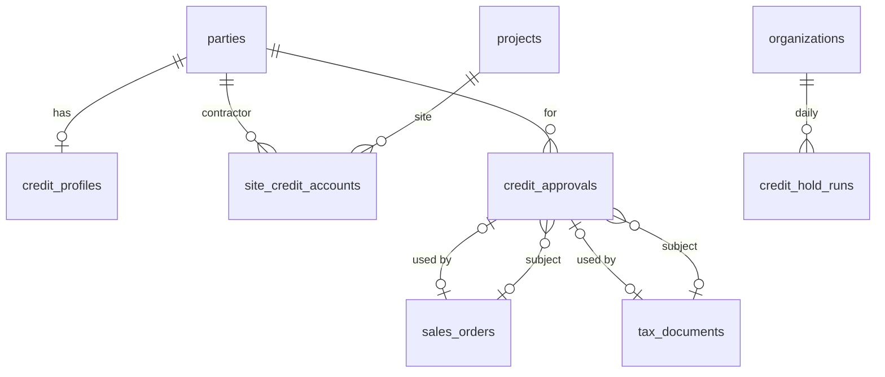
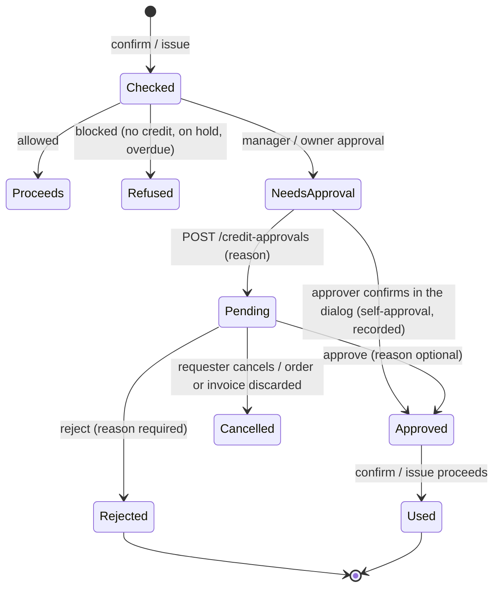

# MVP 3 — Credit, Receivables & Multi-Brand Money (Release 2.1): design spec

|           |                                                                                                                                                                            |
| --------- | -------------------------------------------------------------------------------------------------------------------------------------------------------------------------- |
| Release   | 2.1 "Credit, Receivables & Multi-Brand Money" ([roadmap](https://github.com/Avali-Tech/paint-retail-saas-roadmap/blob/main/docs/phases/phase-2-commerce-finance-paint.md)) |
| Modules   | P2-M09 – M12, P2-M32 – M36                                                                                                                                                 |
| Branch    | feature PRs → `mvp-3`                                                                                                                                                      |
| Builds on | MVP 2 on `mvp-3` at migration `0068` (commit `1ad6626`)                                                                                                                    |
| Status    | Draft for product-owner review. Ageing and statement rules need CA sign-off (§8); BSP and payment gateway are open ([PO-1], [PO-2]).                                       |

**How to read it.** §1 is what we build. §2 is the round 1 contract between the two parallel
sessions, written first so both can start. §3 is the data model, §4 the money rules, §5 the API and
screens, §6 the modules that come after round 1, §7 the build order and §8 the open questions.
`[CA-n]` and `[PO-n]` point to §8.

---

## 1. Scope

### 1.1 In Release 2.1

| ID     | Module                                    | What ships                                                                                                                                                                                               | Done when (roadmap)                                                                                                             |
| ------ | ----------------------------------------- | -------------------------------------------------------------------------------------------------------------------------------------------------------------------------------------------------------- | ------------------------------------------------------------------------------------------------------------------------------- |
| P2-M09 | Credit approval, limit enforcement, sites | Live exposure; projected exposure checked at order confirm and at credit-invoice issue; approval requests routed to a manager or the owner; automatic overdue hold with approved release; site accounts  | The spec §6.3 example (limit ₹30,000, outstanding ₹18,000, order ₹15,000) asks for approval, through real invoices and payments |
| P2-M10 | Receivables & ageing                      | Dashboard (outstanding, due today, due this week, overdue, utilisation, top customers); ageing 0–30 / 31–60 / 61–90 / 90+ by customer, salesperson, store                                                | Ageing figures match the party ledger exactly                                                                                   |
| P2-M11 | Collections                               | Worklist per salesperson; call / WhatsApp / note / promise-to-pay / record payment / escalate / hold; scheduled reminders (SMS and email until a BSP exists)                                             | A broken promise-to-pay date escalates automatically                                                                            |
| P2-M12 | Customer ledger & statements              | Statement for any date range, opening and closing balance, PDF in en / hi / te; share by a signed, expiring link and `wa.me`                                                                             | A contractor receives their statement on WhatsApp in 2 clicks                                                                   |
| P2-M32 | WhatsApp messages & UPI payment links     | Messaging and payment-link provider interfaces with a `log` provider; templates (invoice, receipt, statement, reminder, order ready); opt-in / opt-out; payment links; webhook auto-match and allocation | A reminder paid by UPI is recorded and allocated with no manual entry (with the `log` gateway until [PO-2])                     |
| P2-M33 | Brand scheme, target & rebate tracker     | Schemes with periods, slabs and benefits; progress to next slab from GRNs; expected vs received benefits; claims with ageing; price-hike planner (research)                                              | Per brand: distance to the next slab and benefits still outstanding                                                             |
| P2-M34 | Brand statement reconciliation            | Import a brand statement (CSV / Excel; PDF is research) with a mapping template per brand; match against GRNs, scheme credit notes and recorded brand payments; list mismatches                          | A month's brand statement reconciles with mismatches listed                                                                     |
| P2-M35 | Brand profitability                       | True margin per brand, product and store: sales − cost + schemes − credit cost − loyalty paid; side by side; CSV                                                                                         | The owner answers "which brand makes me the most money?" for any period                                                         |
| P2-M36 | Painter points from invoices              | Points to the influencer of an invoice by rules (per ₹ or per litre, brand multiplier); reversed by credit notes; WhatsApp notice through P2-M32                                                         | A tagged invoice creates points and queues the painter's WhatsApp notice                                                        |

### 1.2 Out of Release 2.1

| Out                                                    | Where it goes                  | What 2.1 leaves ready                                                                               |
| ------------------------------------------------------ | ------------------------------ | --------------------------------------------------------------------------------------------------- |
| P2-M08 SaaS subscriptions with a gateway               | Manual invoicing (PO decision) | Nothing here depends on it; the platform console keeps plans and flags                              |
| A real WhatsApp BSP and payment gateway                | When [PO-1] / [PO-2] answer    | Provider interfaces, `log` providers, outbox, webhook endpoint shape, signed statement links (§6.4) |
| Supplier ledger, purchase invoices, input tax (P2-M17) | 2.2                            | P2-M34 matches GRNs and scheme credit notes; matching supplier invoices waits for P2-M17            |
| Price lists and discounts by role (P2-M13 – M15)       | 2.2                            | P2-M35 reads the price actually billed on each line                                                 |
| Credit scoring, credit intelligence (spec §7.4)        | Phase 3                        | Approval history, holds and ageing are kept for it                                                  |
| Interest on overdue amounts                            | [PO-6]                         | Ageing per document makes it a query                                                                |
| Loyalty catalogue, KYC, UPI payouts (P2-M27)           | 2.5                            | P2-M36 writes to the P1-M26 points ledger; redemption stays manual                                  |

### 1.3 What 2.1 uses from 2.0

| 2.0 piece                                                                     | Used by                                                                            |
| ----------------------------------------------------------------------------- | ---------------------------------------------------------------------------------- |
| `party_ledger` (append-only) and `party_balances` (`postPartyLedger`)         | Exposure (M09), statements (M12), ageing totals (M10)                              |
| `allocations` (append-only, opening balances via `party_ledger_id`)           | Outstanding per document: ageing (M10), site exposure (M09), auto-allocation (M32) |
| `tax_documents.due_on`, `project_id`, `influencer_party_id`                   | Ageing (M10), site accounts (M09), painter points (M36)                            |
| `checkCredit` (`@paint/shared`), `credit_profiles`, `credit_rules`            | Approval routing (M09)                                                             |
| `sales_orders.credit_check` and the 2.0 override columns                      | The approval request replaces the in-dialog override (M09, §4.3)                   |
| `sales_settings.billing_live_on`, `go_live_openings`, `opening_overdue_since` | Exposure source and overdue days (§4.7 of the MVP 2 spec)                          |
| `payments.gateway_reference`                                                  | Auto-matching gateway payments (M32)                                               |
| Notifier, email outbox, the background worker                                 | Approval notices, auto hold (M09), reminders and escalation (M11), messages (M32)  |
| `GET /parties/:id/ledger` with `openDocuments`                                | Statement body (M12), collection worklist (M11)                                    |
| Quotation PDF (pdfkit, Noto fonts)                                            | Statement PDF (M12)                                                                |

---

## 2. Round 1 contract (sessions 1a and 1b)

Round 1 runs two sessions in parallel. **1a [migrations]** builds P2-M09. **1b** builds P2-M10 and
P2-M12 with **no migrations**, on the existing `party_ledger`, `allocations` and `due_on`. This
section is what each may rely on from the other; anything not here is private to its session.

### 2.1 File ownership

| Area                                                                                                  | Owner | The other session                                    |
| ----------------------------------------------------------------------------------------------------- | ----- | ---------------------------------------------------- |
| `packages/db` (schema, migrations 0069+, snapshots, journal, migrate and data-migration tests)        | 1a    | Must not touch                                       |
| `apps/api/src/credit/**`, `apps/api/src/orders/order-credit.ts`, invoice-issue credit gate            | 1a    | Read only                                            |
| `packages/shared/src/credit.ts`, `credit-api.ts` (new)                                                | 1a    | Imports only                                         |
| `apps/api/src/receivables/**` (new), `apps/api/src/statements/**` (new)                               | 1b    | Read only                                            |
| `packages/shared/src/receivables.ts`, `receivables-api.ts` (new)                                      | 1b    | 1a imports nothing from it in round 1                |
| Web: `apps/web/src/credit/**`, order and POS credit prompts, customer 360 credit section              | 1a    | —                                                    |
| Web: `apps/web/src/receivables/**` (new), statement screen and share                                  | 1b    | —                                                    |
| `apps/web/src/i18n/{en,hi,te}-credit.ts`                                                              | 1a    | 1b adds `{en,hi,te}-receivables.ts`                  |
| Shared touch points: `app.module.ts`, `routes.tsx`, nav, `i18n/{en,hi,te}.ts` index, README API table | both  | Append only; resolve conflicts by keeping both sides |

### 2.2 Definitions both sessions use

| Term                | Definition (India dates from the database clock, `(now() at time zone 'Asia/Kolkata')::date`)                                                                                              |
| ------------------- | ------------------------------------------------------------------------------------------------------------------------------------------------------------------------------------------ |
| Open document       | An issued invoice, bill of supply or debit note, or an `opening` party-ledger entry, whose outstanding is above 0 (the existing `OpenDocumentView`)                                        |
| Outstanding(d)      | `total(d) − Σ allocations to d` (payments, credit notes and reversals; cancelled documents excluded)                                                                                       |
| Due date            | `tax_documents.due_on`; for an opening balance, `credit_profiles.opening_overdue_since` when set, else the go-live date                                                                    |
| Days past due       | `asOf − due date` (negative = not yet due)                                                                                                                                                 |
| Ageing bucket       | `not_due` (< 0), `d0_30` (0–30), `d31_60`, `d61_90`, `d90_plus` (> 90) days past due ([CA-1]: due date, not invoice date)                                                                  |
| Balance             | `party_balances.balance_paise` = `Σ party_ledger` = `Σ outstanding − advance` (MVP 2 §4.6)                                                                                                 |
| Advance             | `party_balances.advance_paise` (unallocated money); shown as its own row in ageing, never spread over buckets                                                                              |
| Exposure (credit)   | `balance + open postpaid order value` after go-live; the hand-entered figure before (§4.1). 1b shows "credit utilisation" as `exposure ÷ limit` by calling 1a's existing `creditSummaryOf` |
| Salesperson         | `customer_profiles.assigned_member_id`; parties without one group under "Unassigned"                                                                                                       |
| Store of a document | `tax_documents.store_id`; of an opening balance, the party's home store, else "Business-wide"                                                                                              |

The ageing invariant 1b tests for every party and every `asOf`:
`Σ buckets − advance = balance at asOf` (the party ledger's running balance on that day).

### 2.3 What 1a gives 1b

- `exposureOf`, `creditSummaryOf` and `creditRulesOf` in `apps/api/src/credit/credit-lookups.ts`
  keep their signatures (1a may add optional parameters only).
- Site accounts (§3.3) filter documents by `tax_documents.project_id`. 1b's ageing takes an optional
  `projectId` filter from day one so the site screen can link to it; 1a's site view computes its own
  figures with the same bucket edges (§2.2), and a round 5 test checks both agree.

### 2.4 What 1b gives 1a

- Nothing 1a depends on in round 1. In round 2, collections (P2-M11) builds its worklist on 1b's
  `GET /receivables/ageing` and `GET /parties/:id/statement`.

### 2.5 Merge order

1a merges first (it carries the migrations); 1b rebases on it. Neither changes the other's tests.

---

## 3. Data model

### 3.1 Conventions (unchanged from MVP 1 and 2)

| Convention             | How it applies here                                                                                                                                  |
| ---------------------- | ---------------------------------------------------------------------------------------------------------------------------------------------------- |
| Tenant isolation       | `organization_id`, RLS policy `<table>_tenant_isolation`, `UNIQUE (organization_id, id)`                                                             |
| Composite foreign keys | `(organization_id, x_id) → parent (organization_id, id)`                                                                                             |
| Money                  | `bigint` paise (`_paise`); percentages as integers; ratios computed with `BigInt` (as `checkCredit` does)                                            |
| Dates                  | Business dates are India `date`; instants `timestamptz`; "today" always from the database clock                                                      |
| Audit                  | `audit_row_change()` triggers on every new table that decides money or credit                                                                        |
| Numbering              | `nextDocumentNumber(tx, org, key)` + `formatDocumentNumber` (`AP-000001` for approvals)                                                              |
| Background jobs        | Worker job pattern: `pg_try_advisory_xact_lock`, explicit `organization_id` filter, one transaction per business, one run per business per India day |
| Retries                | `Idempotency-Key` on create endpoints that move money or credit                                                                                      |

### 3.2 Round 1a (P2-M09): new and changed objects, migrations 0069–0071



| Table / change                 | Key columns                                                                                                                                                                                                                                                                                                                                                                                                                                                        | Rules                                                                                                                                                                                                                                              |
| ------------------------------ | ------------------------------------------------------------------------------------------------------------------------------------------------------------------------------------------------------------------------------------------------------------------------------------------------------------------------------------------------------------------------------------------------------------------------------------------------------------------ | -------------------------------------------------------------------------------------------------------------------------------------------------------------------------------------------------------------------------------------------------- |
| `credit_approvals` (new)       | `number` (`AP-000001`), `kind` (`sale` / `release`), `party_id`, `project_id` (site, nullable), `store_id`, `sales_order_id` or `tax_document_id` (sale), `level` (`manager` / `owner`), `amount_paise`, `check` (jsonb: `checkCredit` result and position at request), `reason`, `status` (`pending` / `approved` / `rejected` / `cancelled` / `used`), `requested_by`, `decided_by`, `decided_at`, `decision_reason`, `waive_overdue_until` (release), `used_at` | A sale approval names exactly one subject; a release names none. One pending approval per subject and per party release (partial unique indexes). Rejection needs a reason. `used` only from `approved`. Audited (status, level, amount, decision) |
| `site_credit_accounts` (new)   | `party_id` (contractor), `project_id` (site), `limit_paise`, `status` (`active` / `on_hold` / `closed`), `hold_reason`, `held_at`, `held_by`, `notes`, `created_by`                                                                                                                                                                                                                                                                                                | `UNIQUE (organization_id, party_id, project_id)`; limit > 0; the party holds the project as customer or as a project party; limit ≤ the party's limit (API). Audited (limit, status, hold reason)                                                  |
| `credit_hold_runs` (new)       | `run_on` (India date), `ran_at`, `held_count`                                                                                                                                                                                                                                                                                                                                                                                                                      | One per business per day (unique); append-only like `reconciliation_runs`                                                                                                                                                                          |
| `credit_profiles` (changed)    | add `hold_kind` (`manual` / `auto`), `overdue_waived_until` (date)                                                                                                                                                                                                                                                                                                                                                                                                 | An automatic hold has no member (`held_by` null when `hold_kind = 'auto'`); a trigger refuses changes to `manual_exposure_paise` and `overdue_days` once `billing_live_on` is set (MVP 2 §4.7). Audit adds `hold_kind`, `overdue_waived_until`     |
| `sales_orders` (changed)       | add `credit_approval_id`                                                                                                                                                                                                                                                                                                                                                                                                                                           | Set when a confirm uses an approval; the 2.0 override columns are filled from it, so old and new orders read the same                                                                                                                              |
| `tax_documents` (changed)      | add `credit_check` (jsonb), `credit_approval_id`                                                                                                                                                                                                                                                                                                                                                                                                                   | Written once, in the issuing update; part of the issued, immutable document                                                                                                                                                                        |
| `notification_event` (changed) | add `credit_approval_requested`, `credit_approval_decided`, `credit_hold_applied`                                                                                                                                                                                                                                                                                                                                                                                  | Existing notifier and outbox                                                                                                                                                                                                                       |
| Permissions                    | add `credit:approve_sale` (owners, admins, branch managers)                                                                                                                                                                                                                                                                                                                                                                                                        | Data migration grants it to existing system roles; owner-level approvals stay with the Owner role                                                                                                                                                  |

### 3.3 Site accounts (P2-M09, research)

**Reuse.** A site is the existing `projects` row (P1-M08), already on quotations, orders and invoices
as `project_id` (P2-M31). A site account adds only a limit and a status for one contractor on one
project; it never holds its own ledger. Everything else is a view over documents with that
`project_id` and that party:

| Site figure | Source                                                                                                                              |
| ----------- | ----------------------------------------------------------------------------------------------------------------------------------- |
| Outstanding | Σ outstanding of the party's open documents with `project_id` = site                                                                |
| Open orders | Unbilled value of the party's open postpaid orders with that `project_id`                                                           |
| Exposure    | Outstanding + open orders (advances are not site money, so they never lower a site's exposure)                                      |
| Ledger view | The site's documents, oldest first: each invoice / debit note with its allocations (payments, credit notes) and running outstanding |
| Ageing      | The site's open documents in the §2.2 buckets                                                                                       |
| Roll-up     | The contractor's own exposure already includes every site; a sale on a site is checked against both (§4.2)                          |

**Built in 1a (core):** the table, CRUD, hold / release, site exposure and its check at confirm and
issue, the site view with ledger and ageing, and the screen. **Research, later:** sites billed to a
homeowner but guaranteed by the contractor (a second liable party), per-site credit days, and site
statements on WhatsApp (round 2 with P2-M12's share).

### 3.4 Later rounds (summary; each owning session details its tables before coding)

| Round | Module         | New tables (draft)                                                                                                                                             |
| ----- | -------------- | -------------------------------------------------------------------------------------------------------------------------------------------------------------- |
| 2a    | P2-M11, P2-M32 | `promises_to_pay`, `collection_escalations`, `reminder_schedules`; `message_outbox`, `messaging_consents`, `message_templates`; activity type `promise_to_pay` |
| 2a    | P2-M36         | `loyalty_earn_rules` (per ₹ or per litre, brand multiplier); `loyalty_ledger.kind` gains `influencer`; `tax_document_id` reused                                |
| 3a    | P2-M32         | `payment_links` (party, documents, amount, provider, status, `gateway_reference`, expiry), `gateway_events` (raw webhooks, idempotent)                         |
| 4a    | P2-M33         | `brand_schemes`, `brand_scheme_slabs`, `brand_scheme_benefits`, `brand_claims`, `brand_benefit_receipts`                                                       |
| 5a    | P2-M34         | `brand_statement_templates`, `brand_statement_imports`, `brand_statement_lines`, `brand_statement_matches`                                                     |

---

## 4. Money and credit rules

### 4.1 Exposure

```text
before go-live:  exposure = credit_profiles.manual_exposure_paise         (read-write)
after go-live:   exposure = party_balances.balance_paise
                          + Σ open postpaid order value (confirmed / partly fulfilled,
                            unbilled quantity × line total ÷ quantity, rounded per line)
                 manual_exposure_paise and overdue_days are read-only (API 409 and trigger)
projected        = exposure + amount of the sale being checked
overdue days     = today − min(due date of open documents), never below 0
```

The order being confirmed is excluded from "open postpaid order value" (it is the amount checked).
An invoice raised from a postpaid order moves value from "open orders" to the ledger, so issuing it
never changes exposure and needs no second check.

### 4.2 Where projected exposure is checked

| Moment                                                                           | Amount checked                                            | Check                                                                                                       |
| -------------------------------------------------------------------------------- | --------------------------------------------------------- | ----------------------------------------------------------------------------------------------------------- |
| Confirm a postpaid order                                                         | Order total                                               | `checkCredit(rules, party position, total)`; with a site account, also the site position; the stricter wins |
| Issue an invoice not from a postpaid order, leaving money unpaid (after go-live) | What stays unpaid after the payments taken with the issue | Same, after the invoice and payments are posted in the issuing transaction                                  |
| Walk-in bill                                                                     | —                                                         | Paid in full (MVP 2 rule); never on credit                                                                  |
| Before go-live                                                                   | Invoices are not checked; orders use the manual figures   | The hand-entered exposure is too stale to refuse a bill on                                                  |

"Stricter" orders decisions as `allowed < manager_approval < owner_approval < blocked`. A site check
uses the site's limit and status, the contractor's overdue days and the business rules.

### 4.3 Approval routing (the 2.0 override becomes a request)



| Rule              | Detail                                                                                                                                                                                             |
| ----------------- | -------------------------------------------------------------------------------------------------------------------------------------------------------------------------------------------------- |
| Level             | `manager_approval` → `manager`; `owner_approval` → `owner`; `blocked` is never approvable (put the party on credit, or release the hold)                                                           |
| Who approves      | `manager`: a member with `credit:approve_sale` at the subject's store; `owner`: a member with the Owner role. Never the requester ([PO-3])                                                         |
| Who is told       | `credit_approval_requested` to those approvers; `credit_approval_decided` to the requester; neither to the person who acted                                                                        |
| Waiting           | While an approval is pending the order cannot be confirmed and the invoice cannot be issued (409 `credit_approval_pending`)                                                                        |
| Using an approval | Valid when approved, unused, at a level ≥ the level now needed, and the projected exposure now ≤ the projected exposure approved; otherwise a new approval is needed (409 `credit_approval_stale`) |
| Self-approval     | A member who may approve the level can still approve inside the confirm or issue dialog (`creditOverride: {reason}`): an approval row is written already approved by them and used at once         |
| Audit             | `credit_approvals` status, level, amount and decision are audited; orders and invoices keep the approval id and the check they ran                                                                 |

### 4.4 Automatic credit hold

| Rule      | Detail                                                                                                                                                                                                                      |
| --------- | --------------------------------------------------------------------------------------------------------------------------------------------------------------------------------------------------------------------------- |
| When      | Once per business per India day, from the background worker, after go-live                                                                                                                                                  |
| Who       | Active profiles whose overdue days (§4.1, from the oldest open document past its due date) exceed `credit_rules.hold_after_overdue_days`, and whose `overdue_waived_until` is not today or later                            |
| Effect    | `status = on_hold`, `hold_kind = auto`, reason "Overdue N days (automatic)", no member; `credit_hold_applied` to the party's store's `credit:manage` holders and to `credit:approve` holders                                |
| Job shape | `pg_try_advisory_xact_lock` per business, explicit `organization_id` filter, one transaction per business inside `withTenant`, recorded in `credit_hold_runs` so a second server or a second tick does nothing              |
| Release   | Only with approval: an approver releases directly, or staff with `credit:manage` ask (`kind = release` approval) and an approver approves. Releasing an automatic hold may waive the overdue block up to a date (≤ 90 days) |
| Waiver    | While `overdue_waived_until ≥ today`, `checkCredit` ignores the overdue block for the party and the job skips it; utilisation rules still apply                                                                             |

### 4.5 Ageing and statements (P2-M10, P2-M12)

```text
for every party p and day asOf:
  open(p, asOf)     = documents issued on or before asOf with outstanding(asOf) > 0
  outstanding(d, asOf) = total(d) − Σ allocations to d created on or before asOf (India date)
  bucket(d, asOf)   = §2.2 on asOf − due date
  Σ buckets − advance(asOf) = Σ party_ledger.amount where entry_on ≤ asOf      (must hold exactly)

statement(p, from, to):
  opening  = Σ party_ledger.amount where entry_on < from
  entries  = party_ledger rows with from ≤ entry_on ≤ to, oldest first, with running balance
  closing  = opening + Σ entries = Σ party_ledger.amount where entry_on ≤ to
```

Statements and ageing are queries; neither stores totals. Allocations dated by their `created_at`
India date is [CA-2] (a payment received on the 31st but allocated on the 2nd).

---

## 5. API contract and screens

### 5.1 Round 1a endpoints (P2-M09)

| Method and path                                                                  | Body / query (short)                                                          | Returns                                                                                                                                                                     | Permission                                                                      |
| -------------------------------------------------------------------------------- | ----------------------------------------------------------------------------- | --------------------------------------------------------------------------------------------------------------------------------------------------------------------------- | ------------------------------------------------------------------------------- |
| `GET /parties/:id/credit`                                                        | —                                                                             | Existing view + `exposure` breakdown (balance, open orders, advance), `holdKind`, `overdueWaivedUntil`, `sites` summary                                                     | `credit:read`                                                                   |
| `GET /credit-approvals?status&kind&partyId&mine&limit&offset`                    | `mine=true`: those the member may decide                                      | Page of approvals, pending oldest first                                                                                                                                     | `credit:read`                                                                   |
| `GET /credit-approvals/:id`                                                      | —                                                                             | Approval with the check at request and the check now                                                                                                                        | `credit:read`                                                                   |
| `POST /credit-approvals`                                                         | `{salesOrderId \| invoiceId, reason}` or `{kind: 'release', partyId, reason}` | Pending approval (201); 409 when not needed, blocked or already pending                                                                                                     | `sales:manage` (order), `billing:issue` (invoice), `credit:manage` (release)    |
| `POST /credit-approvals/:id/approve`                                             | `{reason?, waiveOverdueUntil?}` (release)                                     | Approved (a release applies at once)                                                                                                                                        | `credit:approve_sale` (manager), Owner role (owner), `credit:approve` (release) |
| `POST /credit-approvals/:id/reject`                                              | `{reason}`                                                                    | Rejected                                                                                                                                                                    | as approve                                                                      |
| `POST /credit-approvals/:id/cancel`                                              | —                                                                             | Cancelled                                                                                                                                                                   | the requester, or an approver                                                   |
| `POST /sales-orders/:id/confirm`                                                 | `{creditOverride?: {reason}}` (unchanged shape)                               | Order; 409 `credit_approval_required` / `credit_approval_pending` / `credit_approval_stale` / `credit_blocked` / `credit_override_not_allowed` with `credit` and `approval` | `sales:manage`                                                                  |
| `POST /invoices/:id/issue`                                                       | adds `creditOverride?: {reason}`                                              | Issued invoice; same 409 codes                                                                                                                                              | `billing:issue`                                                                 |
| `GET /invoices/:id/credit-check?unpaidPaise=`                                    | —                                                                             | The credit view for issuing the draft on credit                                                                                                                             | `billing:issue`                                                                 |
| `POST /parties/:id/credit/release`                                               | `{reason, waiveOverdueUntil?}`                                                | Credit view                                                                                                                                                                 | `credit:approve`                                                                |
| `GET /parties/:id/sites`, `POST /parties/:id/sites`                              | `{projectId, limitPaise, notes?}`                                             | Site accounts with exposure                                                                                                                                                 | `credit:read` / `credit:approve`                                                |
| `GET /site-accounts/:id`                                                         | —                                                                             | Site with exposure, ledger view and ageing                                                                                                                                  | `credit:read`                                                                   |
| `PATCH /site-accounts/:id`, `POST /site-accounts/:id/hold`, `/release`, `/close` | limit, notes / reason                                                         | Site account                                                                                                                                                                | `credit:approve` (limit, release, close), `credit:manage` (hold)                |

### 5.2 Round 1b endpoints (P2-M10, P2-M12)

| Method and path                                                                                   | Returns                                                                                                                                                               | Permission   |
| ------------------------------------------------------------------------------------------------- | --------------------------------------------------------------------------------------------------------------------------------------------------------------------- | ------------ |
| `GET /receivables/summary?storeId&asOf`                                                           | Total outstanding, due today, due this week (today … today + 6), overdue, advance, utilisation of credit parties, top 10 outstanding                                  | `sales:read` |
| `GET /receivables/ageing?groupBy=party\|salesperson\|store&storeId&projectId&asOf&q&limit&offset` | Rows with the five buckets, advance and balance; totals; CSV with `format=csv`                                                                                        | `sales:read` |
| `GET /parties/:id/ageing?asOf&projectId`                                                          | The party's open documents with bucket and days past due                                                                                                              | `sales:read` |
| `GET /parties/:id/statement?from&to&projectId`                                                    | Opening, entries with running balance, closing, open documents (§4.5)                                                                                                 | `sales:read` |
| `GET /parties/:id/statement/pdf?from&to&lang=en\|hi\|te`                                          | A4 PDF (pdfkit, Noto fonts), "Statement of account"                                                                                                                   | `sales:read` |
| `POST /parties/:id/statement/share`                                                               | `{from, to, lang}` → `{url, expiresAt, whatsappUrl}`: a signed link (HMAC of org, party, period, lang and expiry; 7 days, [PO-4]) and `https://wa.me/<mobile>?text=…` | `sales:read` |
| `GET /public/statements/:token`                                                                   | The PDF, outside tenant scope like public branding; 404 for a bad or expired token; no listing                                                                        | none         |

### 5.3 Screens

| Screen                                 | Session | Key behaviour                                                                                                                                                                                                         |
| -------------------------------------- | ------- | --------------------------------------------------------------------------------------------------------------------------------------------------------------------------------------------------------------------- |
| Credit approvals (`/credit/approvals`) | 1a      | Queue of pending approvals the member may decide (oldest first), filters, each with party, subject, amount, level, the check then and now; approve / reject with a reason                                             |
| Approval prompt (order, POS)           | 1a      | When confirm or issue answers a credit 409: the figures (limit, exposure, projected, %), the level needed, "Ask for approval" with a reason, or "Approve now" when the member may; a pending request shows its status |
| Customer 360 credit section            | 1a      | Live exposure (balance + open orders − advance) next to the limit, source (manual / ledger), overdue days, hold kind, waiver, sites                                                                                   |
| Site accounts                          | 1a      | On the customer 360 credit section and `/site-accounts/:id`: limit, exposure, ledger view, ageing, hold / release                                                                                                     |
| Receivables (`/receivables`)           | 1b      | Dashboard tiles, ageing table with group-by and store filter, CSV                                                                                                                                                     |
| Statement                              | 1b      | Party → Statement: period picker, preview, PDF, "Share on WhatsApp" (2 clicks: Share, then WhatsApp)                                                                                                                  |

---

## 6. Modules after round 1

### 6.1 P2-M11 Collections (round 2a)

| Piece        | Design                                                                                                                                                                                 |
| ------------ | -------------------------------------------------------------------------------------------------------------------------------------------------------------------------------------- |
| Worklist     | Per salesperson (§2.2): overdue parties from the ageing query, oldest bucket first, with last activity, open promise and next step                                                     |
| Actions      | Call, WhatsApp, note (activities, P1-M09); promise to pay (`promises_to_pay`: amount, date, status open / kept / broken); record payment (existing); escalate; credit hold (M09)       |
| Promise kept | Allocations to the party between the promise and its date cover the promised amount                                                                                                    |
| Escalation   | Worker job (M09 pattern): a promise past its date and not kept becomes `broken`, an escalation goes to the salesperson's branch manager and the party's store `credit:approve` holders |
| Reminders    | `reminder_schedules` per business (days before / after due); SMS and email through the outbox until a BSP exists; WhatsApp through `message_outbox` with the `log` provider            |

### 6.2 P2-M32 WhatsApp messages and UPI payment links (rounds 2a and 3a)

| Piece              | Design                                                                                                                                                                                                                                                |
| ------------------ | ----------------------------------------------------------------------------------------------------------------------------------------------------------------------------------------------------------------------------------------------------- |
| Messaging provider | `interface MessagingProvider { send(message: TemplateMessage): Promise<{providerRef}> }`, as `SmsSender`: `log` (dev and tests, prints), `disabled` (default), a BSP adapter later ([PO-1]). `MESSAGING_PROVIDER` env, refused as `log` in production |
| Outbox             | `message_outbox` (party, channel, template, variables, status, attempts, provider ref); the worker sends with retries like email                                                                                                                      |
| Consent            | `messaging_consents` per party and channel: opted in (when, how), opted out; nothing is sent without opt-in ([CA-3] / DPDP Act)                                                                                                                       |
| Templates          | invoice, receipt, statement, payment reminder, order ready / dispatched, points earned; variables only, approved by the BSP later                                                                                                                     |
| Until a BSP        | Every "send on WhatsApp" opens `wa.me/<mobile>?text=…` with a signed, expiring link (statement, invoice, receipt), which needs no BSP                                                                                                                 |
| Payment provider   | `interface PaymentLinkProvider { create(link): Promise<{url, gatewayReference}>; verify(webhook): GatewayEvent }`: `log` (creates `upi://pay?...` intent links and accepts a signed test webhook) and a gateway adapter later ([PO-2])                |
| Auto-allocation    | A verified, new `gateway_events` row records a payment (`gateway_reference` unique per business) and allocates it with the 2.0 allocation service to the link's documents, oldest first; the rest is an advance                                       |

### 6.3 P2-M33 – M35 Brand money (rounds 3b, 4a, 4b, 5a)

| Module | Design                                                                                                                                                                                                                                                                                                                                                                                                                                                                                                                                      |
| ------ | ------------------------------------------------------------------------------------------------------------------------------------------------------------------------------------------------------------------------------------------------------------------------------------------------------------------------------------------------------------------------------------------------------------------------------------------------------------------------------------------------------------------------------------------- |
| M33    | A scheme per brand: period, products or categories, slabs (target in ₹ or litres), benefit (rebate %, ₹ per litre, free quantity, gift / trip points). Progress from GRNs of that brand in the period (purchases at cost, scheme-free units counted as litres, not value, [CA-4]). Expected vs received: expected credit notes and free goods against what the brand issued (entered, later imported in M34). Claims list with ageing. Price-hike planner (research): stock-up value against holding cost, cash tied up and dead-stock risk |
| M34    | Import CSV / Excel with a mapping template per brand (columns, date format, sign convention); lines matched to GRNs (supplier invoice number), scheme credit notes and brand payments by reference, date window and amount; unmatched on either side listed. PDF import is research. Full supplier-ledger matching waits for P2-M17                                                                                                                                                                                                         |
| M35    | Per brand, product and store for a period: sales (taxable value of invoices − credit notes) − cost (stock ledger average cost of units sold) + schemes received and expected − credit cost (average days of credit given × outstanding × the business's cost of money, [PO-5]) − loyalty points paid on that brand                                                                                                                                                                                                                          |

### 6.4 P2-M12 share without a BSP

The signed link is stateless: `base64url(payload).base64url(HMAC-SHA256(key, payload))` with the key
derived from `AUTH_SECRET` (as TOTP secrets are). The public endpoint renders the PDF on request, so
a statement always shows the ledger as of that day for the period chosen; the link cannot be revoked
before it expires ([PO-4]).

### 6.5 P2-M36 painter points (round 2b)

| Rule      | Design                                                                                                                        |
| --------- | ----------------------------------------------------------------------------------------------------------------------------- |
| Who earns | The invoice's `influencer_party_id` with an active loyalty account and the painter or contractor role                         |
| How much  | `loyalty_earn_rules`: per ₹ of taxable value or per litre, with an optional brand multiplier; the best matching rule per line |
| Reversal  | A credit note on the invoice takes back points in proportion to the value credited (the existing reversal hook)               |
| Notice    | A `points_earned` message to the painter through `message_outbox` (P2-M32, `log` provider until [PO-1])                       |
| Bill-to   | The 2.0 bill-to earning stays as it is; [PO-7] decides whether bill-to and influencer may both earn on one invoice            |

---

## 7. Delivery plan

Rules: at most **2 parallel sessions** per round; **exactly one session per round is marked
[migrations]** and only it adds migrations (numbers continue from the last merged one); it commits its
schema and migrations first, on their own, so the other session can rebase on them; each round merges
into `mvp-3` as a whole and leaves the product working. Every session ships unit, integration and e2e
tests with 100 % coverage and `pnpm verify` green.

Risk order: credit is enforced on real money (M09) → receivables reconcile to the ledger (M10, M12)
→ money comes in by itself (M11, M32) → brand money (M33 – M35).

### Round 1 — credit is enforced, receivables are visible

| Session                            | Builds                                                                                                                                                                                                                                                           | Depends on |
| ---------------------------------- | ---------------------------------------------------------------------------------------------------------------------------------------------------------------------------------------------------------------------------------------------------------------- | ---------- |
| 1a [migrations] Credit enforcement | P2-M09: migrations 0069–0071 (§3.2), live exposure, check at confirm and issue, approval requests and queue, routing and notices, self-approval, automatic hold job, approved release with waiver, site accounts; screens (approvals, prompt, 360 credit, sites) | MVP 2      |
| 1b Receivables and statements      | P2-M10 summary and ageing (party, salesperson, store, site filter), P2-M12 statement JSON and PDF, signed link and `wa.me` share; screens                                                                                                                        | MVP 2, §2  |

**Demo:** the spec §6.3 example through real invoices and a payment asks the owner for approval, the
owner approves from the queue and the order confirms; an opening balance overdue 45 days puts the
account on automatic hold overnight and an approver releases it with a waiver; a contractor's site has
its own limit and refuses an order the contractor's own limit would allow; ageing equals the party
ledger for every demo party; a contractor's statement opens on WhatsApp in 2 clicks.

### Round 2 — collections and painter points

| Session                                   | Builds                                                                                                                                                                                    | Depends on |
| ----------------------------------------- | ----------------------------------------------------------------------------------------------------------------------------------------------------------------------------------------- | ---------- |
| 2a [migrations] Collections and messaging | P2-M11 (promises, worklist, escalation job, reminder schedules), the messaging half of P2-M32 (outbox, consents, templates, `MessagingProvider` with `log`), and the P2-M36 tables (§3.4) | Round 1    |
| 2b Painter points                         | P2-M36 earning, reversal, rules screen and the points-earned message, coding against 2a's committed schema                                                                                | 2a schema  |

**Demo:** a broken promise-to-pay escalates overnight; a reminder goes out on schedule (SMS log,
email in Mailpit, WhatsApp log); a homeowner's invoice tagged with a painter credits the painter's
points and queues the WhatsApp notice.

### Round 3 — money comes in by itself

| Session                           | Builds                                                                                                                                                                       | Depends on |
| --------------------------------- | ---------------------------------------------------------------------------------------------------------------------------------------------------------------------------- | ---------- |
| 3a [migrations] UPI payment links | P2-M32 payment links, `PaymentLinkProvider` with `log`, webhook endpoint, idempotent `gateway_events`, auto-match and allocation; link on reminders, statements and invoices | Round 2    |
| 3b Brand engines                  | Pure `packages/shared/src/brand/`: slab progress, expected benefits, price-hike planner (P2-M33) and the margin formula (P2-M35), with property tests; no database           | —          |

**Demo:** a reminder paid through the `log` gateway's signed webhook is recorded and allocated with no
manual entry, and a replayed webhook changes nothing.

### Round 4 — brand schemes and profitability

| Session                       | Builds                                                                                                            | Depends on    |
| ----------------------------- | ----------------------------------------------------------------------------------------------------------------- | ------------- |
| 4a [migrations] Brand schemes | P2-M33 tables, APIs and screens on 3b's engines: schemes, slabs, progress from GRNs, expected vs received, claims | 3b            |
| 4b Brand profitability        | P2-M35 report and screen (sales, cost, loyalty, credit cost; scheme figures from 4a's committed schema), CSV      | 3b, 4a schema |

**Demo:** per brand, distance to the next slab and benefits outstanding; the owner sees which brand
made the most money last quarter.

### Round 5 — brand statements and pilot readiness

| Session                               | Builds                                                                                                                                                                                | Depends on |
| ------------------------------------- | ------------------------------------------------------------------------------------------------------------------------------------------------------------------------------------- | ---------- |
| 5a [migrations] Brand statement recon | P2-M34 templates, import, matching, mismatch list; any CA-driven fixes                                                                                                                | 4a         |
| 5b Pilot readiness                    | 2.1 demo seed (approvals, holds, sites, promises, schemes), scale of ageing and worklists at large-shop volume, translations, accessibility, the site-vs-ageing agreement test (§2.3) | Rounds 1–4 |

**Demo:** a month's brand statement reconciles with mismatches listed; a pilot shop's collections
morning: worklist, two promises, one UPI payment allocated by itself, ageing and statements reconciled.

---

## 8. Open questions

### For the product owner

| #     | Question                                                                                               | Default if unanswered                                               |
| ----- | ------------------------------------------------------------------------------------------------------ | ------------------------------------------------------------------- |
| PO-1  | Which WhatsApp BSP (Gupshup, Interakt, AiSensy, Meta Cloud API direct)? Registration started in P0-M05 | `log` provider; `wa.me` share links                                 |
| PO-2  | Which payment gateway for UPI links (Razorpay, Cashfree, PayU)? Who pays the fees?                     | `log` gateway with signed test webhooks                             |
| PO-3  | May an approver approve their own sale (they are also the requester)?                                  | Yes, in the dialog, recorded as self-approval; never from the queue |
| PO-4  | How long does a shared statement link live?                                                            | 7 days                                                              |
| PO-5  | Cost of money for P2-M35's credit cost (per business setting)?                                         | 12 % a year                                                         |
| PO-6  | Interest on overdue invoices?                                                                          | Out of 2.1                                                          |
| PO-7  | May the bill-to and the influencer both earn points on one invoice?                                    | Yes                                                                 |
| PO-8  | Should a branch manager approve manager-level sales only at their own stores?                          | Yes (store access applies)                                          |
| PO-9  | Enforce credit on invoices before go-live too?                                                         | No (manual figures are stale)                                       |
| PO-10 | Site accounts for parties other than contractors (builders, institutions)?                             | Any party with credit                                               |
| PO-11 | How many days may a release waive an overdue block?                                                    | Up to 90                                                            |

### For the CA

| #    | Question                                                                                                             | Section |
| ---- | -------------------------------------------------------------------------------------------------------------------- | ------- |
| CA-1 | Ageing by due date (our default) or by invoice date?                                                                 | §2.2    |
| CA-2 | Is an allocation dated by when it was recorded, or by the payment's date, for ageing as of a past day?               | §4.5    |
| CA-3 | Consent records needed for WhatsApp reminders under the DPDP Act 2023 and the BSP's rules                            | §6.2    |
| CA-4 | Scheme-free units: counted toward a slab by litres only, at zero value, and how a later rebate credit note is booked | §6.3    |
| CA-5 | Does a statement of account need any statutory wording, and is a Telugu or Hindi statement acceptable?               | §5.2    |
| CA-6 | Brand rebates received as credit notes vs as cash discounts: effect on our purchase cost in P2-M35                   | §6.3    |
