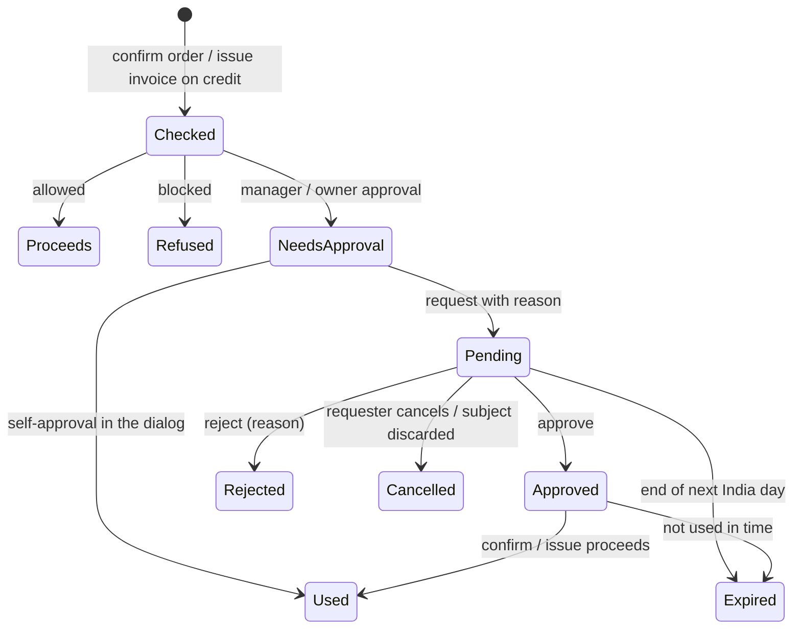
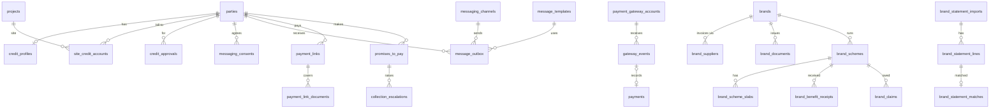

# MVP 3 — Credit, Receivables & Multi-Brand Money (Release 2.1): build spec

|           |                                                                                                                                                                                                                                                                                                                   |
| --------- | ----------------------------------------------------------------------------------------------------------------------------------------------------------------------------------------------------------------------------------------------------------------------------------------------------------------- |
| Release   | 2.1 "Credit, Receivables & Multi-Brand Money" ([roadmap](https://github.com/Avali-Tech/paint-retail-saas-roadmap/blob/main/docs/phases/phase-2-commerce-finance-paint.md#release-21--credit-receivables--multi-brand-money))                                                                                      |
| Modules   | P2-M09 – M12, P2-M32 – M36                                                                                                                                                                                                                                                                                        |
| Branch    | feature PRs → `mvp-3`                                                                                                                                                                                                                                                                                             |
| Builds on | MVP 2 on `mvp-3` at migration `0068` (commit `1ad6626`)                                                                                                                                                                                                                                                           |
| In flight | PR #48 (P2-M10 ageing, P2-M12 statements, no migration); branch `wip/mvp3-credit-enforcement` (P2-M09, migrations 0069–0071, "not yet verified"), which also carries an earlier draft, `docs/mvp-3/credit-and-receivables.md`. This spec replaces that draft and keeps its decisions where they still hold (§1.4) |
| Shares    | The payment-gateway port with P2-M08 SaaS subscriptions, which is built in parallel (§5.3)                                                                                                                                                                                                                        |
| Status    | Draft for product-owner review. The WhatsApp, consent, payment-link and brand-money rules still need sign-off from the CA and legal counsel (§7)                                                                                                                                                                  |

**How to read it.** §1 is what we build and what already exists. §2 is the rules, each numbered
(`CR-3`, `PL-4`) so a test can name the rule it checks; rules that come from law or a platform cite
their source. §3 is the data model, §4 the API and screens, §5 the WhatsApp and payment-gateway
integrations. §6 is the build order and §7 the questions that block or shape it. `[PO-n]`, `[CA-n]`
and `[PI-n]` point to questions for the product owner, the CA (and legal counsel), and the pilots.

The product sells paint **and hardware** (the demo shop is "Sharma Paints & Hardware"). Every
brand-money rule below works for any brand and any unit (litres, kilograms, pieces), not only for paint.

---

## 1. Scope

### 1.1 In Release 2.1

| ID     | Module                                    | What ships                                                                                                                                                                                                      | Done when (roadmap)                                                                         |
| ------ | ----------------------------------------- | --------------------------------------------------------------------------------------------------------------------------------------------------------------------------------------------------------------- | ------------------------------------------------------------------------------------------- |
| P2-M09 | Credit approval, limits and site accounts | Credit checked at order confirm **and** at invoice issue; approval requests in a queue, routed to a manager or the owner; automatic overdue hold with approved release; site sub-accounts with their own limits | The spec §6.3 example (limit ₹30,000, owed ₹18,000, order ₹15,000) raises an owner approval |
| P2-M10 | Receivables and ageing                    | Dashboard tiles; ageing in five buckets by customer, salesperson, store and site; CSV                                                                                                                           | Ageing matches the party ledger exactly, for every party and any as-of day                  |
| P2-M11 | Collections                               | Worklist per salesperson; call, WhatsApp, note, promise-to-pay, record payment, escalate, hold; scheduled reminders                                                                                             | A broken promise-to-pay escalates automatically                                             |
| P2-M12 | Customer ledger and statements            | Statement for any period (customer or site), PDF in en / hi / te, stored and shared by link or WhatsApp                                                                                                         | A contractor receives their statement on WhatsApp in 2 clicks                               |
| P2-M32 | WhatsApp messages and UPI payment links   | Messaging and payment-gateway ports with fakes, then real adapters; consent records; template catalogue; payment links; signed webhooks; automatic recording and allocation                                     | A reminder paid by UPI is recorded and allocated with no manual entry                       |
| P2-M36 | Painter points from invoices              | Points to the invoice's influencer by rules (per ₹ or per unit, brand multiplier); reversed by notes; WhatsApp notice                                                                                           | A tagged ₹50,000 invoice creates +500 points and notifies the painter on WhatsApp           |
| P2-M34 | Brand statement reconciliation            | Import a brand statement (CSV / Excel) through a per-brand template; match against GRNs and brand credit notes; mismatch list                                                                                   | A month's brand statement reconciles, with mismatches listed for follow-up                  |
| P2-M35 | Brand profitability                       | True margin per brand, product and store: net sales − cost of goods + scheme benefits − credit cost − loyalty cost                                                                                              | The owner can answer "which brand makes me the most money?" for any period                  |
| P2-M33 | Brand scheme, target and rebate tracker   | Schemes with periods, slabs and benefits; progress to the next slab, live from GRNs; expected vs received benefits; claims with ageing                                                                          | Per brand: distance to the next slab and which benefits are still outstanding               |

The table is in build order (§6). The brand scheme tracker is last on purpose: its import shapes and
slab rules must come from the pilots' real scheme circulars ([PI-1]).

### 1.2 Out of Release 2.1

| Out                                                      | Where it goes | What 2.1 leaves ready                                                                                                 |
| -------------------------------------------------------- | ------------- | --------------------------------------------------------------------------------------------------------------------- |
| P2-M08 SaaS subscriptions                                | Parallel spec | The shared payment-gateway port and `gateway_events` store (§5.3)                                                     |
| Supplier ledger, supplier invoices, payables (P2-M17)    | 2.2           | Brand statement payment lines are listed and totalled, not matched (BR-6); `brand_documents` holds brand credit notes |
| Purchase returns                                         | 2.2           | Scheme progress counts GRNs only (BS-4)                                                                               |
| Dealer's own schemes and pass-through (P2-M15)           | 2.2           | Brand schemes have ids a customer scheme can link to                                                                  |
| Price-hike planner (part of P2-M33)                      | 2.2 ([PO-12]) | Brand price changes are already dated product prices                                                                  |
| PDF statement import                                     | Research      | CSV and Excel only (BR-1)                                                                                             |
| Marketing WhatsApp (offers, campaigns, broadcast)        | Phase 3       | The `marketing` template category exists and is refused at send (WA-4)                                                |
| WhatsApp order capture, chatbot                          | 3.2           | Inbound messages are stored; only opt-out keywords are acted on (CN-4)                                                |
| Refunds through the gateway                              | Later         | Refunds stay the 2.0 manual refund                                                                                    |
| Interest on overdue invoices                             | [PO-9]        | Ageing per document makes it a query                                                                                  |
| Credit scoring                                           | Phase 3       | Approval, hold and promise history is kept for it                                                                     |
| Loyalty catalogue, painter KYC, UPI payouts, fraud rules | 2.5 (P2-M27)  | Points live in the P1-M26 ledger; redemption stays manual                                                             |

### 1.3 What exists and what is missing

Surveyed on `mvp-3` at `1ad6626` (identical to `mvp-2`), plus the two in-flight branches.

| Area                    | Exists (merged)                                                                                                                                                                                                                                                                                                                | In flight                                                                                                                                                     | Missing for 2.1                                                                                                                           |
| ----------------------- | ------------------------------------------------------------------------------------------------------------------------------------------------------------------------------------------------------------------------------------------------------------------------------------------------------------------------------ | ------------------------------------------------------------------------------------------------------------------------------------------------------------- | ----------------------------------------------------------------------------------------------------------------------------------------- |
| Credit profiles, rules  | `credit_profiles` (0033; `opening_overdue_since` 0060), `credit_requests` (limit-change approvals), `credit_rules` (80 / 100 / 30 days); `checkCredit`, `creditApprovalFor`, `canOverrideCredit` in `@paint/shared`; `exposureOf` in `apps/api/src/credit/credit-lookups.ts` (ledger + open postpaid orders after go-live)     | `wip/mvp3-credit-enforcement`: `credit_approvals`, `site_credit_accounts`, `credit_hold_runs`, approval queue, hold job, site screens (0069–0071, unverified) | Credit check at invoice issue; approval queue for sales; automatic hold; site limits; `credit:approve_sale`                               |
| Order credit override   | `sales_orders.credit_check`, `credit_override_*` (0060); refusals `credit_blocked`, `credit_approval_required`, `credit_override_not_allowed`                                                                                                                                                                                  | Same WIP branch                                                                                                                                               | An approval record the override points to                                                                                                 |
| Contracts               | `contracts` (0030–0032): generic agreements with free-text credit and discount terms; renewal reminders                                                                                                                                                                                                                        | —                                                                                                                                                             | Nothing for 2.1. Contracts enforce no limit or price; 2.1 does not change that                                                            |
| Loyalty                 | `loyalty_accounts`, append-only `loyalty_ledger` (0036–0038, `tax_document_id` 0060), `loyalty_settings` (1 point per ₹100, tiers, expiry); round 4a `earnLoyaltyForInvoice` credits the **bill-to** party; `reverseLoyaltyForNote`, `reverseLoyaltyForCancel`                                                                 | —                                                                                                                                                             | Influencer (painter) earning, earn rules per brand or unit, points notice                                                                 |
| Party ledger, payments  | `party_ledger` (append-only), `party_balances`, `payments` with `gateway_reference` (accepted, never matched), `allocations` with reversals; `receivePayment`, `planAllocations` (oldest first, rest is advance), `openTargets` in `posting.ts`; cheque bounce; opening balances (`go_live_openings`)                          | —                                                                                                                                                             | Gateway payments, a `source` on payments, site (project) on payments                                                                      |
| Reconciliation          | `reconciliation_runs` / `findings` (0065–0066): stock on hand, reserved, party balance, allocation; nightly                                                                                                                                                                                                                    | —                                                                                                                                                             | Ageing and site checks join it (AG-5, SA-6)                                                                                               |
| Receivables, statements | Ledger endpoint `GET /parties/:id/ledger`; reports `sales-by-influencer`, `sales-by-site`                                                                                                                                                                                                                                      | PR #48: `packages/shared/src/receivables/` (ageing engine, statement view), `/receivables`, `/parties/:id/statement(.pdf)`, `wa.me` share                     | Stored statement PDFs, a share link that carries the PDF, site statements                                                                 |
| Notifications           | In-app + email to **members** only; `email_outbox`; `SmsSender` (login OTP only, `log` / `disabled`); one worker on `setInterval` with advisory locks                                                                                                                                                                          | —                                                                                                                                                             | Any message to a party; WhatsApp; templates; consent; delivery receipts                                                                   |
| Payment gateway         | Nothing (no gateway, no webhook endpoint)                                                                                                                                                                                                                                                                                      | P2-M08 session (worktree `subscriptions`, nothing committed yet)                                                                                              | Port, fake, adapter, links, webhooks, auto-allocation                                                                                     |
| PDFs and documents      | pdfkit; `renderReceiptPdf` and `renderQuotationPdf` served on the fly; S3 documents with ClamAV                                                                                                                                                                                                                                | PR #48 statement PDF (on the fly)                                                                                                                             | `renderInvoicePdf` is **not wired to any endpoint**; nothing is stored for sharing                                                        |
| Projects (sites)        | `projects` (0021), `project_parties` (architect / contractor / painter / dealer); `project_id` on quotations, orders, invoices                                                                                                                                                                                                 | WIP site accounts                                                                                                                                             | Site limits, site exposure, site payments                                                                                                 |
| Influencers             | `influencer_party_id` on quotations, orders, invoices and credit notes; `INFLUENCER_ROLES` = painter, contractor, architect                                                                                                                                                                                                    | —                                                                                                                                                             | Earning                                                                                                                                   |
| Brands, purchasing      | `brands` (name, active); `products.brand_id` required; `goods_receipts` with `supplier_invoice_number` / `date`; `goods_receipt_lines` with `free_quantity` and `unit_cost_paise`; `stock_balances.avg_cost_paise`; variants with `pack_size` + `unit` (`ml l g kg piece set m`); `tax_documents.scheme_reference` (free text) | —                                                                                                                                                             | Schemes, slabs, claims, brand documents, statement import, brand ↔ supplier link, supplier invoice totals, cost of goods on invoice lines |

### 1.4 Corrections to the 2.0 spec, and what this spec keeps from the earlier draft

| Finding                                                                                                      | Effect on 2.1                                                                               |
| ------------------------------------------------------------------------------------------------------------ | ------------------------------------------------------------------------------------------- |
| sell-and-bill §1.2 says 2.0 checks credit "at order and invoice time"; the code checks only at order confirm | CR-2 adds the invoice-issue check; a test proves a direct credit invoice is checked         |
| sell-and-bill §1.2 says invoice and receipt PDFs are stored in S3; none are                                  | Round 2 stores the PDFs it shares (ST-5, WA-6)                                              |
| sell-and-bill §1.3 says painter points use `influencer_party_id`; 4a credits the bill-to party               | PP-1 adds influencer earning; bill-to earning stays as it is                                |
| Earlier draft: 2 sessions per round, brand engines in round 3                                                | Now up to 3 sessions per round, brand work last and gated on pilot documents (§6)           |
| Earlier draft: `credit_approvals`, `site_credit_accounts`, hold job, exposure and bucket definitions         | **Kept** (§2.1 – §2.3); round 1a finishes and verifies the WIP branch instead of restarting |
| Earlier draft: stateless HMAC statement links that cannot be revoked                                         | Replaced by stored, revocable `share_links` to a stored PDF (ST-5)                          |

---

## 2. Domain rules

### 2.1 Definitions

All "today" values come from the database clock in India time, `(now() at time zone 'Asia/Kolkata')::date`.

| Term           | Definition                                                                                                                                                      |
| -------------- | --------------------------------------------------------------------------------------------------------------------------------------------------------------- |
| Open document  | An issued invoice, bill of supply or debit note, or an `opening` / charge `adjustment` ledger entry, with outstanding > 0                                       |
| Outstanding(d) | `total(d) − Σ allocations to d` (payments, credit notes, reversals). Cancelled documents are excluded                                                           |
| Due date       | `tax_documents.due_on`; for an opening balance, `opening_overdue_since` when set, else the go-live date ([CA-7])                                                |
| Days past due  | `asOf − due date`; negative means not yet due                                                                                                                   |
| Balance        | `party_balances.balance_paise` = `Σ party_ledger.amount_paise` = `Σ outstanding − advance` (sell-and-bill §4.6)                                                 |
| Advance        | `party_balances.advance_paise`: money received and not allocated, plus unused credit notes                                                                      |
| Exposure       | After go-live: `balance + Σ uninvoiced value of confirmed or partly fulfilled postpaid orders`; before go-live: `manual_exposure_paise` (existing `exposureOf`) |
| Projected      | `exposure + amount being checked`                                                                                                                               |
| Utilisation    | `projected × 100 ÷ limit`, computed with `BigInt` as `checkCredit` does                                                                                         |
| Overdue days   | `today − min(due date of open documents)`, never below 0                                                                                                        |
| Salesperson    | `customer_profiles.assigned_member_id`; parties without one are "Unassigned"                                                                                    |
| Site           | A `projects` row. A **site account** is a limit for one bill-to party on one project (§2.3)                                                                     |

### 2.2 Credit approval and limits (P2-M09)

| #     | Rule                                                                                                                                                                                                                                                      | Checked by                                                     |
| ----- | --------------------------------------------------------------------------------------------------------------------------------------------------------------------------------------------------------------------------------------------------------- | -------------------------------------------------------------- |
| CR-1  | Exposure and overdue days are computed, never stored, after go-live. `PATCH` of `manual_exposure_paise` or `overdue_days` after `billing_live_on` returns 409 and a trigger refuses it                                                                    | Existing test + new trigger test                               |
| CR-2  | Credit is checked at: confirming a postpaid order (amount = order total); issuing an invoice not from a postpaid order that leaves money unpaid (amount = total − payments taken with the issue); never for a fully paid walk-in bill                     | Integration: a direct ₹15,000 credit invoice is checked        |
| CR-3  | An invoice billed from a postpaid order is not checked again: its value moves from "open orders" to the ledger, so exposure does not change                                                                                                               | Exposure before = after issue                                  |
| CR-4  | Decision = `checkCredit(rules, position, amount)`: `allowed` < `manager_approval` < `owner_approval` < `blocked`. Rules 80 / 100: the §6.3 example (₹30,000 limit, ₹18,000 owed, ₹15,000 order = 110 %) gives `owner_approval`                            | Unit and API test of the example                               |
| CR-5  | `blocked` (no credit, on hold, overdue beyond `hold_after_overdue_days`) is never approvable; it is resolved by giving credit or releasing the hold                                                                                                       | 409 `credit_blocked`                                           |
| CR-6  | `manager_approval` is decided by a member holding `credit:approve_sale` **at the subject's store**; `owner_approval` by a member with the Owner role. A requester never decides their own request from the queue                                          | Permission tests per role and store                            |
| CR-7  | One pending approval per subject (order or invoice) and per party release. A rejection needs a reason. Statuses: pending → approved / rejected / cancelled / expired; approved → used                                                                     | Partial unique index; state-machine unit test                  |
| CR-8  | An approval can be used only if it is approved, unused, at a level ≥ the level needed now, not expired (default end of the next India day, [PO-4]), and the projected exposure now ≤ the projected exposure approved. Else 409 `credit_approval_stale`    | Test: a payment-less extra invoice in between makes it stale   |
| CR-9  | A member who may approve the level can approve inside the confirm or issue dialog with a reason; this writes an approval row already approved by them and used at once ("self-approval"), shown as such ([PO-3])                                          | Approval row has `requested_by = decided_by` and `self = true` |
| CR-10 | Automatic hold: once per business per India day, active profiles with overdue days > `hold_after_overdue_days` and no waiver covering today go `on_hold` with `hold_kind = auto`, reason "Overdue N days (automatic)". A second run that day does nothing | Job test, run twice                                            |
| CR-11 | Releasing any hold needs `credit:approve` (directly, or by approving a `release` request). Releasing an automatic hold may waive the overdue block until a date ≤ today + 90 days ([PO-5]); while waived, utilisation rules still apply                   | Test: waived party at 110 % still needs the owner              |
| CR-12 | A bounced cheque does not hold credit by itself; it notifies (existing `cheque_bounced`) and the bounced amount reopens the bills, which then age ([PO-6])                                                                                                | Bounce leaves `status` unchanged                               |
| CR-13 | Every change of limit, status, hold kind, waiver, and every approval decision is audited (`audit_row_change`); orders and invoices keep the check they ran (`credit_check` jsonb) and the approval id                                                     | Audit rows exist after each action                             |



### 2.3 Site sub-accounts (P2-M09)

A site account is a limit and a status for one bill-to party (usually a contractor) on one
project. It has **no ledger of its own**: every site figure is a filter of the party's documents
by `project_id`, so the party ledger stays the only source of truth.

| #    | Rule                                                                                                                                                                                                             | Checked by                                                   |
| ---- | ---------------------------------------------------------------------------------------------------------------------------------------------------------------------------------------------------------------- | ------------------------------------------------------------ |
| SA-1 | One account per (party, project); limit > 0 and ≤ the party's limit; the party is the project's customer or one of its `project_parties`                                                                         | Unique index; API 422                                        |
| SA-2 | Site outstanding = Σ outstanding of the party's open documents with that `project_id`; site exposure = site outstanding + uninvoiced value of the party's open postpaid orders with that `project_id`            | Unit test on the shared engine                               |
| SA-3 | Advances are party money, not site money: they never lower a site's exposure                                                                                                                                     | Test: a ₹10,000 advance leaves site exposure unchanged       |
| SA-4 | A sale carrying a `project_id` that has a site account is checked against the site **and** the party (CR-4); the stricter decision wins. A sale on a project without a site account is checked on the party only | Test: site refuses an order the party limit would allow      |
| SA-5 | A site on hold blocks credit sales on that site only; closing a site needs site outstanding = 0                                                                                                                  | 409 `site_on_hold`, `site_has_outstanding`                   |
| SA-6 | Invariant, in the nightly reconciliation: Σ site outstanding over the party's sites + outstanding of the party's documents on no site account = Σ outstanding of the party                                       | New finding kind `site_outstanding`                          |
| SA-7 | A payment may name a site (`payments.project_id`). It then allocates oldest-first to that site's open documents, and any rest follows the 2.0 default (oldest first across the party, then advance)              | Test: a site payment never pays another site's invoice first |
| SA-8 | Site credit days are the party's credit days in 2.1 ([PI-4])                                                                                                                                                     | —                                                            |

### 2.4 Customer statements (P2-M12)

| #    | Rule                                                                                                                                                                                                                                                              | Checked by                                                  |
| ---- | ----------------------------------------------------------------------------------------------------------------------------------------------------------------------------------------------------------------------------------------------------------------- | ----------------------------------------------------------- |
| ST-1 | Party statement for `from … to`: opening = Σ ledger before `from`; entries = ledger rows in the period, oldest first, with running balance; closing = opening + Σ entries = Σ ledger up to `to`                                                                   | Property test (PR #48)                                      |
| ST-2 | A site statement lists the site's documents in the period with their allocations and the running site outstanding; opening = site outstanding at `from − 1`. It never shows unallocated payments                                                                  | Σ site statement closing = SA-2 outstanding                 |
| ST-3 | Each statement ends with the ageing of open documents on `to` and the bills due; amounts in Indian grouping (₹8,50,000)                                                                                                                                           | Snapshot test                                               |
| ST-4 | Labels in en / hi / te; the title "Statement of Account" is always also in English; dates are printed beside labels, never inside a translation                                                                                                                   | Snapshot per language                                       |
| ST-5 | Sharing stores the PDF as a document (`document_category = statement`) and creates a `share_links` row (token, expiry default 7 days, [PO-7]). The public link serves that stored PDF, so the customer sees what was shared even if the ledger changes later      | Test: a payment after sharing does not alter the shared PDF |
| ST-6 | A share link can be revoked; a revoked or expired link returns 404 with no detail. Every open is counted (`opened_count`, `last_opened_at`)                                                                                                                       | Test: revoke then fetch                                     |
| ST-7 | Two clicks: on the party (or site, or a receivables row) **Statement** opens this FY to today in the party's `preferred_language`; **Send on WhatsApp** sends the `statement` template when the party has opted in (CN-1), else opens `wa.me` with the share link | e2e: 2 clicks to a queued message                           |
| ST-8 | A statement shows a UPI payment link (and its QR) for the closing balance when the business has a gateway connected and the balance > 0 (PL-1)                                                                                                                    | Snapshot with and without gateway                           |

### 2.5 Receivables ageing (P2-M10)

The ageing engine and screens are built in PR #48. These rules are what it must keep and what 2.1 adds.

| #    | Rule                                                                                                                                                                                             | Checked by                                      |
| ---- | ------------------------------------------------------------------------------------------------------------------------------------------------------------------------------------------------ | ----------------------------------------------- |
| AG-1 | Buckets by days past the **due date** ([CA-1]): `not_due` (< 0), `0–30`, `31–60`, `61–90`, `90+`. "Overdue" = 1 day or more; "due this week" = as-of day and the six after                       | Unit tests on the edges (−1, 0, 30, 31, 90, 91) |
| AG-2 | Advance is a separate column, never spread over buckets. **Σ buckets − advance = balance** at the as-of day, for every party                                                                     | Property test over random books                 |
| AG-3 | Ageing works as of any past day: an allocation counts from the later of its two ends' dates; a bounce from its bounce date ([CA-2])                                                              | Property test: every day of a random history    |
| AG-4 | Group by customer, salesperson, store or site; the store of an opening balance is the party's home store, else "Business-wide". A store filter refuses (404) a store the member does not work at | Permission tests                                |
| AG-5 | The nightly reconciliation adds `ageing`: for every party, today's Σ buckets − advance = `party_balances.balance_paise`                                                                          | Finding raised on a forced mismatch             |
| AG-6 | Dashboard tiles: total outstanding, due today, due this week, overdue, advance, credit utilisation of credit parties, top 10 outstanding                                                         | API test on the demo seed                       |

### 2.6 Collections, promise-to-pay and escalation (P2-M11)

| #     | Rule                                                                                                                                                                                                                                           | Checked by                                           |
| ----- | ---------------------------------------------------------------------------------------------------------------------------------------------------------------------------------------------------------------------------------------------- | ---------------------------------------------------- |
| CO-1  | Worklist for a member: parties assigned to them (managers: their stores' parties) with overdue > 0, ordered by oldest bucket, then overdue amount; each row shows last activity, open promise, next reminder                                   | API test ordering                                    |
| CO-2  | Call, WhatsApp and note are P1-M09 `activities` on the party (activity type gains `promise_to_pay` and `collection_note`); record payment is the 2.0 payment                                                                                   | Activity row per action                              |
| CO-3  | A promise has amount > 0 and ≤ overdue + due this week, a date from today to today + 60 days ([PO-8]), optional site; one open promise per party (per site when given)                                                                         | 422 on each limit                                    |
| CO-4  | A promise is **kept** when payments in received from its creation day to its date (inclusive, net of later bounces) ≥ its amount. It is evaluated by the daily job on the day after its date, plus a grace of `promise_grace_days` (default 1) | Job tests: exact, short by ₹1, bounced later         |
| CO-5  | A promise not kept becomes **broken** and raises an escalation: level 1 to the salesperson's branch manager(s); level 2 to the owner when the party has a second broken promise in 90 days or overdue days > `hold_after_overdue_days`         | Notification recipients test                         |
| CO-6  | A bounced cheque that made a promise "kept" turns it to broken on the bounce date and escalates                                                                                                                                                | Test                                                 |
| CO-7  | Escalations are acknowledged (with a note) or resolved by payment; they are append-only events, never edited                                                                                                                                   | Trigger test                                         |
| CO-8  | Reminder schedule per business: offsets from the due date (default −3, 0, +7, +15, +30 days). At most one reminder per party per day, combining every document due; only to parties with consent on that channel (CN-1); only 09:00–20:00 IST  | `reminder_log` unique (party, day); time-window test |
| CO-9  | Reminders stop for a document once it is paid, and for a party while it has an open promise not yet due                                                                                                                                        | Job test                                             |
| CO-10 | Reminder channel order: WhatsApp (when connected and consented), then email, then SMS ([PO-10]); every reminder with an amount > 0 carries a payment link when a gateway is connected                                                          | Channel-selection unit test                          |

### 2.7 WhatsApp messages (P2-M32)

**Platform rules** (Meta, checked 16 Oct 2026; Meta changes them, so the BSP adapter is re-checked each round):

| Rule                                                                                                                                                 | What it means for us                                                                                     | Source                                                                               |
| ---------------------------------------------------------------------------------------------------------------------------------------------------- | -------------------------------------------------------------------------------------------------------- | ------------------------------------------------------------------------------------ |
| Outside a 24-hour customer-service window opened by the customer, only **approved templates** may be sent                                            | Every message we start is a template; free text only as a reply inside an open window (not built in 2.1) | [Meta pricing](https://developers.facebook.com/docs/whatsapp/pricing)                |
| Templates are categorised marketing, utility or authentication; Meta may change the category it assigns                                              | We store the category Meta approved, per template per WABA, and send only `utility` in 2.1               | Same                                                                                 |
| Per-message pricing since 1 Jul 2025: charged when a template is delivered; utility templates inside an open window are free                         | Cost per delivered message is recorded from the BSP's delivery receipt; a monthly count per business     | Same                                                                                 |
| India: WABAs of India-billed customers must move to INR billing by 31 Dec 2026, or messages stop from 1 Jan 2027                                     | The BSP must bill the WABA in INR ([PO-1])                                                               | Same                                                                                 |
| Opt-in is required before messaging; it must name the business and say the person agrees to receive messages; opt-out of categories must be honoured | Consent rules CN-1 – CN-6                                                                                | [Meta opt-in](https://developers.facebook.com/docs/whatsapp/overview/getting-opt-in) |
| Low quality (blocks, reports) leads to rate limits                                                                                                   | Daily cap per number (setting) and the quiet-hours window of CO-8                                        | Same                                                                                 |

**Our rules:**

| #    | Rule                                                                                                                                                                                                                                                                                    | Checked by                                |
| ---- | --------------------------------------------------------------------------------------------------------------------------------------------------------------------------------------------------------------------------------------------------------------------------------------- | ----------------------------------------- |
| WA-1 | Each business sends from **its own** WhatsApp number (WABA), connected through the BSP, so the message names the shop ([PO-1]). No business sends from another's number                                                                                                                 | Channel belongs to one `organization_id`  |
| WA-2 | Template catalogue (platform-defined, versioned): `invoice_issued`, `receipt_issued`, `statement_ready`, `payment_reminder_due`, `payment_reminder_overdue`, `promise_confirmed`, `order_ready`, `points_earned`, `points_redeemed`; each in en, hi, te                                 | Catalogue unit test: every key × language |
| WA-3 | A template is sendable for a business only when its status for that WABA is `approved`; a `paused` or `rejected` template falls back to `wa.me` share (manual) for staff-initiated sends and to email for scheduled ones                                                                | Fallback unit test                        |
| WA-4 | Category `marketing` is refused at send in 2.1                                                                                                                                                                                                                                          | 422 `template_category_not_allowed`       |
| WA-5 | Variables are data-minimal: party first name, shop name, document number, amount, due date, points. Never GSTIN, address, the bill-to's name in a painter's message, or another party's data                                                                                            | Snapshot of rendered variables            |
| WA-6 | Documents (invoice, receipt, statement) go as the template's document header from a stored PDF (ST-5) by short-lived URL; the payment link goes in a **URL button with a dynamic suffix** on our own fixed domain (`https://<pay-domain>/p/{{1}}`), which redirects to the gateway link | Rendered payload test                     |
| WA-7 | Every message is an outbox row, sent by the worker after the business transaction commits; the outbox row's id is the idempotency key to the provider, so a retry never sends twice                                                                                                     | Retry test with the fake                  |
| WA-8 | Delivery receipts (sent, delivered, read, failed) update the outbox row's status forward only; failures keep the provider's error code                                                                                                                                                  | Out-of-order receipts test                |

### 2.8 Consent and opt-in (DPDP Act)

| Rule                                                                                                                                                                | What it means for us                                                                       | Source                                                                                                                                                                                                                                      |
| ------------------------------------------------------------------------------------------------------------------------------------------------------------------- | ------------------------------------------------------------------------------------------ | ------------------------------------------------------------------------------------------------------------------------------------------------------------------------------------------------------------------------------------------- |
| Processing needs consent after a notice, or a legitimate use; consent must be free, specific, informed, unambiguous; withdrawing it must be as easy as giving it    | A purpose-specific consent record per channel, and STOP that works from the message itself | DPDP Act 2023 ss.5–7                                                                                                                                                                                                                        |
| DPDP Rules 2025 were notified in Nov 2025; consent-manager rules apply after 12 months and the notice, consent and breach rules after 18 months (about 13 May 2027) | We build to the 2027 standard now, so no pilot data needs re-consent later                 | [PIB explainer](https://static.pib.gov.in/WriteReadData/specificdocs/documents/2025/nov/doc20251117695301.pdf), [AZB summary](https://www.azbpartners.com/bank/update-indias-digital-personal-data-protection-framework-comes-into-effect/) |
| The notice must be clear, separate, and state the specific purpose                                                                                                  | A versioned notice text per language, shown before consent is recorded                     | Same                                                                                                                                                                                                                                        |

The business is the data fiduciary for its customers and painters; we are its processor. Whether
transactional messages to an existing customer may rely on the legitimate use in s.7(a) instead of
consent is [CA-3]. **Default: we ask for consent anyway**, because Meta's opt-in rule needs it regardless.

| #    | Rule                                                                                                                                                                                                                                            | Checked by                                       |
| ---- | ----------------------------------------------------------------------------------------------------------------------------------------------------------------------------------------------------------------------------------------------- | ------------------------------------------------ |
| CN-1 | A message to a party is sent only if the party's latest consent for (channel, purpose) is `granted` **at send time** (checked by the worker, not when queued). Purpose in 2.1: `transactional` (bills, receipts, statements, reminders, points) | Test: opt-out between queue and send → `skipped` |
| CN-2 | A consent record holds party, mobile (E.164), channel, purpose, `granted` / `withdrawn`, method (`counter_with_notice`, `signed_form`, `whatsapp_reply`, `web_form`, `import_with_evidence`), notice version and language, member, time         | Schema check; API 422 on missing fields          |
| CN-3 | Consent records are append-only; the current state is the latest row per (party, channel, purpose)                                                                                                                                              | Trigger test                                     |
| CN-4 | An inbound "STOP" (also `stop`, `unsubscribe`, `रोकें`, `ఆపు`, [PI-6]) records `withdrawn` with method `whatsapp_reply` within the webhook request, and sends nothing more; "START" grants again                                                | Webhook test                                     |
| CN-5 | A changed mobile number does not carry consent over: the new number needs a new record                                                                                                                                                          | Test                                             |
| CN-6 | An import of consent needs an evidence document (scanned form) attached; without one, imported parties start `none`                                                                                                                             | Import test                                      |
| CN-7 | Party merge keeps the stricter state (any `withdrawn` wins)                                                                                                                                                                                     | Merge test                                       |

### 2.9 UPI payment links and automatic allocation (P2-M32)

The business is the merchant: it connects **its own** gateway account, and money goes from the
customer to the business through the gateway. The platform never receives or holds the money
([CA-4]). Gateway rules we rely on, for Razorpay (the default, [PO-2]); other adapters must match them:

| Rule                                                                                                                | Source                                                                     |
| ------------------------------------------------------------------------------------------------------------------- | -------------------------------------------------------------------------- |
| Webhooks carry `X-Razorpay-Signature`, an HMAC-SHA256 of the **raw body** with the webhook secret (not the API key) | [Validate webhooks](https://razorpay.com/docs/webhooks/validate-test)      |
| A webhook may arrive more than once; `x-razorpay-event-id` identifies the event                                     | Same                                                                       |
| A payment link carries a `reference_id` set by us; when a webhook is late, the API can be fetched for the status    | [Payment Links API](https://razorpay.com/docs/payments/payment-links/apis) |

| #     | Rule                                                                                                                                                                                                                                                     | Checked by                                       |
| ----- | -------------------------------------------------------------------------------------------------------------------------------------------------------------------------------------------------------------------------------------------------------- | ------------------------------------------------ |
| PL-1  | A link is for one party, an amount (default: the chosen documents' outstanding; at most the party's balance), optional documents and site, INR, expiry (default 7 days, [PO-7]); `reference_id` = our link id                                            | 422 above balance                                |
| PL-2  | Creating a link for documents that already have an active link cancels the old one at the gateway first. A payment that still arrives on a cancelled or expired link is recorded (the money is real), as an advance-first payment (PL-7)                 | Fake: pay a cancelled link                       |
| PL-3  | The webhook is verified on the raw body with the account's secret before anything is parsed; a bad signature gets 401 and is not stored                                                                                                                  | Test with a tampered body                        |
| PL-4  | The business is found from the URL's `accountKey` (random, per connected account), never from the body                                                                                                                                                   | Test: valid signature, wrong key → 401           |
| PL-5  | Every verified event is stored once in `gateway_events` (unique provider + event id). A payment is created once per gateway payment id (unique per business): a replayed or duplicate event changes nothing                                              | Replay test: one payment, one ledger row         |
| PL-6  | The payment, its ledger entry and its allocations are written in one transaction; the webhook answers 2xx only after commit, and 5xx on failure so the gateway retries                                                                                   | Fault-injection test                             |
| PL-7  | Allocation: the link's documents first, oldest due first, each up to its outstanding at that moment; then the 2.0 default (oldest open documents of the party, then advance). A site link applies SA-7                                                   | Test: one document paid meanwhile at the counter |
| PL-8  | The payment: `source = gateway`, mode kind from the method the gateway reports (UPI, card, net banking → a mapped payment mode), `received_on` = India date of capture, store = the link's store, receipt number from the RC series, no register session | Field test                                       |
| PL-9  | Amount recorded = amount the customer paid; the gateway fee is stored on the event and never reduces what the party paid ([CA-5])                                                                                                                        | Test                                             |
| PL-10 | Missed webhooks: hourly, links active or partly paid for over 1 hour are fetched from the gateway; payments found are processed through the same path as a webhook (PL-5 keeps it idempotent)                                                            | Fake drops a webhook; job records it             |
| PL-11 | After a gateway payment: in-app notice to the party's salesperson and store (`payment_received_online`) and a `receipt_issued` message to the party (CN-1)                                                                                               | Notification test                                |
| PL-12 | Without a connected gateway, statements and reminders show a UPI intent QR (`upi://pay?pa=<VPA>&pn=<shop>&am=<amount>&tn=<ref>`) for the business's VPA; such payments are not matched automatically                                                     | Snapshot test                                    |
| PL-13 | Tally: gateway receipts export as Receipts to the mode's ledger (default `Razorpay Clearing`, mapped like any mode)                                                                                                                                      | Mapper fixture                                   |

```mermaid
sequenceDiagram
  participant C as Customer (UPI app)
  participant G as Gateway
  participant W as POST /webhooks/payments/:provider/:accountKey
  participant DB as One transaction
  C->>G: pays link (reference_id = link id)
  G->>W: payment_link.paid (raw body, signature, event id)
  W->>W: find account by accountKey; verify HMAC on raw body
  W->>DB: insert gateway_events (unique event id) — duplicate → 200, stop
  W->>DB: payment (unique gateway payment id), party_ledger −amount
  W->>DB: allocations: link documents → party default → advance
  W->>DB: link status paid / partly_paid; outbox: receipt message, staff notice
  W-->>G: 200 after commit
```

### 2.10 Painter points from invoices (P2-M36)

Round 4a already credits the **bill-to** party (`purchase` on taxable value) and reverses it on
notes and cancellation. 2.1 adds the influencer.

| #    | Rule                                                                                                                                                                                                                                                                                                                   | Checked by                            |
| ---- | ---------------------------------------------------------------------------------------------------------------------------------------------------------------------------------------------------------------------------------------------------------------------------------------------------------------------- | ------------------------------------- |
| PP-1 | When an invoice is issued with an `influencer_party_id` that holds the painter or contractor role ([PO-11]: architects too?) and an active loyalty account, the influencer earns in the issuing transaction                                                                                                            | Integration test                      |
| PP-2 | Points per line from `loyalty_earn_rules`: basis `per_rupee` (paise of taxable value per point) or `per_unit` (points per litre, kg or piece of the line, from `pack_size × qty`); optional brand or category; multiplier in basis points. The most specific matching rule wins (product > category > brand > default) | Pure `influencerPointsFor` unit tests |
| PP-3 | Points per line are floored to whole points, then summed; a default rule of 1 point per ₹100 is seeded, so a ₹50,000 taxable invoice earns 500                                                                                                                                                                         | Done-when test                        |
| PP-4 | One earn row per invoice per influencer: `loyalty_ledger.kind = influence` with `tax_document_id`; unique (tax document, party, kind)                                                                                                                                                                                  | Unique index                          |
| PP-5 | When the bill-to and the influencer are the same party, it earns once, by the influencer rule ([PO-11])                                                                                                                                                                                                                | Test                                  |
| PP-6 | A credit note takes points back in proportion to the taxable value credited per line (rounded up, so no points are kept for value returned); a cancellation takes back all. A balance may go below 0 only through reversals; redemption is refused while below 0                                                       | Tests                                 |
| PP-7 | The influencer cannot be changed after issue (2.0 immutability); a wrong tag is fixed by credit note and re-issue                                                                                                                                                                                                      | Existing trigger                      |
| PP-8 | The `points_earned` message carries points, invoice number, store and new balance; never the homeowner's name or the bill value (WA-5). One per invoice, after commit                                                                                                                                                  | Rendered variables test               |
| PP-9 | Points cost for brand profitability = points × `point_value_paise` (setting, default 100 = ₹1), on the brand of the line that earned them                                                                                                                                                                              | BP-6                                  |

### 2.11 GST and accounting rules for brand money

| Rule                                                                                                                                                     | What it means for us                                                                                                                   | Source                                                                                                                                                                                                                                                     |
| -------------------------------------------------------------------------------------------------------------------------------------------------------- | -------------------------------------------------------------------------------------------------------------------------------------- | ---------------------------------------------------------------------------------------------------------------------------------------------------------------------------------------------------------------------------------------------------------- |
| A discount after supply reduces value only if agreed before the supply, linked to invoices, and the recipient reverses the ITC on it                     | A brand **tax credit note** carries GST; it lowers our purchase cost by its taxable value, and its GST is input credit we must reverse | [CGST s.15(3)(b)](https://taxinformation.cbic.gov.in/content/html/tax_repository/gst/acts/2017_CGST_act/active/chapter4/section15_v1.00.html)                                                                                                              |
| From 1 Oct 2025 the supplier's tax falls only if the recipient has reversed the ITC                                                                      | Same; recorded as `itc_to_reverse_paise` for the accountant, not filed by us in 2.1                                                    | [s.34(2) proviso](https://taxinformation.cbic.gov.in/content/html/tax_repository/gst/acts/2017_CGST_act/active/chapter7/section34_v1.00.html)                                                                                                              |
| A **financial / commercial credit note** (no GST) does not change the supplier's tax; the recipient keeps its ITC                                        | Lowers margin cost by its full amount; no ITC effect                                                                                   | [Circular 92/11/2019-GST](https://gstcouncil.gov.in/sites/default/files/2024-06/circular-cgst-92.pdf); Circular 251/08/2025-GST of 12 Sep 2025 ([summary](https://www.taxmann.com/post/blog/gst-treatment-of-post-sale-discounts-cbic-circular-251-2025/)) |
| Routine dealer discounts are not consideration for a service; separately paid promotional work (display, co-branding) is a taxable service by the dealer | A benefit marked `promotional_service` is flagged for the CA, not counted as a purchase discount                                       | Circular 251/08/2025-GST (same summary)                                                                                                                                                                                                                    |
| Free quantity received under a scheme is entered at zero cost on the GRN (P1-M16)                                                                        | Free units already lower average cost, so margin must **not** add them again (BP-4)                                                    | Existing GRN rule                                                                                                                                                                                                                                          |
| Gifts and trips from a brand may be business perquisites on which the brand deducts TDS                                                                  | Recorded at the brand's declared value as a non-cash benefit, shown apart from margin ([CA-8])                                         | Income-tax s.194R (1961 Act; numbering under the 2025 Act to confirm)                                                                                                                                                                                      |

### 2.12 Brand statement reconciliation (P2-M34)

| #    | Rule                                                                                                                                                                                                                                                                                                                                                                                                                                                               | Checked by                                |
| ---- | ------------------------------------------------------------------------------------------------------------------------------------------------------------------------------------------------------------------------------------------------------------------------------------------------------------------------------------------------------------------------------------------------------------------------------------------------------------------ | ----------------------------------------- |
| BR-1 | Import a CSV or Excel statement for one brand and period through a **template** per brand: header row, column map (date, document number, type, narration, debit, credit or signed amount), date format, sign convention, type mapping (regex on type or narration)                                                                                                                                                                                                | Parser fixtures from pilot files ([PI-2]) |
| BR-2 | An import is refused unless its opening + Σ lines = its closing (when the file states them), so a mis-parsed file never reconciles                                                                                                                                                                                                                                                                                                                                 | Test with a dropped row                   |
| BR-3 | The same file (SHA-256) cannot be imported twice; an overlapping period warns, and lines already imported (same brand document number and type) are skipped                                                                                                                                                                                                                                                                                                        | Tests                                     |
| BR-4 | Line types: `invoice` (brand sold to us), `credit_note`, `debit_note`, `payment`, `opening`, `other`                                                                                                                                                                                                                                                                                                                                                               | Template unit tests                       |
| BR-5 | Matching, per line: an `invoice` to the GRN of a supplier linked to that brand (`brand_suppliers`) whose normalised `supplier_invoice_number` (upper case, spaces and `/ -` removed) is equal; a `credit_note` / `debit_note` to a `brand_documents` row with the same number. Result: `matched` (amount difference ≤ ₹1, setting), `amount_mismatch`, `missing_in_ours`. GRNs and brand documents of that brand in the period with no line are `missing_in_brand` | Matcher unit tests (pure)                 |
| BR-6 | `payment` lines are listed and totalled, not matched, until supplier payments exist (P2-M17)                                                                                                                                                                                                                                                                                                                                                                       | Report test                               |
| BR-7 | GRN amounts compare to `goods_receipts.supplier_invoice_total_paise` (new, entered from the brand's invoice at GRN); a GRN without it is `amount_unknown`, never `matched`                                                                                                                                                                                                                                                                                         | Test                                      |
| BR-8 | A `missing_in_ours` credit note can be accepted, creating a `brand_documents` row (tax or financial, CA rules §2.11) from the line; this is how most received benefits enter the system                                                                                                                                                                                                                                                                            | Test                                      |
| BR-9 | Each mismatch has a follow-up status (open, resolved, ignored with reason); statement lines are immutable after import; match decisions and status changes are audited                                                                                                                                                                                                                                                                                             | Trigger and audit tests                   |

### 2.13 Brand profitability (P2-M35)

For a period, per brand (and drill-down per product and store):

```text
net sales      = Σ taxable value of invoice lines − Σ taxable value of credit-note lines        (brand of the line's product)
cost of goods  = Σ qty sold × unit_cost_paise snapshotted on the line at issue − same for restocked returns
gross margin   = net sales − cost of goods
benefits       = Σ brand_documents taxable value (tax CN) + full value (financial CN) in the period
                 [+ expected and not yet received, from schemes, in the "expected" column, round 5]
credit cost    = rate × Σ_documents (outstanding_paise × days outstanding in the period) ÷ 365   (receivables of the brand's lines)
               − rate × Σ GRN cost of the brand × supplier payment-terms days ÷ 365              (credit the brand gives us)
loyalty cost   = Σ points earned on the brand's lines × point_value_paise
true margin    = gross margin + benefits − credit cost − loyalty cost
```

| #    | Rule                                                                                                                                                                                        | Checked by                                 |
| ---- | ------------------------------------------------------------------------------------------------------------------------------------------------------------------------------------------- | ------------------------------------------ |
| BP-1 | Invoice lines snapshot `unit_cost_paise` from `stock_balances.avg_cost_paise` at issue (new column). Lines issued before the column exists get the current average, marked `cost_estimated` | Issue test; backfill flag test             |
| BP-2 | Credit cost uses `cost_of_money_bps` (setting, default 1200 = 12 % a year, [PO-13]); an invoice's outstanding is shared to its lines by taxable value                                       | Unit test of the formula                   |
| BP-3 | Brand-level amounts (benefits, brand credit) are shared to stores and products by their share of the brand's net sales; Σ over stores = brand total exactly (largest-remainder rounding)    | Property test                              |
| BP-4 | Free quantity is never added as a benefit (it is already in the average cost)                                                                                                               | Test: free units change cost, not benefits |
| BP-5 | Gifts and trips are shown in their own column and are not in true margin by default ([CA-8])                                                                                                | Report test                                |
| BP-6 | Brands side by side, sortable by true margin and margin %; CSV through the reports framework                                                                                                | e2e                                        |

### 2.14 Brand scheme, target and rebate tracker (P2-M33)

Built last (§6), from the pilots' real circulars ([PI-1]). The shapes below are the starting point;
round 5 adjusts them to what the circulars contain, and records each circular as a fixture.

| #     | Rule                                                                                                                                                                                                                                                                                              | Checked by                              |
| ----- | ------------------------------------------------------------------------------------------------------------------------------------------------------------------------------------------------------------------------------------------------------------------------------------------------- | --------------------------------------- |
| BS-1  | A scheme belongs to one brand: name, circular reference and the circular document, period (India dates, inclusive), scope (all the brand's products, or chosen categories / products), basis `value` (purchase taxable value), `volume` (litres, kg or pieces) or `both`                          | Schema checks                           |
| BS-2  | A volume basis has one unit; products whose unit cannot convert to it (ml → l, g → kg; pieces and sets only to pieces) are outside the scheme, listed on the scheme                                                                                                                               | Unit conversion tests                   |
| BS-3  | Slabs ascend strictly; each has a threshold and benefits: `rebate_bps` on eligible value, `paise_per_unit`, free goods (variant, quantity), gift or trip (description, declared value). A slab is `retrospective` (benefit on all eligible purchases) or `incremental` (only above the threshold) | Engine unit tests                       |
| BS-4  | Eligible purchases = GRN lines of in-scope products whose brand invoice date (else GRN date) is in the period; free units count to volume only when the scheme says so ([PI-3]); purchase returns are not netted until 2.2                                                                        | Engine tests with each circular fixture |
| BS-5  | Progress (achieved, current slab, next threshold, shortfall, days left, daily run-rate needed) is computed at read time, so a GRN posted is reflected on the next read                                                                                                                            | API test: post GRN, read progress       |
| BS-6  | Expected benefit = the engine on achieved at period end (provisional before it); rounding half-up to the paise once per scheme                                                                                                                                                                    | Unit tests                              |
| BS-7  | Schemes stack: one GRN line may count toward several schemes                                                                                                                                                                                                                                      | Test                                    |
| BS-8  | Received benefits are `brand_documents` (credit notes) and free-goods GRN lines linked to a scheme, never more than once in total across schemes                                                                                                                                                  | Unique link; test                       |
| BS-9  | After period end + `claim_after_days` (default 30), expected − received > 0 opens a claim; it ages from period end with in-app reminders at 30, 60 and 90 days; it closes when received ≥ expected, or is written off with a reason (audited)                                                     | Job tests                               |
| BS-10 | A circular amended by the brand is a new **version** of the scheme; past versions stay readable; progress and claims use the latest version                                                                                                                                                       | Versioning test                         |

---

## 3. Data model

### 3.1 Conventions (unchanged from MVP 1 and 2)

| Convention             | How it applies here                                                                                                                                                                      |
| ---------------------- | ---------------------------------------------------------------------------------------------------------------------------------------------------------------------------------------- |
| Tenant isolation       | `organization_id`, RLS policy `<table>_tenant_isolation`, `UNIQUE (organization_id, id)`; webhook and public-link tables resolve the tenant by key, then run inside `withTenant`         |
| Composite foreign keys | `(organization_id, x_id) → parent (organization_id, id)`                                                                                                                                 |
| Money and rates        | `bigint` paise (`_paise`); rates and multipliers as `integer` basis points (`_bps`); quantities `numeric(14,3)`                                                                          |
| Dates                  | Business dates India `date`; instants `timestamptz`; "today" from the database clock                                                                                                     |
| Ledgers and events     | Append-only by `REVOKE UPDATE, DELETE` plus a reject trigger (as `party_ledger`, 0055)                                                                                                   |
| Audit                  | `audit_row_change()` on every table that decides money, credit, consent or brand benefits                                                                                                |
| Jobs                   | The existing worker: `pg_try_advisory_xact_lock`, explicit `organization_id`, one transaction per business, a `*_runs` row so a second server or tick does nothing                       |
| Retries                | `Idempotency-Key` on every create that moves money, credit or messages                                                                                                                   |
| Secrets                | Tenant gateway and BSP credentials encrypted with AES-256-GCM under `INTEGRATION_CREDENTIALS_KEY`; never returned by the API (last 4 characters only); changes audited without the value |
| Migrations             | Only the round's [migrations] session adds them; numbers continue from the last merged one (0069 next)                                                                                   |

### 3.2 Overview



### 3.3 New tables, by round

| Round | Table                        | Key columns                                                                                                                                                                                                                                                                                                                                                             | Rules                                                                                                                       |
| ----- | ---------------------------- | ----------------------------------------------------------------------------------------------------------------------------------------------------------------------------------------------------------------------------------------------------------------------------------------------------------------------------------------------------------------------- | --------------------------------------------------------------------------------------------------------------------------- |
| 1a    | `credit_approvals`           | `number` (`AP-000001`), `kind` (`sale` / `release`), `party_id`, `project_id`, `store_id`, `sales_order_id` or `tax_document_id`, `level` (`manager` / `owner`), `amount_paise`, `projected_paise`, `check` (jsonb), `reason`, `status`, `self_approved`, `requested_by`, `decided_by`, `decided_at`, `decision_reason`, `expires_at`, `waive_overdue_until`, `used_at` | CR-7, CR-8; one pending per subject (partial unique); audited                                                               |
| 1a    | `site_credit_accounts`       | `party_id`, `project_id`, `limit_paise`, `status` (`active` / `on_hold` / `closed`), `hold_reason`, `held_at`, `held_by`, `notes`                                                                                                                                                                                                                                       | SA-1, SA-5; audited                                                                                                         |
| 1a    | `credit_hold_runs`           | `run_on`, `ran_at`, `held_count`                                                                                                                                                                                                                                                                                                                                        | Unique (organization, `run_on`); append-only                                                                                |
| 2a    | `messaging_channels`         | `provider`, `phone_e164`, `display_name`, `provider_account_ref`, `credentials_encrypted`, `webhook_key` (random), `status` (`pending` / `connected` / `disconnected`), `daily_cap`                                                                                                                                                                                     | One connected channel per business in 2.1; audited                                                                          |
| 2a    | `message_templates`          | Platform catalogue: `key`, `version`, `language`, `category`, `body` (with `{{n}}`), `variables` (jsonb schema), `header_kind` (`none` / `document`), `button` (`none` / `url_suffix`)                                                                                                                                                                                  | Not tenant-scoped (platform data, read-only to tenants)                                                                     |
| 2a    | `message_template_approvals` | `channel_id`, `template_key`, `version`, `language`, `provider_template_name`, `status` (`submitted` / `approved` / `rejected` / `paused`), `category_assigned`, `checked_at`                                                                                                                                                                                           | WA-3; status from the BSP's template sync                                                                                   |
| 2a    | `messaging_consents`         | `party_id`, `phone_e164`, `channel` (`whatsapp` / `sms` / `email`), `purpose`, `state` (`granted` / `withdrawn`), `method`, `notice_version`, `language`, `evidence_document_id`, `recorded_by`, `recorded_at`                                                                                                                                                          | CN-2, CN-3; append-only                                                                                                     |
| 2a    | `message_outbox`             | `party_id`, `channel_id`, `channel`, `template_key`, `language`, `variables` (jsonb), `document_id`, `button_suffix`, `reason` (`invoice` / `reminder` / …), `reference_type`, `reference_id`, `status` (`queued` / `sent` / `delivered` / `read` / `failed` / `skipped`), `skip_reason`, `attempts`, `next_attempt_at`, `provider_message_id`, `cost_paise`            | Status moves forward only (WA-8); insert after commit (WA-7)                                                                |
| 2a    | `message_events`             | `outbox_id` or `channel_id`, `kind` (`status` / `inbound`), `payload` (jsonb, inbound text kept 90 days), `received_at`                                                                                                                                                                                                                                                 | Append-only                                                                                                                 |
| 2a    | `share_links`                | `token_hash`, `document_id`, `purpose` (`statement` / `invoice` / `receipt` / `points`), `party_id`, `expires_at`, `revoked_at`, `revoked_by`, `opened_count`, `last_opened_at`                                                                                                                                                                                         | ST-5, ST-6; the token is shown once and stored hashed                                                                       |
| 2a    | `payment_gateway_accounts`   | `provider`, `mode` (`test` / `live`), `key_id`, `credentials_encrypted`, `webhook_secret_encrypted`, `account_key` (random, in the webhook URL), `status`, `connected_by`                                                                                                                                                                                               | One live account per business; audited                                                                                      |
| 2a    | `payment_links`              | `number` (`PL-000001`), `account_id`, `party_id`, `project_id`, `store_id`, `amount_paise`, `paid_paise`, `expires_at`, `gateway_link_id`, `short_url`, `status` (`created` / `partly_paid` / `paid` / `cancelled` / `expired`), `created_by`                                                                                                                           | Amount, party and documents immutable after create; status forward only                                                     |
| 2a    | `payment_link_documents`     | `link_id`, `document_id` or `party_ledger_id`, `amount_paise`                                                                                                                                                                                                                                                                                                           | Insert with the link only                                                                                                   |
| 2a    | `gateway_events`             | `account_id`, `provider`, `event_id`, `event_type`, `gateway_payment_id`, `amount_paise`, `fee_paise`, `tax_on_fee_paise`, `method`, `payload` (jsonb), `received_at`, `processed_at`, `payment_id`, `error`                                                                                                                                                            | Unique (provider, `event_id`); append-only except `processed_at`, `payment_id`, `error` set once. Shared with P2-M08 (§5.3) |
| 3a    | `promises_to_pay`            | `party_id`, `project_id`, `amount_paise`, `promised_on`, `status` (`open` / `kept` / `broken` / `cancelled`), `evaluated_on`, `activity_id`, `created_by`                                                                                                                                                                                                               | CO-3, CO-4; amount and date immutable; one open per party / site                                                            |
| 3a    | `collection_escalations`     | `party_id`, `promise_id`, `level` (1 / 2), `reason` (`promise_broken` / `bounce_after_kept` / `overdue`), `raised_on`, `acknowledged_by`, `acknowledged_at`, `note`                                                                                                                                                                                                     | CO-7; append-only except the acknowledgement, set once                                                                      |
| 3a    | `reminder_log`               | `party_id`, `sent_on`, `channel`, `outbox_id`, `documents` (jsonb ids)                                                                                                                                                                                                                                                                                                  | Unique (party, `sent_on`) (CO-8)                                                                                            |
| 3a    | `collection_runs`            | `run_on`, `promises_evaluated`, `reminders_queued`                                                                                                                                                                                                                                                                                                                      | One per business per day                                                                                                    |
| 3a    | `loyalty_earn_rules`         | `earner` (`influencer` / `bill_to`), `basis` (`per_rupee` / `per_unit`), `paise_per_point` or `points_per_unit`, `unit`, `brand_id`, `category_id`, `product_id`, `multiplier_bps` (10000 = 1×), `active_from`, `active_to`                                                                                                                                             | Audited; no two active rules with the same scope and earner overlap in time (gist exclusion)                                |
| 4a    | `brand_suppliers`            | `brand_id`, `supplier_party_id`                                                                                                                                                                                                                                                                                                                                         | Unique pair; a supplier may serve several brands                                                                            |
| 4a    | `brand_documents`            | `brand_id`, `supplier_party_id`, `kind` (`credit_note` / `debit_note`), `tax_kind` (`tax` / `financial`), `number`, `issued_on`, `taxable_paise`, `gst_paise`, `total_paise`, `itc_to_reverse_paise`, `benefit_kind` (`scheme` / `price_protection` / `promotional_service` / `other`), `source` (`manual` / `statement`), `document_id`                                | Unique (brand, kind, normalised number); immutable after save, corrected by a reversing row                                 |
| 4a    | `brand_statement_templates`  | `brand_id`, `version`, `file_kind` (`csv` / `xlsx`), `mapping` (jsonb: header row, columns, date format, sign, type rules)                                                                                                                                                                                                                                              | New version on change; old imports keep theirs                                                                              |
| 4a    | `brand_statement_imports`    | `brand_id`, `template_id`, `period_from`, `period_to`, `file_sha256`, `document_id`, `opening_paise`, `closing_paise`, `status` (`parsed` / `reconciled`), `imported_by`                                                                                                                                                                                                | Unique (organization, `file_sha256`) (BR-3)                                                                                 |
| 4a    | `brand_statement_lines`      | `import_id`, `line_no`, `entry_on`, `type`, `brand_document_number`, `narration`, `amount_paise` (+ = brand is owed more)                                                                                                                                                                                                                                               | Immutable after import                                                                                                      |
| 4a    | `brand_statement_matches`    | `line_id` or (`goods_receipt_id` / `brand_document_id` for `missing_in_brand`), `result`, `difference_paise`, `follow_up` (`open` / `resolved` / `ignored`), `follow_up_reason`, `decided_by`                                                                                                                                                                           | Audited (BR-9)                                                                                                              |
| 5a    | `brand_schemes`              | `brand_id`, `root_scheme_id`, `version`, `name`, `circular_reference`, `circular_document_id`, `period_from`, `period_to`, `basis`, `unit`, `scope` (jsonb ids), `free_units_count`, `claim_after_days`, `status` (`draft` / `active` / `superseded` / `closed`)                                                                                                        | BS-1, BS-10; audited                                                                                                        |
| 5a    | `brand_scheme_slabs`         | `scheme_id`, `threshold` (`numeric` for volume, paise for value), `mode` (`retrospective` / `incremental`), `rebate_bps`, `paise_per_unit`, `free_variant_id`, `free_quantity`, `gift_description`, `gift_value_paise`                                                                                                                                                  | Thresholds strictly ascending (BS-3)                                                                                        |
| 5a    | `brand_benefit_receipts`     | `scheme_id`, `brand_document_id` or `goods_receipt_line_id`, `amount_paise`                                                                                                                                                                                                                                                                                             | A document or line is linked once in total (BS-8)                                                                           |
| 5a    | `brand_claims`               | `scheme_id`, `expected_paise`, `received_paise`, `opened_on`, `status` (`open` / `closed` / `written_off`), `reason`                                                                                                                                                                                                                                                    | BS-9; audited                                                                                                               |

### 3.4 Existing tables that change

| Round | Table                | Change                                                                                                                                                                                                          | Why                |
| ----- | -------------------- | --------------------------------------------------------------------------------------------------------------------------------------------------------------------------------------------------------------- | ------------------ |
| 1a    | `credit_profiles`    | Add `hold_kind` (`manual` / `auto`), `overdue_waived_until`; trigger refusing manual figures after go-live                                                                                                      | CR-1, CR-10, CR-11 |
| 1a    | `sales_orders`       | Add `credit_approval_id`; the 2.0 override columns are filled from the approval so old and new orders read the same                                                                                             | CR-13              |
| 1a    | `tax_documents`      | Add `credit_check` (jsonb), `credit_approval_id`, written once in the issuing update                                                                                                                            | CR-2, CR-13        |
| 1a    | `payments`           | Add `project_id` (nullable, composite FK)                                                                                                                                                                       | SA-7               |
| 1a    | Permissions          | Add `credit:approve_sale` (owner, org admin, branch manager by data migration)                                                                                                                                  | CR-6               |
| 2a    | `payments`           | Add `source` (`counter` / `gateway` / `import`, default `counter`), `payment_link_id`, `gateway_payment_id` (unique per organisation when set); `created_by_member_id` may be null only when `source = gateway` | PL-5, PL-8         |
| 2a    | `payment_modes`      | Seed mode `Online (gateway)` of kind `upi` and allow a mode per gateway method                                                                                                                                  | PL-8               |
| 2a    | `document_category`  | Add `statement`; `document_record_type` adds `party_statement`                                                                                                                                                  | ST-5               |
| 2a    | `parties`            | Add `preferred_language` (`en` / `hi` / `te`, nullable; `en` when empty). No language is stored anywhere today                                                                                                  | WA-2, ST-7         |
| 2a    | `notification_event` | Add `payment_received_online`, `message_failed`, `template_status_changed`                                                                                                                                      | PL-11, WA-3        |
| 3a    | `activity_type`      | Add `promise_to_pay`, `collection_note`                                                                                                                                                                         | CO-2               |
| 3a    | `loyalty_ledger`     | `kind` adds `influence`; unique (`tax_document_id`, `loyalty_account_id`, `kind`) for earn rows                                                                                                                 | PP-4               |
| 3a    | `loyalty_settings`   | Add `point_value_paise` (default 100)                                                                                                                                                                           | PP-9               |
| 3a    | `sales_settings`     | Add `reminder_offsets` (int array, default `{-3,0,7,15,30}`), `promise_grace_days` (1), `promise_max_days` (60)                                                                                                 | CO-3, CO-4, CO-8   |
| 3a    | `notification_event` | Add `promise_broken`, `collection_escalated`                                                                                                                                                                    | CO-5               |
| 4a    | `goods_receipts`     | Add `supplier_invoice_total_paise`                                                                                                                                                                              | BR-7               |
| 4a    | `tax_document_lines` | Add `unit_cost_paise`, `cost_estimated` (bool); data migration fills existing lines with the current average and `cost_estimated = true`                                                                        | BP-1               |
| 4a    | `sales_settings`     | Add `cost_of_money_bps` (1200), `statement_match_tolerance_paise` (100)                                                                                                                                         | BP-2, BR-5         |
| 5a    | `notification_event` | Add `brand_claim_ageing`                                                                                                                                                                                        | BS-9               |

### 3.5 Immutability and audit

| Table                                                  | Allowed after insert                                                                                     |
| ------------------------------------------------------ | -------------------------------------------------------------------------------------------------------- |
| `messaging_consents`, `message_events`, `reminder_log` | Nothing                                                                                                  |
| `gateway_events`                                       | `processed_at`, `payment_id`, `error`, each set once                                                     |
| `message_outbox`                                       | `status` forward only (queued → sent → delivered → read; any → failed / skipped), attempts, provider ids |
| `payment_links`, `payment_link_documents`              | `status` forward only, `paid_paise` up only; nothing else                                                |
| `credit_approvals`                                     | Status by the state machine (§2.2); decision fields set once                                             |
| `promises_to_pay`                                      | `status` from `open` once, `evaluated_on`                                                                |
| `collection_escalations`                               | Acknowledgement fields set once                                                                          |
| `brand_documents`, `brand_statement_lines`             | Nothing; corrections are reversing rows or a new import                                                  |
| `brand_schemes`                                        | Editable while `draft`; after `active`, a change is a new version (BS-10)                                |
| Existing 2.0 ledgers and issued documents              | Unchanged rules (sell-and-bill §3.6)                                                                     |

Audited (old and new values): credit profiles, site accounts, approvals, gateway and messaging
accounts (never the secret), consents, earn rules, brand documents, statement match decisions,
schemes, slabs and claims.

---

## 4. API contract and screens

### 4.1 Endpoints

Same style as MVP 2: NestJS controllers, Zod bodies, paise, paged lists, `Idempotency-Key` on creates.

| Round | Method and path                                                                                                                                                               | Body / query (short)                                                                                 | Returns                                                                                              | Permission                                                                                    |
| ----- | ----------------------------------------------------------------------------------------------------------------------------------------------------------------------------- | ---------------------------------------------------------------------------------------------------- | ---------------------------------------------------------------------------------------------------- | --------------------------------------------------------------------------------------------- |
| 1a    | `GET /parties/:id/credit`                                                                                                                                                     | —                                                                                                    | Existing view + exposure breakdown, hold kind, waiver, sites                                         | `credit:read`                                                                                 |
| 1a    | `GET /credit-approvals?status&kind&partyId&mine`, `GET /credit-approvals/:id`                                                                                                 | `mine`: those the member may decide                                                                  | Page / approval with the check then and now                                                          | `credit:read`                                                                                 |
| 1a    | `POST /credit-approvals`                                                                                                                                                      | `{salesOrderId, reason}` / `{invoiceId, unpaidPaise, reason}` / `{kind: 'release', partyId, reason}` | Pending approval; 409 when not needed, blocked or already pending                                    | `sales:manage` / `billing:issue` / `credit:manage`                                            |
| 1a    | `POST /credit-approvals/:id/approve`, `/reject`, `/cancel`                                                                                                                    | `{reason?, waiveOverdueUntil?}` / `{reason}` / —                                                     | Approval                                                                                             | `credit:approve_sale` (manager), Owner (owner), `credit:approve` (release); cancel: requester |
| 1a    | `POST /sales-orders/:id/confirm`, `POST /invoices/:id/issue`                                                                                                                  | adds `creditOverride?: {reason}`                                                                     | As today; 409 `credit_approval_required` / `_pending` / `_stale` / `credit_blocked` / `site_on_hold` | unchanged                                                                                     |
| 1a    | `GET/POST /parties/:id/sites`, `GET/PATCH /site-accounts/:id`, `POST /site-accounts/:id/hold`, `/release`, `/close`                                                           | `{projectId, limitPaise, notes?}`, reason                                                            | Site account with exposure, ledger view, ageing                                                      | read `credit:read`; limit, release, close `credit:approve`; hold `credit:manage`              |
| 1b    | `GET /receivables/summary?storeId&asOf`, `GET /receivables/ageing?groupBy&storeId&projectId&asOf&format=csv`                                                                  | `groupBy=party\|salesperson\|store\|site`                                                            | Tiles; rows with buckets, advance, balance                                                           | `credit:read` (PR #48), `receivables:read` from round 3                                       |
| 1b    | `GET /parties/:id/statement?from&to&projectId`, `GET …/statement.pdf?lang`                                                                                                    | —                                                                                                    | Statement JSON / PDF                                                                                 | `sales:read`                                                                                  |
| 2a    | `POST /parties/:id/statement/share`                                                                                                                                           | `{from, to, projectId?, lang, send?: 'whatsapp'}`                                                    | `{shareUrl, expiresAt, outboxId?, waMeUrl?}`                                                         | `sales:read`                                                                                  |
| 2a    | `POST /invoices/:id/share`, `POST /payments/:id/share`                                                                                                                        | `{send?: 'whatsapp'}`                                                                                | Same shape; stores the PDF first                                                                     | `sales:read`                                                                                  |
| 2a    | `GET /s/:token` (public)                                                                                                                                                      | —                                                                                                    | The stored PDF; 404 if bad, expired or revoked                                                       | none; rate-limited                                                                            |
| 2a    | `DELETE /share-links/:id`                                                                                                                                                     | —                                                                                                    | Revoked                                                                                              | `sales:manage`                                                                                |
| 2a    | `GET/POST /parties/:id/consents`                                                                                                                                              | `{channel, purpose, state, method, noticeVersion, language, evidenceDocumentId?}`                    | Current state and history                                                                            | read `parties:read`; write `parties:manage`                                                   |
| 2a    | `GET /messages?partyId&status&from&to`, `POST /messages/:id/retry`                                                                                                            | —                                                                                                    | Outbox page with status and cost                                                                     | `parties:read` / `parties:manage`                                                             |
| 2a    | `GET/PUT /settings/messaging`, `POST /settings/messaging/templates/sync`                                                                                                      | Connect via BSP (embedded sign-up result), daily cap                                                 | Channel, template approval states                                                                    | `organization:manage`                                                                         |
| 2a    | `GET/PUT /settings/payment-gateway`                                                                                                                                           | `{provider, mode, keyId, keySecret, webhookSecret}`                                                  | Account with masked secrets and its webhook URL                                                      | `organization:manage`                                                                         |
| 2a    | `POST /payment-links`, `GET /payment-links?partyId&status`, `POST /payment-links/:id/cancel`                                                                                  | `{partyId, documentIds?, projectId?, amountPaise?, expiresInDays?, send?: 'whatsapp'}`               | Link with `shortUrl` and our redirect URL                                                            | `payments:manage`                                                                             |
| 2a    | `GET /p/:linkNumberToken` (public)                                                                                                                                            | —                                                                                                    | 302 to the gateway link; 410 if paid, cancelled or expired                                           | none                                                                                          |
| 2a    | `POST /webhooks/payments/:provider/:accountKey`, `POST /webhooks/messaging/:provider/:channelKey` (public)                                                                    | Raw body, provider signature headers                                                                 | 200 / 401 / 5xx (PL-3 – PL-6, CN-4)                                                                  | signature                                                                                     |
| 3a    | `GET /collections/worklist?memberId&storeId`                                                                                                                                  | —                                                                                                    | Rows per CO-1                                                                                        | `receivables:read`                                                                            |
| 3a    | `POST /parties/:id/promises`, `POST /promises/:id/cancel`                                                                                                                     | `{amountPaise, promisedOn, projectId?, note?}`                                                       | Promise + activity                                                                                   | `receivables:manage`                                                                          |
| 3a    | `GET /collection-escalations?status`, `POST /collection-escalations/:id/acknowledge`                                                                                          | `{note}`                                                                                             | Escalation                                                                                           | `receivables:manage`                                                                          |
| 3a    | `GET/PUT /settings/collections`                                                                                                                                               | Offsets, grace, max days                                                                             | Settings                                                                                             | `organization:manage`                                                                         |
| 3a    | `GET/POST/PATCH /loyalty-earn-rules`                                                                                                                                          | Rule fields (§3.3)                                                                                   | Rules with a preview on a sample invoice                                                             | `loyalty:manage`                                                                              |
| 4a    | `GET/POST /brands/:id/suppliers`, `GET/POST /brand-documents`                                                                                                                 | Link; document fields                                                                                | —                                                                                                    | `purchasing:manage`                                                                           |
| 4a    | `GET/POST /brands/:id/statement-templates`, `POST /brand-statements/imports` (multipart), `GET /brand-statements/imports/:id`, `POST /brand-statements/matches/:id/follow-up` | File + template; follow-up status and reason                                                         | Parsed preview, then matches and mismatch list                                                       | `brand_money:manage` (new)                                                                    |
| 4a    | `GET /reports/brand-profitability?from&to&groupBy=brand\|product\|store&format=csv`                                                                                           | —                                                                                                    | Rows per §2.13                                                                                       | `brand_money:read` (new)                                                                      |
| 5a    | `GET/POST /brand-schemes`, `POST /brand-schemes/:id/activate`, `/amend`, `GET /brand-schemes/:id/progress`                                                                    | Scheme with slabs                                                                                    | Scheme, versions, progress                                                                           | `brand_money:manage` / `brand_money:read`                                                     |
| 5a    | `GET /brand-claims?status`, `POST /brand-claims/:id/write-off`, `POST /brand-schemes/:id/receipts`                                                                            | Reason; document or GRN line link                                                                    | Claims with ageing                                                                                   | `brand_money:manage`                                                                          |

New permissions: `credit:approve_sale` (round 1), `receivables:read` / `receivables:manage` (round 3,
granted by data migration to owner, admin, branch manager, sales executive), `brand_money:read` /
`brand_money:manage` (round 4, owner and admin only, because purchase cost and margins are sensitive).

### 4.2 Screens

| Screen                               | Round  | Key behaviour                                                                                                                                       |
| ------------------------------------ | ------ | --------------------------------------------------------------------------------------------------------------------------------------------------- |
| Credit approvals `/credit/approvals` | 1a     | Pending items the member may decide, oldest first; each shows party, subject, amount, level, the check then and now; approve / reject with a reason |
| Approval prompt (order, POS)         | 1a     | On a credit 409: limit, exposure, projected, %, level needed; "Ask for approval" or "Approve now" when allowed; a pending request shows its status  |
| Customer 360 credit + sites          | 1a     | Exposure breakdown, overdue days, hold kind and waiver; site accounts with limit, exposure, ageing, hold / release                                  |
| Receivables `/receivables`           | 1b     | Tiles, ageing table with group-by and store filter, CSV                                                                                             |
| Statement                            | 1b, 2b | Period picker, preview, PDF; **Send on WhatsApp** (consented) or share link + `wa.me`; UPI QR on the PDF                                            |
| Party messaging panel                | 2b     | Consent state per channel with history and "Record consent" (shows the notice in the party's language); message log with delivery status            |
| Settings: WhatsApp, gateway          | 2c     | Connect, test send to own number, template approval states; gateway keys (masked), webhook URL to paste, test-mode payment                          |
| Payment link dialog                  | 2b     | From an invoice, the ledger or the worklist: documents pre-ticked, amount, expiry, send by WhatsApp or copy                                         |
| Collections worklist                 | 3b     | Per CO-1; row actions call, WhatsApp, note, promise, pay link, record payment, hold; escalations tab                                                |
| Earn rules and painter points        | 3c     | Rule list with a live preview; painter's ledger shows each invoice's points and reversals                                                           |
| Brand statement import               | 4b     | Pick brand and template → upload → preview with the opening + lines = closing check → reconcile → mismatch list with follow-up                      |
| Brand profitability                  | 4c     | Brands side by side for a period; drill to product and store; CSV; "expected" column appears in round 5                                             |
| Schemes and claims                   | 5c     | Scheme editor from a circular (attached); progress board per brand: achieved, next slab, shortfall, days left, run-rate; claims with ageing         |

```text
┌ Collections · Ravi · Ameerpet ─────────────────────────────── Escalations (2) ┐
│ Party               Overdue    Oldest  Promise          Last activity          │
│ Raj Contractors     ₹18,500    44 d    ₹10,000 by 20/10 Call 14/10 "will pay"   │
│  └ Site: Kondapur   ₹12,000    44 d                                            │
│ Lakshmi Builders    ₹62,300    31 d    —                Reminder 15/10 (read)   │
│ [Call] [WhatsApp] [Promise] [Pay link] [Record payment] [Hold]                 │
└────────────────────────────────────────────────────────────────────────────────┘
```

---

## 5. Integration points

### 5.1 Ports and adapters

The API depends only on ports in `packages/shared` (types, pure helpers, fakes) and gets the
implementation through `AppModule.forRoot` overrides, as `SmsSender`, `EmailSender` and
`VirusScanner` do today.

```ts
// packages/shared/src/messaging/port.ts
interface MessagingPort {
  sendTemplate(m: {
    channel: ChannelRef;
    to: E164;
    template: { name: string; language: 'en' | 'hi' | 'te' };
    variables: string[];
    documentUrl?: string;
    buttonUrlSuffix?: string;
    idempotencyKey: string;
  }): Promise<{ providerMessageId: string }>;
  verifyWebhook(raw: { body: Buffer; headers: Record<string, string> }, secret: string): boolean;
  parseWebhook(body: Buffer): MessagingEvent[]; // status | inbound text | template status
  listTemplates(channel: ChannelRef): Promise<TemplateStatus[]>;
}

// packages/shared/src/payments-gateway/port.ts  (shared with P2-M08)
interface PaymentGatewayCore {
  verifyWebhook(raw: { body: Buffer; headers: Record<string, string> }, secret: string): boolean;
  parseEvent(body: Buffer): GatewayEvent; // { eventId, type, paymentId?, amountPaise, feePaise, method, referenceId?, … }
}
interface PaymentLinks extends PaymentGatewayCore {
  createLink(
    a: AccountRef,
    l: {
      amountPaise: number;
      referenceId: string;
      expiresAt: Date;
      customer: { name: string; phone?: E164 };
      description: string;
    },
  ): Promise<{ gatewayLinkId: string; shortUrl: string }>;
  cancelLink(a: AccountRef, gatewayLinkId: string): Promise<void>;
  fetchLink(
    a: AccountRef,
    gatewayLinkId: string,
  ): Promise<{ status: LinkStatus; payments: GatewayPayment[] }>;
}
// P2-M08 adds `Subscriptions extends PaymentGatewayCore` on the platform's own account.
```

| Implementation       | Used in               | Behaviour                                                                                                                                                                                    |
| -------------------- | --------------------- | -------------------------------------------------------------------------------------------------------------------------------------------------------------------------------------------- |
| `FakeMessaging`      | Tests, dev, demo      | Records sends; `deliver(id)`, `fail(id, code)`, `inbound(phone, text)` produce **signed** webhook bodies, so the real webhook path is tested                                                 |
| `FakePaymentGateway` | Tests, dev, demo      | Deterministic ids; `pay(linkId, amountPaise, method)` returns a webhook body signed with the account's secret by the same HMAC rule as Razorpay; `drop()` simulates a lost webhook for PL-10 |
| `RazorpayGateway`    | Production ([PO-2])   | Payment Links API; webhook verification per §2.9                                                                                                                                             |
| BSP adapter          | Production ([PO-1])   | One of Gupshup, Interakt, AiSensy, or Meta Cloud API direct through a Tech Provider                                                                                                          |
| `disabled`           | Default where not set | Every send is `skipped` with reason `channel_disabled`; links cannot be created                                                                                                              |

`MESSAGING_PROVIDER` and `PAYMENT_GATEWAY` (`disabled` default; `fake` refused when
`NODE_ENV=production`, as `SMS_PROVIDER=log` is), plus `INTEGRATION_CREDENTIALS_KEY` and
`PUBLIC_LINK_BASE_URL`, are added to `docs/environment-variables.md`.

### 5.2 Port contract tests

Each port has one contract suite in `packages/testing` that every implementation runs: the fake
in every CI run, the real adapters against **recorded sandbox fixtures** (no network in CI). A manual
`pnpm --filter api smoke:gateway` / `smoke:whatsapp` script runs the same suite live against a
sandbox before each pilot release. The suite covers: create → pay → webhook verifies; tampered body
fails; duplicate event id; partial payment; expired link; template rejected; STOP inbound.

### 5.3 Coordination with P2-M08 subscriptions

| Shared                                                                                         | Owner                                         | Rule                                                                                                                                                                      |
| ---------------------------------------------------------------------------------------------- | --------------------------------------------- | ------------------------------------------------------------------------------------------------------------------------------------------------------------------------- |
| `packages/shared/src/payments-gateway/` (core types, `verifyWebhook`, `parseEvent`, fake core) | Whichever session merges first; round 1c here | Both sessions agree the core types in round 1 before either merges; the other only adds files (`links.ts` here, `subscriptions.ts` there)                                 |
| `gateway_events` table                                                                         | First [migrations] owner to need it           | Has `account_id` for tenant accounts **and** a platform account row for subscriptions (`organization_id` null only for platform events, with its own RLS-free admin path) |
| Webhook endpoint shape                                                                         | Same                                          | `/webhooks/payments/:provider/:accountKey`; the platform account has its own key                                                                                          |
| Adapter                                                                                        | Same provider for both ([PO-2])               | One `RazorpayGateway` class with links and subscriptions methods                                                                                                          |

The difference to keep: in P2-M08 **we** are the merchant (tenants pay us); in 2.1 **the business**
is the merchant (its customers pay it). Accounts never mix: a tenant account's webhook can never touch
platform billing, and the reverse.

### 5.4 Other touch points

| System             | 2.1 use                                                                                                          |
| ------------------ | ---------------------------------------------------------------------------------------------------------------- |
| Tally export       | Gateway receipts (PL-13); brand documents are **not** exported in 2.1 (purchase side waits for P2-M17)           |
| Reconciliation job | New finding kinds `ageing`, `site_outstanding`, `gateway_unprocessed` (verified event with no payment after 1 h) |
| Documents (S3)     | Stored PDFs for shares; circulars and statement files with ClamAV, as today                                      |
| Imports            | Consent import with evidence (CN-6); brand statements (BR-1)                                                     |

---

## 6. Delivery plan

Rules: at most **3 parallel sessions** per round; **exactly one session per round is marked
[migrations]** and only it adds migrations, committing schema first so the others rebase on it;
sessions code against this spec's contracts and merge in the order listed; each round merges into
`mvp-3` as a whole, leaves the product working, and ends with a demo. Every session ships unit,
integration and e2e tests at 100 % coverage with `pnpm verify` green.

**Commit protocol (every session):** stage the change, run `pnpm verify`, open the PR to `mvp-3`;
the round's [migrations] session merges first.

**Risk order:** credit enforced on real money → ageing that reconciles → money arriving by itself
(external parties, signatures, idempotency) → collections and points (jobs on that money) → brand
money (depends on pilot documents we do not have yet).

### Round 0 — prerequisites (product owner, starts now, no code)

| Item                                                                                                                       | Needed by | Why                                                    |
| -------------------------------------------------------------------------------------------------------------------------- | --------- | ------------------------------------------------------ |
| Choose the BSP and start WABA onboarding for one pilot ([PO-1])                                                            | Round 2   | Business verification and template approval take weeks |
| Choose the gateway; one pilot opens a merchant account ([PO-2])                                                            | Round 2   | Merchant KYC takes days to weeks                       |
| Consent notice text in en / hi / te, reviewed by counsel ([CA-3])                                                          | Round 2   | CN-2 records the notice version                        |
| From each pilot: their brand statements for the last 2 months, for every brand ([PI-2])                                    | Round 4   | Templates and matcher fixtures                         |
| From each pilot: the scheme circulars for the current and last quarter, and their own working of what they earned ([PI-1]) | Round 5   | The engine must reproduce the dealer's own figures     |

### Round 1 — credit is enforced, receivables are visible

| Session                            | Builds                                                                                                                                                                                                                                         | Depends on |
| ---------------------------------- | ---------------------------------------------------------------------------------------------------------------------------------------------------------------------------------------------------------------------------------------------- | ---------- |
| 1a [migrations] Credit enforcement | Finish and verify `wip/mvp3-credit-enforcement` against §2.2 – §2.3: migrations 0069+ (§3.3, §3.4 round 1a, incl. `payments.project_id`), check at invoice issue (CR-2), approval queue, expiry, hold job, release with waiver, sites; screens | MVP 2      |
| 1b Receivables and statements      | Land PR #48 rebased on 1a; add the site group-by and site statement (ST-2), the `ageing` and `site_outstanding` reconciliation findings                                                                                                        | 1a schema  |
| 1c Integration ports               | `packages/shared/src/messaging/` and `payments-gateway/`: port types, fakes, signed-webhook helpers, template catalogue as data (keys, languages, variables, category), the contract suites; core types agreed with the P2-M08 session         | —          |

**Demo:** the §6.3 example through real invoices asks the owner, who approves from the queue; a
direct credit invoice at the counter is checked too; an opening balance overdue 45 days goes on
automatic hold overnight and is released with a waiver; a contractor's site refuses an order the
contractor's own limit would allow; ageing = ledger for every demo party; the fake gateway's signed
webhook passes the contract suite.

### Round 2 — money comes in by itself

| Session                                    | Builds                                                                                                                                                                                                                        | Depends on      |
| ------------------------------------------ | ----------------------------------------------------------------------------------------------------------------------------------------------------------------------------------------------------------------------------- | --------------- |
| 2a [migrations] Messages and payment links | §3.3 round 2a tables, §3.4 changes; outbox worker with consent at send time; webhook endpoints; payment links; auto-recording and allocation (PL-1 – PL-11); missed-webhook job; `gateway_unprocessed` finding                | 1c ports        |
| 2b Consent and sharing                     | Consent capture and history, STOP / START, share links and public routes, stored PDFs (wires `renderInvoicePdf`), WhatsApp send buttons on invoice, receipt and statement, payment-link dialog, UPI QR and intent fallback    | 2a schema       |
| 2c Real adapters                           | BSP adapter and Razorpay adapter passing the contract suites on recorded sandbox fixtures; settings screens; smoke scripts. If [PO-1] / [PO-2] are unanswered: replay and load tests of the webhook path on the fakes instead | 1c, 2a contract |

**Demo:** staff send a reminder with a pay button to a consented demo customer; a UPI payment
through the gateway sandbox (or the fake) is recorded, allocated to the right invoice and receipted
on WhatsApp with no manual entry; the same webhook replayed changes nothing; a tampered webhook gets
401; a customer who replied STOP gets nothing.

### Round 3 — collections and painter points

| Session                                    | Builds                                                                                                                                                                                                | Depends on |
| ------------------------------------------ | ----------------------------------------------------------------------------------------------------------------------------------------------------------------------------------------------------- | ---------- |
| 3a [migrations] Collections and earn rules | §3.3 round 3a tables and changes; promise evaluation and escalation job; scheduled reminders (CO-8 – CO-10); `receivables:*` permissions; influencer earning and reversal in the issue and note paths | Round 2    |
| 3b Collections screens                     | Worklist, promise dialog, escalations, reminder settings                                                                                                                                              | 3a schema  |
| 3c Painter points                          | Pure `influencerPointsFor`; earn-rules screen with preview; `points_earned` / `points_redeemed` messages; painter's points statement by share link                                                    | 3a schema  |

**Demo:** a broken promise escalates overnight to the branch manager and, the second time, to the
owner; scheduled reminders go out only inside 09:00–20:00 and only to consented parties; a ₹50,000
invoice tagged to a painter credits +500 points and the painter gets a WhatsApp notice without the
homeowner's name; a return takes the points back.

### Round 4 — brand statements and profitability (gate: [PI-2] statements received)

| Session                                        | Builds                                                                                                                                                        | Depends on |
| ---------------------------------------------- | ------------------------------------------------------------------------------------------------------------------------------------------------------------- | ---------- |
| 4a [migrations] Brand documents and statements | §3.3 round 4a tables; GRN invoice total; cost snapshot on invoice lines with the backfill; `brand_money:*` permissions; brand documents CRUD; import endpoint | Round 3    |
| 4b Statement reconciliation                    | Pure parser and matcher (`packages/shared/src/brand/statement/`) with fixtures from the pilots' anonymised statements; import wizard; mismatch list           | 4a schema  |
| 4c Brand profitability                         | Pure margin engine (`packages/shared/src/brand/margin.ts`) with property tests (BP-3); report and screen; benefits from brand documents only                  | 4a schema  |

**Demo:** a pilot's real month for one brand imports, reconciles, and lists its mismatches; an
accepted brand credit note appears as a benefit; the owner sees brands side by side by true margin.

### Round 5 — brand scheme tracker (gate: [PI-1] circulars received); 2.1 ready

| Session                         | Builds                                                                                                                                                                                                                                                                               | Depends on  |
| ------------------------------- | ------------------------------------------------------------------------------------------------------------------------------------------------------------------------------------------------------------------------------------------------------------------------------------ | ----------- |
| 5a [migrations] Schemes         | §3.3 round 5a tables; scheme, slab, version, receipt and claim APIs; claim job                                                                                                                                                                                                       | Round 4     |
| 5b Scheme engine                | Pure engine (`packages/shared/src/brand/scheme/`): eligible purchases, unit conversion, slabs retrospective / incremental, expected benefit; **one fixture per real circular** whose expected figure matches the pilot's own working (or the difference is explained and signed off) | 5a contract |
| 5c Scheme screens and readiness | Scheme editor, progress board, claims; "expected" column in profitability; 2.1 demo seed (approvals, holds, sites, promises, points, a brand month); translations; accessibility; large-shop timings                                                                                 | 5a, 5b      |

**Demo:** per brand, the distance to the next slab changes as a GRN is posted; benefits still
outstanding are listed as claims; the owner's brand ranking includes expected benefits; a pilot
morning: collections worklist, two promises, one UPI payment allocated by itself, ageing and
statements reconciled.

---

## 7. Open questions

### For the product owner

| #     | Question                                                                                                                                                    | Default if unanswered                                |
| ----- | ----------------------------------------------------------------------------------------------------------------------------------------------------------- | ---------------------------------------------------- |
| PO-1  | Which BSP (Gupshup, Interakt, AiSensy, Meta Cloud API via a Tech Provider)? Each business on its own number (WA-1), or one platform number for small shops? | Own number per business; fakes until chosen          |
| PO-2  | Which gateway (Razorpay, Cashfree, PayU)? Who pays the fee: the shop, or the customer as a convenience fee?                                                 | Razorpay; the shop pays; no convenience fee          |
| PO-3  | May an approver approve their own sale inside the dialog?                                                                                                   | Yes, recorded as self-approval; never from the queue |
| PO-4  | How long does a credit approval stay usable?                                                                                                                | Until the end of the next India day                  |
| PO-5  | Longest overdue waiver on releasing an automatic hold?                                                                                                      | 90 days                                              |
| PO-6  | Should a bounced cheque put credit on hold?                                                                                                                 | No; notify and let the bills age                     |
| PO-7  | Lifetime of share links and payment links?                                                                                                                  | 7 days each                                          |
| PO-8  | Longest promise-to-pay date?                                                                                                                                | 60 days                                              |
| PO-9  | Interest on overdue invoices?                                                                                                                               | Out of 2.1                                           |
| PO-10 | Reminder channels when WhatsApp is not connected: email, SMS (needs DLT registration), or none?                                                             | Email only; SMS after DLT templates are registered   |
| PO-11 | Which influencer roles earn (painter, contractor, architect)? Do bill-to and influencer both earn when they differ?                                         | Painter and contractor; both earn                    |
| PO-12 | Price-hike planner in 2.1 or 2.2?                                                                                                                           | 2.2                                                  |
| PO-13 | Cost of money for credit cost in brand profitability                                                                                                        | 12 % a year, per-business setting                    |
| PO-14 | Who may see brand profitability and purchase cost?                                                                                                          | Owner and admin only (`brand_money:*`)               |

### For the CA (and legal counsel)

| #     | Question                                                                                                                                                                   | Default if unanswered                               |
| ----- | -------------------------------------------------------------------------------------------------------------------------------------------------------------------------- | --------------------------------------------------- |
| CA-1  | Ageing by due date or by invoice date?                                                                                                                                     | Due date                                            |
| CA-2  | For ageing as of a past day, is an allocation dated when recorded or by the payment's date?                                                                                | The later of its two ends' dates                    |
| CA-3  | DPDP: consent or legitimate use (s.7(a)) for bills, statements and reminders? Is our notice text and record (CN-2) enough for the 2027 rules?                              | Consent for every message; records as CN-2          |
| CA-4  | Is a business connecting its own gateway account, with funds never touching the platform, outside RBI's payment-aggregator rules for us?                                   | Yes; the platform never holds or routes funds       |
| CA-5  | Gateway fees and the GST on them: how should the shop book them, and do they belong in brand profitability?                                                                | Kept on the event; not in profitability             |
| CA-6  | Brand tax credit notes vs financial credit notes (s.15(3)(b), Circulars 92/2019 and 251/2025): is our treatment in margin right, and what must we record for ITC reversal? | §2.11 as written                                    |
| CA-7  | When does an opening balance with no "overdue since" date fall due?                                                                                                        | The go-live date                                    |
| CA-8  | Brand gifts and trips: TDS under s.194R (or its 2025 Act successor), and are they in margin?                                                                               | Recorded at declared value, shown apart from margin |
| CA-9  | Does a statement of account need statutory wording; is a Hindi or Telugu statement with an English title acceptable?                                                       | No wording; acceptable                              |
| CA-10 | Points redeemed by a painter as goods or cash: any GST or TDS effect the dealer must record?                                                                               | Out of 2.1 (redemption stays manual)                |

### For the pilots

| #    | Question                                                                                                                  | Default if unanswered                                          |
| ---- | ------------------------------------------------------------------------------------------------------------------------- | -------------------------------------------------------------- |
| PI-1 | Share each brand's scheme circulars for this and last quarter, and your own working of what you earned                    | Round 5 waits; if one pilot only, its circulars set the shapes |
| PI-2 | Share 2 months of statements from each brand portal (MyAwaaz, Berger Shakti, Nerolac Saathi, JSW Saathi, hardware brands) | Round 4 waits; one brand per pilot is enough to start          |
| PI-3 | Do free units count toward a volume slab in your brands' schemes?                                                         | Per scheme; off unless the circular says so                    |
| PI-4 | Do sites need their own credit days, or only their own limit?                                                             | Own limit; party's credit days                                 |
| PI-5 | Who approves credit in your shop today, and how fast must an approval be?                                                 | Branch manager to 100 %, owner above                           |
| PI-6 | Which words do your customers use to stop messages, in Hindi and Telugu? What tone and timing should reminders have?      | The CN-4 list; offsets −3, 0, +7, +15, +30 days, 09:00–20:00   |
| PI-7 | Will your painters accept a WhatsApp notice for every invoice, or prefer a weekly summary?                                | Every invoice                                                  |
